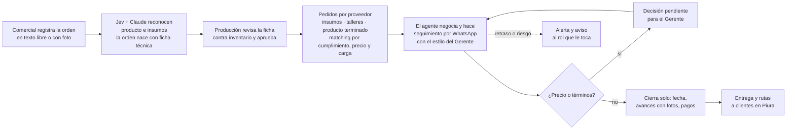
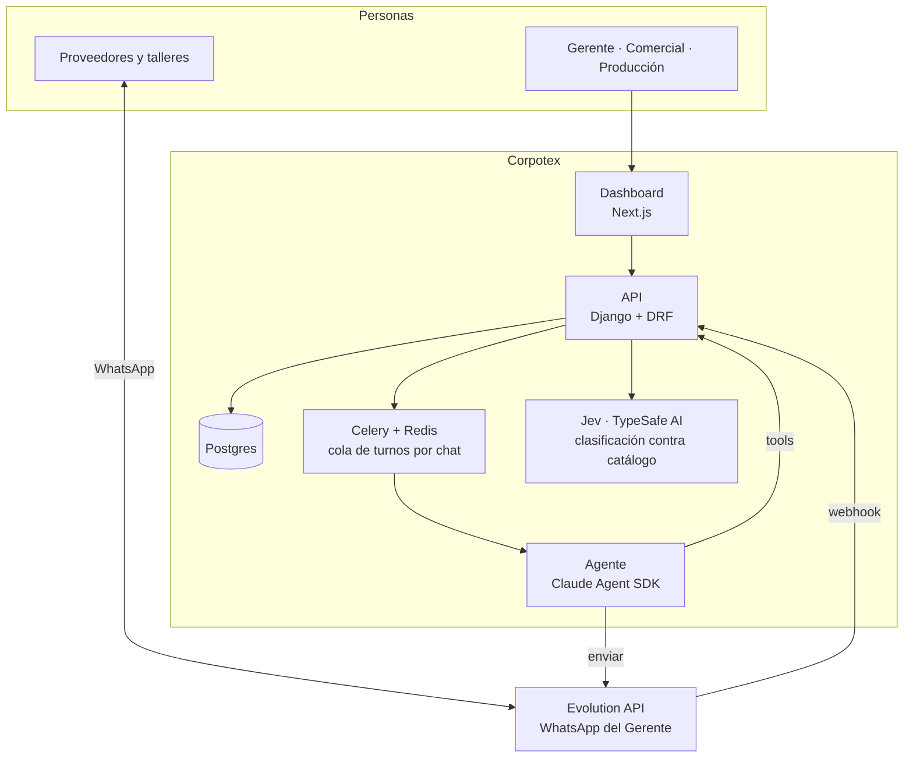
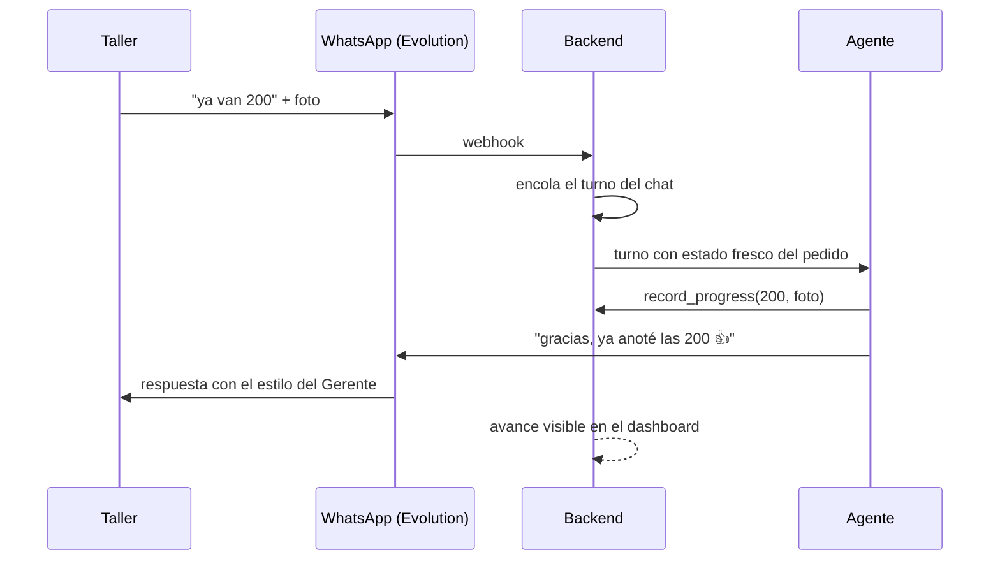

# Corpotex · Reto 7 · Piura Innova 2026

Un agente que lleva la orden del cliente hasta que el proveedor entrega. Habla por WhatsApp desde el número del Gerente y con su estilo; el equipo ve todo en un dashboard; el Gerente solo decide.

**El dolor:** al proveedor le dan 5 días cuando al cliente le prometieron 10, y aun así hay pedidos que nadie revisa hasta el día 9. Todo pasa por el Gerente y nada queda anotado.

Equipo Amaru: Oscar, Valeria, Nesky y Freddy. Demo en vivo: [corpotex.oscargicast.com](https://corpotex.oscargicast.com). **[Video demo de 2 minutos](docs/demo/pitch/demo-2min.mp4)**: las ocho features del dashboard, grabadas del sistema real.

## Qué hace



Si un taller cancela a mitad del pedido, el sistema redistribuye entre otros talleres y recalcula fecha, costo y ruta crítica.

## Cómo está hecho



Cada mensaje de un proveedor abre un turno del agente; un chat nunca corre dos turnos a la vez. El agente lee el estado fresco de la API, usa tools (leer historial, enviar, actualizar pedido, escalar al Gerente) y escribe como el Gerente. El seguimiento proactivo lo programa el sistema según el plazo del pedido y lo configura el Gerente.



## Decisiones de arquitectura (ADR)

Todas en [`docs/adr/`](docs/adr/). Las que explican el producto:

| ADR | Decisión |
|---|---|
| [0004](docs/adr/0004-agente-claude-agent-sdk.md) | El agente corre con Claude Agent SDK y tools en Python; una sesión por pedido |
| [0010](docs/adr/0010-cola-de-turnos-y-aislamiento-del-agente.md) | Cola de turnos por chat: cada mensaje abre un turno, nunca dos a la vez |
| [0012](docs/adr/0012-el-agente-no-se-hace-pasar-por-humano.md) | El agente no se hace pasar por humano |
| [0001](docs/adr/0001-segunda-instancia-evolution.md), [0016](docs/adr/0016-celulares-en-allowed-number.md) | WhatsApp por Evolution API con allowlist de celulares de proveedores |
| [0017](docs/adr/0017-asistente-en-el-dashboard.md), [0020](docs/adr/0020-asistente-proactivo.md) | Un asistente por rol en el dashboard, que avisa solo de retrasos y riesgos |
| [0019](docs/adr/0019-estilo-por-usuario-y-refresco-diario.md) | El estilo del Gerente se extrae de sus chats y se aprueba antes de usarse |
| [0025](docs/adr/0025-pedidos-consolidados-y-crud-de-ordenes.md) | Pedidos consolidados por proveedor y matching multicriterio con justificación |
| [0027](docs/adr/0027-seguimiento-proactivo-configurable.md) | Seguimiento proactivo por plazo, con modos mínimo, balanceado y alto |
| [0028](docs/adr/0028-orden-magica.md), [0029](docs/adr/0029-ficha-tecnica-editable-y-fechas.md) | Orden reconocida mientras se escribe; ficha técnica editable por instrucción |
| [0026](docs/adr/0026-flota-y-rutas-en-vivo.md) | Flota y rutas de entrega en vivo en el mapa de Piura |
| [0030](docs/adr/0030-pausa-del-agente-y-ficha-de-proveedores.md) | Pausa del agente por proveedor y capacidad de planta en el Monitor |

Stack y convenciones: Django + DRF, Next.js, Postgres, Celery y Redis, Claude Agent SDK, Jev; monorepo con `docker compose up` desde la raíz ([0008](docs/adr/0008-monorepo.md), [0023](docs/adr/0023-compose-en-la-raiz.md)); código en inglés, textos y documentación en español ([0014](docs/adr/0014-codigo-en-ingles.md)).

## Correrlo

```bash
cp .env.example .env   # claves de WhatsApp, Claude y Jev
docker compose up
docker compose exec web python manage.py seed_demo
```

Dashboard en `http://localhost:3000`, API en `http://localhost:8000`. Más detalle en [`docs/arquitectura/`](docs/arquitectura/README.md) y en [`CLAUDE.md`](CLAUDE.md).
