# Modelo de datos del backend (planning)

Estado: propuesta revisada el 10/10 con lo acordado entre sesiones y simplificada a pedido de Oscar. No hay nada implementado.

Fuentes: `CLAUDE.md` y `docs/adr/`: Django + DRF (0002), Postgres (0005), monorepo (0008), API (0009), cola de turnos (0010), onboarding (0011), suscripción (0013), código en inglés (0014), celulares en `AllowedNumber` (0016), asistente del dashboard (0017, reemplaza al 0007 del Pana), Celery y Redis (0018), estilo por usuario (0019), asistente proactivo (0020), seed (0021), conexión de Claude desde el dashboard (0022), compose en la raíz (0023) y los 8 criterios del jurado (0024, que reemplaza al 0015: vuelven las rutas).

**Idioma (ADR 0014):** todo el código va en inglés: apps, modelos, campos, valores de `choices`, servicios, excepciones, URLs y claves JSON de la API. Siguen en español este documento y lo que lee una persona: `verbose_name`, los `*_display` de la API, el admin, el dashboard y los mensajes de WhatsApp.

**Regla de simplificación:** un campo existe solo si alguien lo escribe y no se puede calcular. Lo que se calcula (totales, avance, puntajes, estados derivados) sale en la API como campo de solo lectura, pero no se guarda. La lista de lo que se quitó está al final de "Equivalencias".

## Equivalencias español → inglés

El orquestador fijó `Order`, `PurchaseOrder` y `Supplier`, y las tools del agente. El resto de los nombres los fija esta tabla. `docs/glosario.md` la junta con las tools del agente y las funciones de `personalidad`.

### Apps y modelos

| App | Modelos |
|---|---|
| `core` → `core` | `Usuario` → `User`, `Configuracion` → `Config`, `Marca` → `Brand`, `Cliente` → `Customer`, `Producto` → `Product`, `Insumo` → `Material`, `ProductoInsumo` → `ProductMaterial`, `OnboardingEstilo` → `OnboardingStyle`, `VersionEstilo` → `StyleVersion` |
| `proveedores` → `suppliers` | `Proveedor` → `Supplier`, `Tarifa` → `Rate`. `Calificacion` desaparece: es el campo `PurchaseOrder.rating` |
| `operaciones` → `operations` | `Orden` → `Order`, `OrdenItem` → `OrderItem`, `Requerimiento` → `Requirement`, `Pedido` → `PurchaseOrder`, `PedidoItem` → `PurchaseOrderItem`, `Avance` → `ProgressReport`, `Entrega` → `Delivery`, `Pago` → `Payment`, `Ruta` → `Route`, `ParadaRuta` → `RouteStop` (vuelven, ADR 0024) |
| `mensajeria` → `messaging` | `NumeroPermitido` → `AllowedNumber`, `Conversacion` → `Conversation`, `Mensaje` → `Message`, `Turno` → `Turn` |
| `gerencia` → `manager` (no `management`, que choca con `management/commands/` de Django) | `Decision` → `Decision`, `Alerta` → `Alert`, `AvisoAlerta` → `AlertNotification` (nuevo, ADR 0020) |
| `agente` → `agent` | Sin modelos: tareas de Celery, tools y prompts del agente de WhatsApp y del asistente. Runtime del SDK en `backend/.agent/` (gitignored) |
| `seed` → `seed` | Sin modelos: el comando `seed_demo`, `data/*.json` e `images/` (ADR 0021) |

Roles: los grupos de Django se llaman `Gerente`, `Comercial` y `Produccion`, porque el nombre del grupo es una etiqueta del admin. En código y en la API son `role: manager | sales | production`.

### Campos

Sufijos: `*_on` para fechas (`date`) y `*_at` para fecha con hora (`datetime`). Auditoría en todas las tablas: `creado_en` → `created_at`, `actualizado_en` → `updated_at`.

| Modelo | Español → inglés |
|---|---|
| `User` | `username`, `password`, `first_name` e `is_staff` no cambian. Rol → `role` (propiedad que sale del grupo). `estilo_md` → `style_md`, `estilo_refrescado_en` → `style_refreshed_at` (ADR 0019) |
| `Config` | `reloj_inicio_real` → `clock_real_start`, `reloj_inicio_simulado` → `clock_sim_start`, `reloj_factor` → `clock_factor`, `reloj_pausado` → `clock_paused`, `colchon_dias` → `buffer_days`, `duraciones_etapa` → `stage_durations`, `onboarding` → `onboarding`, `usuario_agente` → `agent_user`, `numero_agente` → `agent_phone` (nuevo), `planta_nombre` → `plant_name`, `planta_lat` → `plant_lat`, `planta_lng` → `plant_lng` (vuelven, ADR 0024), `claude_conectado_en` → `claude_connected_at` y `claude_ultimo_error` → `claude_last_error` y `claude_ultimo_error_en` → `claude_last_error_at` (nuevos, ADR 0022), `horas_decision_pendiente` → `decision_pending_hours` (nuevo, ADR 0020) |
| `Brand` | `nombre` → `name`, `descripcion` → `description` |
| `Customer` | `nombre` → `name`, `ruc` → `tax_id`, `tipo` → `kind`, `direccion` → `address`, `lat`, `lng` (ADR 0024) |
| `Product` | `codigo` → `code`, `nombre` → `name`, `imagen` → `image` |
| `Material` | `codigo` → `sku` (código interno de Corpotex), `nombre` → `name`, `tipo` → `kind`, `unidad` → `unit`, `stock` → `stock`, `imagen` → `image` (nuevo, ADR 0021) |
| `ProductMaterial` | `producto` → `product`, `insumo` → `material`, `cantidad_por_unidad` → `qty_per_unit` |
| `Order` | `codigo` → `code`, `cliente` → `customer`, `marca` → `brand`, `responsable` → `owner`, `estado` → `status`, `etapa_produccion` → `production_stage`, `fecha_emision` → `issued_on`, `fecha_entrega_prometida` → `promised_on`, `fecha_estimada` → `estimated_on`, `ruta_critica` → `critical_path`, `riesgo` → `risk`, `riesgo_motivo` → `risk_reason` |
| `OrderItem` | `orden` → `order`, `producto` → `product`, `cantidad` → `quantity`, `tallas` → `sizes`, `color` → `color`, `personalizacion` → `customization`, `precio_unitario` → `unit_price` |
| `Requirement` | `orden` → `order`, `tipo` → `kind`, `insumo` → `material`, `producto` → `product`, `cantidad_necesaria` → `qty_needed`, `cantidad_de_stock` → `qty_from_stock` |
| `Supplier` | `nombre` → `name`, `tipo` → `kind`, `especialidades` → `specialties`, `ciudad` → `city`, `direccion` → `address`, `lat`, `lng` (vuelven, ADR 0024), `es_propio` → `is_in_house`, `capacidad_semanal` → `weekly_capacity`, `lead_time_dias` → `lead_time_days`, `frecuencia_consulta_horas` → `follow_up_every_hours`, `moneda` → `currency` (nuevo; antes estaba en `Rate` y `PurchaseOrder`), `origen` → `source`, `detalle_origen` → `source_detail` (nuevo, ADR 0024: url y extracto de la fuente externa; ningún prompt lo lee), `estado` → `status`, `notas` → `notes`. Los celulares viven en `AllowedNumber` (ADR 0016) |
| `Rate` | `proveedor` → `supplier`, `insumo` → `material`, `producto` → `product`, `precio_unitario` → `unit_price`, `vigente_desde` → `valid_from` |
| `PurchaseOrder` | `codigo` → `code`, `proveedor` → `supplier`, `conversacion` → `conversation`, `estado` → `status`, `proveedor_sugerido` → `suggested_supplier`, `justificacion` → `rationale`, `puntajes` → `scores` (vuelven, ADR 0024; el ranking completo vive en `Decision.detail.proposal`), `token_reporte` → `report_token`, `link_reporte_enviado_en` → `report_link_sent_at` (nuevos, ADR 0024), `redistribuido_de` → `redistributed_from`, `fecha_limite_interna` → `internal_due_on`, `fecha_comprometida` → `committed_on`, `proxima_consulta_en` → `next_follow_up_at`, `condiciones` → `terms`, `calificacion` → `rating` (json; reemplaza a los 6 campos `rating_*`) |
| `PurchaseOrderItem` | `pedido` → `purchase_order`, `requerimiento` → `requirement`, `cantidad` → `quantity`, `precio_unitario` → `unit_price`, `cantidad_entregada` → `qty_delivered` |
| `ProgressReport` | `pedido` → `purchase_order`, `unidades_completadas` → `units_done`, `nota` → `note`, `foto` → `photo`, `mensaje` → `message`, `reportado_en` → `reported_at`, `acusado_en` → `acknowledged_at` (nuevo, ADR 0024: el agente ya acusó recibo del reporte web) |
| `Delivery` | `pedido` → `purchase_order`, `cantidad_recibida` → `qty_received`, `cantidad_defectuosa` → `qty_defective`, `calidad` → `quality`, `recibido_por` → `received_by`, `recibido_en` → `received_at`, `nota` → `note` |
| `Payment` | `pedido` → `purchase_order`, `tipo` → `kind`, `monto` → `amount`, `metodo` → `method`, `pagado_en` → `paid_at`, `comprobante` → `receipt` |
| `Route` (vuelve) | `fecha` → `date`, `estado` → `status`, `distancia_km` → `distance_km`, `duracion_min` → `duration_min`, `trazado` → `path`, `recalculada_de` → `recalculated_from`, `vehiculo` → `vehicle` (null: ruta proyectada de la redistribución), `iniciada` → `started_at`, `completada` → `completed_at` (ADR 0026) |
| `RouteStop` (vuelve) | `ruta` → `route`, `posicion` → `position`, `tipo` → `kind`, `proveedor` → `supplier`, `cliente` → `customer`, `pedido` → `purchase_order`, `orden` → `order`, `nombre` → `name`, `direccion` → `address`, `lat`, `lng`, `hora_estimada` → `eta` (llegada), `entregada` → `delivered_at` |
| `Order` (despacho, ADR 0026) | `fecha_programada` → `scheduled_delivery_on`, `direccion_entrega` → `delivery_address`, `delivery_lat`, `delivery_lng` (null: la del cliente) |
| `Vehicle` | `nombre` → `name`, `placa` → `plate`, `tipo` → `kind`, `capacidad` → `capacity_units` (prendas), `color`, `chofer` → `driver_name`, `activo` → `is_active`, `last_lat`, `last_lng`, `last_heading`, `last_speed_kmh`, `last_seen_at` |
| `VehiclePosition` | `vehiculo` → `vehicle`, `ruta` → `route`, `lat`, `lng`, `rumbo` → `heading`, `velocidad` → `speed_kmh`, `registrada` → `recorded_at`, `origen` → `source` |
| `AllowedNumber` | `telefono` → `phone`, `lid` → `lid`, `nombre` → `name`, `proveedor` → `supplier`, `activo` → `active`, `simulado` → `simulated` |
| `Conversation` | `canal` → `channel`, `numero` → `allowed_number`, `usuario` → `user` (solo `dashboard`), `sesion_agente` → `agent_session`, `accion_pendiente` → `pending_action` |
| `Message` | `conversacion` → `conversation`, `autor` → `author`, `texto` → `text`, `media` → `media`, `id_externo` → `external_id`, `estado` → `status`, `error` → `error`, `enviado_en` → `sent_at`, `leido_en` → `read_at` (nuevo, ADR 0020), `turno` → `turn`, `accion` → `action`, `contexto` → `context` |
| `Turn` | `conversacion` → `conversation`, `motivo` → `reason`, `estado` → `status`, `intentos` → `attempts`, `error` → `error`, `disponible_en` → `available_at` |
| `Decision` | `tipo` → `kind`, `estado` → `status`, `pedidos` → `purchase_orders` (M2M), `conversacion` → `conversation`, `resumen` → `summary`, `detalle` → `detail`, `nota` → `note`, `resuelta_por` → `resolved_by`, `resuelta_en` → `resolved_at`, `comunicada_en` → `communicated_at` |
| `Alert` | `tipo` → `kind`, `severidad` → `severity`, `estado` → `status`, `orden` → `order`, `pedido` → `purchase_order`, `decision` → `decision` (nuevo, para `decision_pending`), `mensaje` → `text`, `detectada_en` → `detected_at`, `resuelta_en` → `resolved_at` |
| `AlertNotification` (nuevo) | `alerta` → `alert`, `usuario` → `user`, `turno` → `turn`, `enviada_en` → `sent_at` |
| `OnboardingStyle` | `estado` → `status`, `desde` → `since`, `paso` → `step`, `progreso` → `progress`, `borrador_md` → `draft_style_md`, `borrador_notas` → `draft_notes`, `borrador_origen` → `draft_source` (onboarding o template), `transcript_temporal` → `temp_transcript`, `latido` → `heartbeat_at`, `error` → `error`, `aprobado_en` → `approved_at` |
| `StyleVersion` | `usuario` → `user`, `estilo_md` → `style_md`, `notas` → `notes_snapshot`, `origen` → `source`, `cambios` → `changelog` |

### Valores de `choices`

| Campo | Español → inglés |
|---|---|
| `User.role` | gerente → `manager`, comercial → `sales`, produccion → `production` |
| `Customer.kind` | empresa → `company`, colegio → `school`, ong → `ngo`, persona → `individual` |
| `Material.kind` | tela → `fabric`, boton → `button`, cierre → `zipper`, cuello_puno → `collar_cuff`, otro → `other` |
| `Material.unit` | m → `m`, kg → `kg`, unidad → `unit` |
| `Order.status` | registrada → `registered`, desglosada → `broken_down`, confirmada → `confirmed`, en_abastecimiento → `sourcing`, en_produccion → `in_production`, lista → `ready`, entregada → `delivered`, cancelada → `cancelled` |
| `Order.production_stage` | corte → `cutting`, sublimado → `sublimation`, bordado → `embroidery`, costura → `sewing`, acabado → `finishing` |
| `Order.risk` | ok → `ok`, en_riesgo → `at_risk`, en_peligro → `in_danger` |
| `OrderItem.customization` | bordado → `embroidery`, estampado → `print`, sublimado → `sublimation` |
| `Order.critical_path[]` | tipo → `kind`: insumo → `material`, taller → `workshop`, produccion → `production`, entrega → `delivery`. estado → `status`: pendiente → `pending`, en_curso → `in_progress`, hecho → `done`, atrasado → `late` |
| `Requirement.kind`, `Supplier.kind` | insumo/insumos → `material`, taller → `workshop`, terminado → `finished`. El pedido toma el `kind` de su proveedor |
| `Supplier.source` | registrado → `registered`, autoregistro → `self_registered`, externo → `external` (ADR 0024; reemplaza a `suggested`) |
| `Supplier.status` | activo → `active`, por_revisar → `pending_review`, inactivo → `inactive` |
| `Supplier.currency` | `PEN` y `USD` no cambian |
| `Payment.method` | yape → `yape`, transferencia → `transfer`, efectivo → `cash` |
| `PurchaseOrder.status` | sugerido → `suggested`, aprobado → `approved`, en_negociacion → `negotiating`, confirmado → `confirmed`, en_proceso → `in_progress`, entregado → `delivered`, rechazado_proveedor → `declined_by_supplier`, cancelado_proveedor → `cancelled_by_supplier`, cancelado → `cancelled` |
| `Payment.kind` | adelanto → `advance`, saldo → `balance` |
| `Route.status` | propuesta → `proposed`, planificada → `planned`, en_curso → `in_progress`, completada → `completed`, reemplazada → `replaced`, descartada → `discarded` |
| `RouteStop.kind` | recojo → `pickup`, entrega → `delivery` |
| `Vehicle.kind` | furgón → `van`, camioneta → `pickup`, moto → `motorcycle`, camión → `truck` |
| `VehiclePosition.source` | simulador → `simulator`, dispositivo → `device`, manual → `manual` |
| `Conversation.channel` | whatsapp → `whatsapp`, simulador → `simulator`, dashboard → `dashboard` (asistente) |
| `Message.author` | proveedor → `supplier`, agente → `agent`, gerente → `manager`, usuario → `user` (persona del dashboard). En la API del asistente sale como `role`: `user` → `user`, `agent` → `assistant` |
| `Message.status` | recibido → `received`, procesado → `processed`, error → `error`, enviado → `sent`, fallido → `failed` |
| `Turn.reason` | mensaje → `message`, decision → `decision`, seguimiento → `follow_up`, pedido_aprobado → `purchase_order_approved`, alerta → `alert` (ADR 0020), reporte_web → `web_report` (ADR 0024) |
| `Turn.status` | pendiente → `pending`, en_curso → `running`, hecho → `done`, error → `error` |
| `Decision.kind` | aprobar_asignacion → `approve_assignment`, precio → `price`, terminos → `terms`, otro → `other` |
| `Decision.status` | pendiente → `pending`, aprobada → `approved`, rechazada → `rejected`, proveedor_cambiado → `supplier_changed`, cancelada → `cancelled` |
| `Alert.kind` | pedido_estancado → `stalled_purchase_order`, retraso → `delay`, orden_en_peligro → `order_in_danger`, sin_respuesta → `no_response`, pago_pendiente → `payment_due`, instancia_caida → `instance_down`, sin_canal → `no_channel`, turno_fallido → `turn_failed`, refresco_estilo_fallido → `style_refresh_failed`, decision_pendiente → `decision_pending` (ADR 0020), claude_desconectado → `claude_disconnected` (ADR 0022) |
| `Alert.severity` | info → `info`, advertencia → `warning`, critica → `critical` |
| `Alert.status` | abierta → `open`, reconocida → `acknowledged`, resuelta → `resolved` |
| `OnboardingStyle.status` | sin_iniciar → `not_started`, extrayendo → `extracting`, borrador → `draft`, aprobado → `approved`, error → `error` |
| `OnboardingStyle.step` | proveedores → `suppliers`, juntando → `merging` |
| `StyleVersion.source` | onboarding → `onboarding`, diario → `daily`, plantilla → `template`, manual → `manual`, vuelta_atras → `rollback` |
| Estado por proveedor en `OnboardingStyle.progress` | pendiente → `pending`, leyendo → `reading`, analizando → `analyzing`, listo → `done`, sin_celular → `no_phone`, sin_chat → `no_chat`, no_permitido → `not_allowed`, error → `error` |

### Campos que se quitaron (10/10, pedido de Oscar)

Se calculan, se repetían o nadie los iba a usar en la demo. Los que el dashboard muestra siguen en la API, como campos de solo lectura.

| Modelo | Quitado | Por qué |
|---|---|---|
| `PurchaseOrder` | `kind` | Es el `kind` del proveedor |
| | `candidates` | El ranking completo vive en `Decision.detail.proposal` de su asignación; el pedido guarda solo `rationale` y `scores` del elegido (ADR 0024) |
| | `changed_by_manager` | Es `supplier != suggested_supplier` |
| | `total_amount`, `currency` | Suma de los ítems; la moneda es la del proveedor |
| | `units_done`, `last_progress_at`, `delivered_on` | Salen del último `ProgressReport` y de la última `Delivery` |
| | `follow_up_requested_at` | El seguimiento se detecta con `next_follow_up_at <= clock.now()` (sección 4) |
| | `approved_by` | Es `Decision.resolved_by` de la asignación |
| | `rating_delay_days`, `rating_quality`, `rating_defect_pct`, `rating_price_vs_ref_pct`, `rating_score`, `rated_at` | Un solo json `rating` |
| `Order` | `total_amount` | Suma de los ítems |
| | `spec_sheet`, `source` | No habrá PDFs de Comercial (ADR 0021) |
| `Requirement` | `qty_to_order`, `status` | `qty_needed − qty_from_stock`, y el estado sale de sus `PurchaseOrderItem` |
| `Supplier` | `contact_name`, `payment_method` | El contacto es `AllowedNumber.name`; el método de pago va en cada `Payment`. `address`, `lat` y `lng` volvieron con las rutas (ADR 0024) |
| | `on_time_score`, `quality_score` | Promedio de `PurchaseOrder.rating` de sus pedidos cerrados, calculado |
| `Rate` | `currency`, `source` | La moneda es la del proveedor; la fuente no se usaba |
| `Customer` | `contact_name`, `phone` | Nadie le escribe al cliente |
| `Product` | `category` | No se usaba |
| `ProgressReport` | `source` | Es `whatsapp` si tiene `message`, si no, `web` |
| `Payment` | `status`, `due_on`, `invoice_required`, `invoice_number`, `recorded_by` | `paid` es `paid_at` lleno (en la API, `status` calculado); el vencimiento se calcula; el resto es contabilidad fuera del alcance |
| `AllowedNumber` | `role` | Todos los números activos actúan de proveedor; el del Gerente es `Config.agent_user` |
| `Conversation` | `status`, `last_message_at` | No se usaban; el último mensaje se consulta |
| `Message` | `direction`, `media_type`, `payload` | Sale de `author`; el tipo, del archivo; el payload crudo va al log |
| `Turn` | `decision` | Era solo rastro; el porqué sale del estado fresco |
| `Decision` | `order`, `new_supplier`, `channel` | La orden sale de los pedidos; el proveedor nuevo queda en el pedido; el canal no se usaba |

### Servicios y excepciones

Son sync; el agente los envuelve con `sync_to_async`. Los que tienen reglas de permiso reciben `actor` como keyword obligatorio y sin valor por defecto: un `User`, o `None` cuando los llama el sistema (el agente de WhatsApp, el matching o el tick), que lo pasa a propósito. Así, si una tool del asistente se olvida de pasarlo, falla con `TypeError` en vez de correr con permisos de sistema. Lo chequean con `require_role(actor, *roles)`, que lanza `PermissionDenied`.

| Español | Inglés | Módulo |
|---|---|---|
| `reloj.ahora()` | `clock.now()` | `core/clock.py` |
| `encolar_turno(conversacion, motivo)` | `enqueue_turn(conversation, reason)` | `messaging/services.py` |
| `tomar_siguiente_turno()` | `claim_next_turn(conversation_id=None) -> TurnBatch \| None` | `messaging/services.py` |
| `LoteTurno` | `TurnBatch {turn, message_ids, decision_ids, follow_up_purchase_order_ids, new_purchase_order_ids, alert_ids, web_report_ids}` | `messaging/services.py` |
| `terminar_turno(lote, sesion_id, error=None)` | `finish_turn(batch, session_id, error=None)` | `messaging/services.py` |
| `recuperar_turnos_colgados()` | `recover_stuck_turns()` | `messaging/services.py` |
| `estado_turno(lote)` | `turn_state(batch) -> dict` | `messaging/services.py` |
| Estado del turno del asistente | `assistant_turn_state(batch) -> dict` | `messaging/services.py` |
| `historial(conversacion, limite=20)` | `message_history(conversation, limit=20)` | `messaging/services.py` |
| `enviar_texto(conversacion, texto, turno)` | `send_text(conversation, text, turn)` | `messaging/services.py` |
| `pedido_de_conversacion(conversacion, codigo)` | `purchase_order_for_conversation(conversation, code)` | `messaging/services.py` |
| Acción del asistente | `record_assistant_action(conversation, turn, action)` | `messaging/services.py` |
| Respuesta final del asistente | `post_assistant_message(conversation, turn, text, action=None)` | `messaging/services.py` |
| Última foto del lote | `latest_photo_id(message_ids) -> int \| None` | `messaging/services.py` |
| Serializer por rol | `serializer_for(model, role)` | `core/serializers.py` |
| Marcar leídos | `mark_assistant_read(conversation, up_to_id)` | `messaging/services.py` |
| `evolution.enviar_texto` (cliente HTTP) | `evolution.send_text(phone, text)` | `messaging/evolution.py` |
| Lectura de chats para el estilo | `evolution.find_messages(jid, since)` | `messaging/evolution.py` |
| Instancia (onboarding) | `evolution.connection_state()`, `find_webhook()`, `find_settings()`, `connect()`, `set_webhook()`, `set_settings()` | `messaging/evolution.py` |
| Desglose | `break_down_order(order)` | `operations/services.py` |
| Comercial registra una orden | `register_order(payload, *, actor)` | `operations/services.py` |
| Producción confirma | `confirm_order(order, *, actor)` | `operations/services.py` |
| Matching | `match_requirements(requirements)` | `operations/services.py` |
| Ruta crítica | `compute_critical_path(order)` | `operations/services.py` |
| `aprobar_pedidos` | `approve_purchase_orders(purchase_orders, *, actor)` | `operations/services.py` |
| `confirmar_pedido` | `confirm_purchase_order(purchase_order, *, unit_price, committed_on, terms)` | `operations/services.py` |
| `registrar_avance` | `record_progress(purchase_order, *, units_done, note="", message_id=None, photo=None, actor)` | `operations/services.py` |
| Registrar entrega | `record_delivery(purchase_order, *, qty_received, qty_defective, quality, note="", actor)` | `operations/services.py` |
| Marcar pago | `mark_payment_paid(payment, *, method, receipt=None, actor)` | `operations/services.py` |
| `cancelar_por_proveedor` | `cancel_by_supplier(purchase_order, *, reason, units_done=None)` | `operations/services.py` |
| `redistribuir` | `redistribute(purchase_order)` | `operations/services.py` |
| Planificar ruta (ADR 0024) | `plan_route(date, *, actor=None) -> Route` | `operations/routes.py` |
| Planificar el día por vehículo (ADR 0026) | `plan_day(date, *, vehicle_ids=None, order_ids=None, actor) -> DayPlan`, `move_dispatch`, `start_route`, `complete_route`, `deliver_stop` | `operations/routes.py` |
| Reporte público (P1) | `record_public_report(token, *, units_done, photo=None, note="")`, `report_url(purchase_order) -> str`, `mark_report_link_sent(purchase_order)` | `operations/services.py` |
| Proveedores sugeridos (P1) | `create_suggested_suppliers(candidates, *, actor) -> {created, skipped}` | `suppliers/services.py` |
| Puntajes del proveedor | `supplier_scores(supplier) -> {on_time, quality}` | `suppliers/services.py` |
| `crear_decision` | `create_decision(*, kind, purchase_orders, summary, detail, conversation=None)` | `manager/services.py` |
| `resolver_decision` | `resolve_decision(decision, *, action, supplier_id=None, purchase_order_id=None, note="", actor)` | `manager/services.py` |
| Reconocer alerta | `acknowledge_alert(alert, *, actor)` | `manager/services.py` |
| Monitor | `run_monitor()` | `manager/services.py` |
| Avisar por rol (ADR 0020) | `notify_roles(alert)` | `manager/services.py` |
| `tick()` | `tick()` | `manager/services.py` |
| Mover el reloj | `set_clock(*, factor=None, paused=None, advance_hours=None, actor)` | `core/clock.py` |
| Permisos | `require_role(actor, *roles)` | `core/permissions.py` |
| Extracción de estilo (onboarding) | `run_style_extraction()` | `core/onboarding.py` |
| Estilo por usuario | `approve_style(onboarding_style, *, actor)`, `restore_style_version(version, *, actor)`, `refresh_style(user_id=None)` | `core/style.py` |
| Tareas de Celery | `run_turn(conversation_id)`, `tick`, `run_style_extraction`, `refresh_style(user_id=None)` | `agent/tasks.py`, `manager/tasks.py`, `core/tasks_style.py` (reexportadas por `core/tasks.py`) |
| Conexión de Claude (ADR 0022) | `claude_auth.start() -> {url, state}`, `exchange(code)`, `status()`, `disconnect()`, `set_api_key(api_key)`, `mark_claude_disconnected(error_text)`, `mark_claude_connected()`; constantes `CLIENT_ID`, `AUTHORIZE_URL`, `TOKEN_URL`, `REDIRECT_URI`, `SCOPES` copiadas de `mano` | `core/claude_auth.py` |
| Seed | `python manage.py seed_demo` | `seed/management/commands/seed_demo.py` |
| `ReglaDeJefe(motivo)` | `ManagerApprovalRequired(reason)` | `operations/exceptions.py` |
| `NumeroNoPermitido` | `NumberNotAllowed` | `messaging/exceptions.py` |
| `EnvioFallido` | `SendFailed` | `messaging/exceptions.py` |
| `PedidoAjeno` | `ForeignPurchaseOrder` | `messaging/exceptions.py` |
| Rol insuficiente | `PermissionDenied` (de Django) | lo lanza `require_role` |

### URLs de la API

Todas con barra final (ADR 0009). Los filtros también van en inglés (`?status=`, `?risk=`, `?brand=`, `?kind=`, `?order=`, `?supplier=`, `?waiting_manager=1`, `?source=`). En `/api/orders/` y `/api/purchase-orders/`, `?status=a,b` acepta una lista y `?q=` busca por código (contiene, sin distinguir mayúsculas; en pedidos también por código de orden).

| Español | Inglés |
|---|---|
| `/api/auth/login/`, `/api/auth/logout/`, `/api/auth/me/` | no cambian. `logout/` responde 200 sin revocar el token: dos ventanas del mismo usuario en la demo |
| Contadores del menú (nuevo, ADR 0020) | `/api/me/badges/` (GET) |
| Seguimiento proactivo (ADR 0027 §1-§2, §5; S1) | `Config.follow_up_mode` (`minimal` · `balanced` · `high`, defecto `balanced`), `follow_up_window_start`/`follow_up_window_end` (09:00/18:00, hora de Lima), `follow_up_weekdays` ([0..5], 0 = lunes; el domingo fuera); `Supplier.follow_up_mode` (vacío = el general; `follow_up_every_hours` queda sin uso); `PurchaseOrder.last_follow_up_on`, `awaiting_reply_since`, `reminded_at`, `follow_up_note`, y `next_follow_up_at` pasa a ser la hora planeada de hoy (o null); `Turn.follow_up` (JSON que solo escribe el tick: `{kind, reason, mode, purchase_orders: {id: {kind, reason}}}`). `manager/follow_up.py`: `plan_for_today()` decide en código: puntos de control por modo y plazo (de la confirmación, o la aprobación, a `committed_on`: mínimo 50 % y víspera; balanceado 30/60/85 % y víspera; alto todos los días; un punto que cae en día no hábil pasa al siguiente hábil), saltos (mínimo: escribió o reportó desde el punto anterior; balanceado: reportó en 24 h y va a ritmo), "siempre" (entrega hoy o mañana; avance más de 15 puntos bajo la línea recta; sin reporte pasado el 30 %), un turno por proveedor y día (varios pedidos en un lote) más un recordatorio (4 h balanceado, 2 h alto, al día hábil siguiente en mínimo, donde ocupa el día), con desfase fijo por proveedor en la primera hora de la ventana. El tick (`enqueue_due_follow_ups`) es lo único que encola turnos `follow_up`, solo dentro de la ventana y en días hábiles, y `claim` deja esperando un lote de seguimiento fuera de la ventana; el primer contacto sigue con `QUIET_HOURS`. Un mensaje del proveedor limpia `awaiting_reply_since` y `reminded_at` en sus pedidos abiertos. Al cerrar el turno: `last_follow_up_on = hoy` siempre; si el agente envió (y el lote no traía mensajes del proveedor) el punto de control fija `awaiting_reply_since` y el recordatorio `reminded_at`; un recordatorio saltado fija `reminded_at` y mantiene la espera. `stalled_purchase_order` = sin respuesta pasado el plazo del recordatorio. API (solo Gerente): `GET/PATCH /api/settings/follow-up/` `{mode, mode_display, window_start, window_end, weekdays}` (`window_start < window_end`, ventana ≥ 2 h, al menos un día) y `GET /api/settings/follow-up/preview/` → `[{supplier: {id, name}, purchase_orders: [code], at, kind, reason, mode}]`; `follow_up_mode` en el detalle y el PATCH de proveedores (no en el autoregistro). Seed: valores por defecto y el pedido del número real con `last_follow_up_on = hoy` |
| Seguimiento reactivo (ADR 0027 §6; S5) | `FollowUpRequest` (`purchase_order`, `requested_by`, `requested_at`, `status` `pending` · `asked` · `answered` · `skipped`, `asked_at`, `answered_at`, `answer_summary`, `skip_reason`) y en `PurchaseOrder` `last_follow_up_kind`/`last_follow_up_at` (el último seguimiento enviado). `POST /api/orders/<id>/follow-up/` (los tres roles) y `POST /api/purchase-orders/<id>/follow-up/` (Gerente y Producción; Comercial 403) con `{dry_run?}` → 202 (200 en `dry_run`, sin crear ni encolar) `{requests: [{id | null, purchase_order: {id, code}, supplier_name, status, asked_at, already_asked, skip_reason, channel: whatsapp | simulator | null}], detail}`: una solicitud por pedido abierto; si el pedido ya espera respuesta (`awaiting_reply_since`) o tiene una solicitud `asked` de menos de 2 h, se cuelga de esa espera (`asked`, con la hora original) y no encola; la planta propia y los proveedores sin número quedan `skipped` con `skip_reason = "sin canal"`; el resto va en un turno `follow_up` por conversación con `kind = "requested"`, `reason = "<Rol> pide avance de <código>"` y `requested_by` (sin ventana ni modo; por WhatsApp real de noche, 21-7 o `QUIET_HOURS`, el turno espera a las 07:00; el simulador va al instante). Al cerrar el turno las solicitudes pasan a `asked` (al enviar, con espera nueva desde el `sent_at` del mensaje del agente, y sin espera si el proveedor ya contestó después de ese mensaje; al saltar, colgadas de la espera existente); `answer_follow_up_requests` también limpia `awaiting_reply_since` y `reminded_at` del pedido. Un turno con mensajes o reportes del proveedor lleva `follow_up_request_ids` y `turn_state.open_follow_up_requests: [{id, purchase_order_code, asked_at}]`; `operations.services.answer_follow_up_requests(request_ids, *, summary)` las pasa a `answered` y abre una `Alert` `follow_up_answered` solo para quien preguntó (su asistente la recibe plana: `purchase_order, supplier_name, order_codes, answer_summary, requested_at, url`; se resuelve al avisar y no se repite al Gerente). El monitor pasa a `skipped` las solicitudes de pedidos cerrados. Lista y detalle de pedidos: `awaiting_reply`, `pending_follow_up: {requested_by_role, requested_by_role_display, requested_at, status, asked_at, answered_at, answer_summary} | null`, `last_follow_up: {kind, at, awaiting_reply} | null`. Seed: el proveedor del número real en `minimal` y su pedido con `last_follow_up_on` = el siguiente día hábil |
| Inventario (nuevo, P0 del 10/10) | `/api/materials/` (GET, Gerente y Producción; `?kind=`, `?q=` sobre sku y nombre): `[{id, sku, name, kind, kind_display, unit, unit_display, stock, committed, available, to_order, incoming, image}]` ordenado por `kind`, `name`; `committed` = suma de `Requirement.qty_from_stock` de órdenes no entregadas ni canceladas y `available = stock − committed`; `to_order` = lo que falta comprar (suma de `remaining_to_order` de `open_material_requirements`, el mismo número que `total_to_order` de "Por pedir"; "0.00" si nada) e `incoming: [{id, code, status, status_display, qty_pending}]` = pedidos vivos del insumo (`OPEN_STATUSES` o `suggested`) con lo que sus ítems de ese insumo aún tienen que traer (`quantity − qty_delivered`), ordenados por `internal_due_on` (pedido de Oscar, 11/10 00:00: que se vea cuándo un insumo sale a pedir). Los tres agregados se calculan una vez para toda la lista (`to_order_by_material`, `incoming_by_material`, `committed_stock_by_material`): sin consultas por fila. `/api/materials/<id>/` agrega `requirements: [{id, order_id, order_code, qty_needed, qty_from_stock, qty_to_order, status, status_display}]` de esas órdenes (`status` es el de la orden) |
| Conversaciones (regla del 10/10 20:50) | Las conversaciones con proveedores tienen información sensible y solo las ve el Gerente: `GET /api/conversations/<id>/messages/` y todo `/api/simulator/*` son `IsManager` (403 para Comercial y Producción), y `conversation_id`, `conversation` y `last_message` están en `MANAGER_ONLY_FIELDS`, así ningún serializer ni el Monitor los saca fuera del Gerente. Comercial y Producción ven del pedido el estado, los avances (`units_done`, `progress_pct`, `last_progress_at`, fotos) y las fechas. El asistente de esos roles pasa por las mismas vistas; `read_history` sigue siendo solo del agente de WhatsApp |
| Escritura de proveedores (B4.5, ADR 0016/0024) | `POST /api/suppliers/` (Gerente; `phone` y `contact_name` opcionales crean el `AllowedNumber` inactivo), `PATCH /api/suppliers/<id>/ {status?, name?, kind?, specialties?, city?, address?, lat?, lng?, weekly_capacity?, lead_time_days?, follow_up_every_hours?, currency?, notes?, contact_name?, rates?}` (`contact_name` renombra el primer número real del proveedor, lo que el bot saluda; `rates` es la lista completa de precios de referencia y reemplaza la anterior: `[{material_id | product_id, unit_price, valid_from?}]`, 400 si un ítem no existe, si van ambos o ninguno, o si el precio no es mayor que 0; los pedidos conservan su `unit_price`). `POST /api/suppliers/` acepta los mismos campos, incluido `rates`. Cada `rates[]` del detalle trae `material_id` y `product_id` para editar, `POST /api/suppliers/self-register/` (público, responde solo `{id, name, status, source}`), `POST /api/suppliers/import/` (multipart `file` CSV → `{created, updated, errors: [{row, error}]}`; coincide por `phone`, si no por `name` sin distinguir mayúsculas y conserva el nombre guardado), `POST /api/suppliers/<id>/numbers/ {phone, name?}` (201, inactivo), `PATCH /api/suppliers/<id>/numbers/<number_id>/ {active?, name?, phone?}` (400 si el `phone` ya existe o el número tiene conversación; no hay DELETE) |
| Línea de tiempo (10/10 21:40) | `GET /api/orders/<id>/` y `GET /api/purchase-orders/<id>/` traen `status_history: [{status, status_display, at, actor, note}]` ordenado por `at` (ISO con zona). Sale del modelo `StatusChange(order? \| purchase_order?, status, at, actor, note)` que escribe `operations.services.set_status`, el único punto de cambio de estado; `actor` es `"system"`, `"agent"` o el username; `note` lleva el motivo en las salidas (`cancelled`, `cancelled_by_supplier`) y la razón del matching en `suggested`. `seed_demo` rellena una fila por estado ya pasado, repartidas entre la emisión y T |
| Ítems a medida (ADR 0025 C, B6.3b) | `OrderItem.product` es opcional: un ítem sin producto lleva `description` (prenda, color, tallas, personalizaciones en texto libre; `customization` también es texto libre y puede traer varias cosas: las etapas de planta salen de palabras como "bordado"/"sublimado"/"estampado"); `POST`/`PATCH /api/orders/` aceptan `items: [{product?: code, description?, quantity, color?, customization?, sizes?, unit_price?}]` (400 si un ítem no trae ni producto ni descripción). `break_down_order` desglosa solo los ítems con producto y deja `Order.needs_classification = true`; `POST /api/orders/<id>/confirm/` responde 400 hasta clasificarlos (B6.4). El serializer devuelve `description` y `product: null` en esos ítems |
| Clasificación con IA (ADR 0025 C, B6.4) | `POST /api/orders/<id>/classify/` (Gerente y Producción) → `{order_id, items: [{item_id, description, product: {existing_id, code, name} \| {new: {code, name, brand}}, confidence, materials: [{sku, name, material_id} \| {new: {sku, name, kind, unit}}, qty_per_unit, unit, confidence]}]}` para cada ítem sin producto. `operations/classify.py`: (1) Jev `Choice` entre el catálogo + `nuevo` (`operations/jev.py` sobre `typesafe-sdk` 0.7: `TypeSafeClient.system_one(state, questions)`; `choose`, `choose_many(state, {nombre: (criteria, instructions)})` en UNA llamada, `yes`; sin reintentos y con un presupuesto de 8 s por ítem que solo cuenta el tiempo de Jev; con `TYPESAFE_API_KEY` vacío, sin el paquete, con error o sin presupuesto devuelven `None` con `logger.warning` y sigue Claude; los tests fuerzan la key vacía); si elige un producto con confianza ≥ 0.6, la propuesta es ese producto con su lista de insumos, sin llamar a Claude; (2) si no, Claude (`agent.sdk.complete` con esquema, modelo `AGENT_MODEL`, effort low) propone producto (existente o nuevo) e insumos; si elige un producto del catálogo, la propuesta lleva la lista de insumos del catálogo (la que usa `apply-classification`), no la de Claude; un insumo "nuevo" cuyo SKU extiende uno existente (`TEL-ALG-30-AZM` → `TEL-ALG-30`) o cuyo nombre es igual a uno existente queda como el existente, y si dos líneas caen en el mismo SKU se suman; los procesos de planta (corte, costura, bordado, sublimado, estampado) se descartan: no son insumos que se compran; (3) Jev revisa todos los insumos propuestos del ítem en una sola llamada (SKU existente o `nuevo`; los procesos de planta ni se preguntan): confirma o corrige un insumo que ya es existente (SKU de `by_sku`, confianza ≥ 0.6) y da la confianza cuando ambos dicen nuevo, pero nunca convierte un insumo nuevo en uno existente ni deshace el dedupe (medido el 10/10 23:10: juntaba broche de presión con BOT-MET-NX e hilo de bordar con HIL-POL-40); sin Jev, la confianza es la que da Claude (0.5 si no la da). Medido sobre CP-2026-0161: con Jev ~9,5 s (3 llamadas de Jev de ~0,45 s y una de Claude, porque el polo sale del catálogo), sin Jev ~19 s (dos llamadas de Claude). Si el modelo falla responde 502 con el motivo, nunca 500. `POST /api/orders/<id>/apply-classification/ {items: [{item_id, product: {existing_id} \| {new: {code, name, brand}}, materials: [{sku} \| {new: {sku, name, kind, unit}}, qty_per_unit, unit]}]}` crea producto (código único; la marca por nombre o la de la orden), insumos nuevos con stock 0 y la lista de insumos, asigna el producto al ítem y vuelve a desglosar (`needs_classification = false`); devuelve el detalle de la orden con `warnings` (cantidades vacías, productos sin insumos). `TYPESAFE_API_KEY` y `TYPESAFE_MODEL` en settings y `.env.example` |
| CRUD de órdenes por rol (ADR 0025 B) | `PATCH /api/orders/<id>/ {customer?, brand?, issued_on?, promised_on?, notes?, items?}` (`items` reemplaza la lista completa y vuelve a desglosar; los requerimientos que ya tienen pedido no se tocan y vuelven en `warnings`); `POST /api/orders/<id>/cancel/ {reason?}` (cancela la orden y sus pedidos `suggested`, rechaza su decisión pendiente si queda vacía; 400 desde `in_production`); permisos: Comercial crea, edita y cancela solo sus órdenes hasta `broken_down`, el Gerente edita cualquiera y cancela antes de producción, Producción no toca órdenes (403). `GET /api/customers/` (`?q=`) → `[{id, name, ruc, kind, kind_display, address, lat, lng}]` y `GET /api/products/` (`?brand=`, `?q=`) → `[{id, code, name, brand: {id, name} \| null, image}]`, para el formulario; `Order.notes` y `Product.brand` son campos nuevos (el seed infiere la marca del prefijo del código: UNI, NEX, LMC) |
| Sugerencia de compra (ADR 0025 A.5, B6.2) | El `tick` (`run_monitor` → `suggest_purchases`) abre una `Alert` `purchase_suggested` por material (`Alert.material`, única mientras esté abierta) cuando la fecha límite más cercana de sus requerimientos abiertos cae dentro de `lead_time_days` del proveedor sugerido + `buffer_days`; `detail` guarda la fila de "Por pedir" sin `candidates`; el texto no lleva precios. Se resuelve sola cuando el material ya no tiene requerimientos abiertos (pedido generado o orden cancelada). Llega a Gerente y Producción (`notify_roles`, `?mine=1`); en `GET /api/alerts/` el `detail` pierde `reference_price` fuera del Gerente y en `assistant_turn_state.alerts[]` va plana: `material: {id, sku, name, unit}, total_to_order, orders: [{code, qty, due_on}], suggested_supplier, reference_price, currency` (los dos últimos `null` para Producción) |
| Por pedir y pedidos consolidados (ADR 0025) | `GET /api/requirements/pending/` (Gerente y Producción; `?material_ids=`), `POST /api/purchase-orders/generate/ {material_ids?, supplier_overrides?}` (201 `{created, decision_id, skipped}`), `POST /api/orders/break-down/ {order_ids?}` (200 `{broken_down, skipped}`) |
| Alertas (nuevo) | `/api/alerts/` (GET): abiertas por defecto, `?status=acknowledged \| resolved \| all`; `?mine=1` deja solo las que le tocan al rol del usuario, con la misma regla de `notify_roles` (`alert_concerns_role`): el Gerente todo, Comercial lo que toca la fecha del cliente (`order_in_danger`, `delay`, `no_response`), Producción `order_in_danger` y lo de talleres |
| `/api/reloj/` (GET, PATCH) | `/api/clock/` solo GET (decisión del 10/10 21:40: la demo corre en tiempo real; `seed_demo` deja `clock_sim_start = clock_real_start = ahora`, `clock_factor = 1`, `clock_paused = false`, y las fechas relativas `T±n` del seed se resuelven contra el ahora real; el `tick` sigue cada 10 s) |
| `/api/monitor/` | no cambia |
| `/api/gerente/pendientes/` | `/api/manager/pending/` |
| `/api/gerente/decisiones/<id>/` (POST) | `/api/manager/decisions/<id>/` |
| `/api/ordenes/`, `/api/ordenes/<id>/`, `/api/ordenes/<id>/confirmar/` | `/api/orders/`, `/api/orders/<id>/`, `/api/orders/<id>/confirm/` |
| `/api/pedidos/`, `/api/pedidos/<id>/` | `/api/purchase-orders/`, `/api/purchase-orders/<id>/` |
| Entregas y avances desde el dashboard | `/api/purchase-orders/<id>/deliveries/` (POST), `/api/purchase-orders/<id>/progress/` (POST, multipart con foto) |
| `/api/pagos/`, `/api/pagos/<id>/pagar/` | `/api/payments/`, `/api/payments/<id>/pay/` (multipart `{method, receipt?}`) |
| Rutas (vuelven, ADR 0024) | `GET /api/routes/` (todas; `?date=`, `?status=`), `GET /api/routes/?current=1` → `{current, replaced}` (con `?date=` la de ese día; si no, la `planned`/`in_progress` más próxima desde hoy), `GET /api/routes/<id>/` (cualquier estado), `POST /api/routes/plan/ {date}` (201; Gerente y Producción; 400 sin coordenadas de planta). Todos los roles leen rutas: no llevan precios. Cada ruta: `{id, name, date, status, status_display, distance_km, duration_min, path, recalculated_from, stops_count, stops: [{position, kind: plant \| delivery, kind_display, name, address, lat, lng, eta, supplier: null, customer, purchase_order: null, order}], created_at}` |
| Reporte público del taller (P1, ADR 0024) | `/api/report/<token>/` (GET y POST multipart, sin auth) |
| `/api/alertas/<id>/reconocer/` | `/api/alerts/<id>/acknowledge/` |
| `/api/proveedores/`, `/api/proveedores/<id>/`, `/api/proveedores/importar/`, `/api/proveedores/autoregistro/` | `/api/suppliers/`, `/api/suppliers/<id>/`, `/api/suppliers/import/`, `/api/suppliers/self-register/` (público, P0) |
| Números del proveedor (ADR 0016) | `/api/suppliers/<id>/numbers/` (POST), `/api/suppliers/<id>/numbers/<number_id>/` (PATCH) |
| `/api/simulador/contactos/`, `/api/simulador/mensajes/` | `/api/simulator/contacts/`, `/api/simulator/messages/` |
| `/api/conversaciones/<id>/mensajes/?desde=<id>` | `/api/conversations/<id>/messages/?after=<id>` |
| `/api/onboarding/whatsapp/`, `.../qr/`, `.../webhook/` | no cambian |
| `/api/onboarding/estilo/` (GET, PUT), `extraer/`, `importar-txt/`, `base/`, `aprobar/` | `/api/onboarding/style/`, `extract/`, `import-txt/`, `template/`, `approve/` |
| `/webhooks/evolution/<secreto>/` | `/webhooks/evolution/<secret>/` (la URL no cambia) |
| Asistente (ADR 0017 y 0020) | `/api/assistant/messages/?after=<id>` (GET), `/api/assistant/messages/` (POST), `/api/assistant/messages/read/` (POST), `/api/assistant/reset/` (POST) |
| Estilo (ADR 0019) | `/api/style/versions/`, `/api/style/versions/<id>/`, `/api/style/versions/<id>/restore/` (POST). P1: `/api/style/refresh/` (POST) |
| Conexión de Claude (ADR 0022, solo Gerente) | `/api/settings/claude/start/` (POST), `/api/settings/claude/exchange/` (POST), `/api/settings/claude/status/` (GET), `/api/settings/claude/disconnect/` (POST), `/api/settings/claude/set-key/` (POST) |
| `/api/schema/` | no cambia |

Claves JSON: las de los modelos. Cada `status` o `kind` viaja con su `status_display` o `kind_display`, que es el texto en español.

**Campos calculados en la API** (no se guardan): `Order.total_amount`; `PurchaseOrder.kind`, `total_amount`, `currency`, `units_done`, `progress_pct`, `last_progress_at`, `delivered_on`, `changed_by_manager`, `candidates` (el `proposal` de su `Decision` de asignación), `paid_amount`, `pending_amount`, `waiting_manager`; `Requirement.qty_to_order` y `status`; `Supplier.on_time_score`, `quality_score`, `open_purchase_orders`, `load_pct`, `numbers_count`, `active_numbers_count`, `payments_summary`; `Payment.status` y `due_on`; `Message.direction`. Todo objeto anidado de producto o material trae `image` (URL relativa `/media/...`): ítems de la orden, requerimientos, ítems del pedido y tarifas.

### Sin Pana ni Kenji (ADR 0017)

Se eliminan el contrato con Kenji, `notify_pana` y los `pana_notified_at`. Los avisos llegan por el asistente del dashboard (ADR 0020), el Monitor y los contadores de `/api/me/badges/`. La decisión se resuelve con `{action: approve | reject | change_supplier, supplier_id?, purchase_order_id?, note?}` (sección 4).

## Resumen

- 7 apps de Django (6 con lógica y `seed`), 28 modelos y 29 tablas propias: la 29.ª es la intermedia de `Decision.purchase_orders`. No cuenta las de Django, DRF y Celery (grupos, tokens, sesiones).
- Todos los modelos se crean de una vez, P0 y P1 juntos. P1 queda como lógica y endpoints, no como tablas, para que el frontend tenga el contrato completo desde el principio.
- Las fechas del negocio usan el reloj simulado (acelerado), no la hora real. Las excepciones son los tiempos de WhatsApp y de la cola, que van en hora real.
- Las escalaciones al Gerente son filas de `Decision`. Una decisión puede cubrir un lote de pedidos.
- Hay dos agentes sobre la misma cola de turnos (`Turn`), uno a la vez por conversación: el de WhatsApp, que escribe por el Gerente con su estilo, y el asistente del dashboard, uno por usuario, con tools según su rol (ADR 0017) y que avisa solo cuando el monitor detecta un problema (ADR 0020).
- Todo el trabajo en segundo plano corre en Celery con Redis, y `Turn` sigue siendo la fuente de verdad de la cola (ADR 0018).
- Los mensajes de números que no están activos en la allowlist no se guardan: la instancia `corpotex` recibe todo lo que llega al número de Oscar, familia incluida.
- Toda la data de la demo entra con `seed_demo` desde JSON e imágenes en `backend/seed/` (ADR 0021, sección 8).

## Convenciones

| Tema | Regla |
|---|---|
| Claves | `id` bigint autoincremental en todas las tablas. Los diagramas muestran las FK como `<nombre>_id`; en Django el campo se llama `<nombre>`. |
| Auditoría | Todas las tablas tienen `created_at` y `updated_at` en hora real. Los diagramas los omiten. |
| Fechas de negocio | Todo `*_on` y todo `*_at` del dominio se escribe con `clock.now()` (hora simulada). Excepciones en hora real: `Message.sent_at`, `Message.read_at`, `Turn.available_at`, `OnboardingStyle.since`, `OnboardingStyle.heartbeat_at` y `User.style_refreshed_at`. |
| Dinero | `Decimal(12, 2)`. La moneda es la del proveedor (`Supplier.currency`): `PEN` por defecto, `USD` solo para el de México, sin conversión automática. |
| Estados | `TextChoices` con valor en inglés y etiqueta en español. Las transiciones viven en servicios, no en `save()`. |
| Borrado | No se borra: se pasa a `cancelled`, `inactive` o `discarded`. La excepción es `seed_demo`, que borra y recrea la data de demo. |
| Teléfonos | Formato del JID de WhatsApp, sin `+` (ej. `51900000000`). |
| Permisos | Por rol, en dos capas: los servicios chequean `require_role(actor, ...)`, y la lectura pasa por serializers por rol, que usan también las tools del asistente y los turnos de aviso. El modelo no puede conseguir más permisos pidiéndolos. Precios, pagos y celulares (`AllowedNumber.phone`, `numbers`) solo los ve el Gerente. A `sales` y `production` tampoco les llega texto libre donde se cuelan precios o teléfonos: `PurchaseOrder.terms` y `candidates`, `Decision.summary` y `detail`, `Supplier.notes` y el texto de los mensajes de WhatsApp; ven estados, fechas, cantidades y nombres. `Alert.text` sale de plantillas sin precios ni teléfonos, así que lo ven todos. El simulador lista contactos sin teléfono. |
| Servicios | Las vistas, el webhook, las tools de los dos agentes y las tareas de Celery llaman a `backend/*/services.py`. Nadie más escribe modelos directo. |
| API | FKs anidadas como `{id, name}` o `{id, code}`. Listas sin paginación. URLs de archivos relativas (`/media/...`). Fechas ISO con zona `America/Lima`. |

## Apps

| App | Modelos | Responsabilidad |
|---|---|---|
| `core` | `User`, `Config`, `Brand`, `Customer`, `Product`, `Material`, `ProductMaterial`, `OnboardingStyle`, `StyleVersion` | Usuarios y roles, reloj, catálogo, inventario, onboarding y estilo por usuario |
| `suppliers` | `Supplier`, `Rate` | Registro de proveedores y talleres, precios históricos y puntajes calculados |
| `operations` | `Order`, `OrderItem`, `Requirement`, `PurchaseOrder`, `PurchaseOrderItem`, `ProgressReport`, `Delivery`, `Payment`, `Route`, `RouteStop` | Órdenes de clientes, desglose, pedidos a proveedores, calificación, pagos y rutas |
| `messaging` | `AllowedNumber`, `Conversation`, `Message`, `Turn` | Allowlist, chats de WhatsApp, simulador y asistente, webhook, cola de turnos y envío por Evolution |
| `manager` | `Decision`, `Alert`, `AlertNotification` | Pendientes del Gerente, monitor, avisos por rol y tick |
| `agent` | sin modelos | Tarea `run_turn`, tools y prompts del agente de WhatsApp y del asistente (sesión `agente`); `agent/persona/` es de la sesión `personalidad` |
| `seed` | sin modelos | `seed_demo`, `data/*.json` e `images/` |

## Vista general

Solo relaciones; los campos están en las secciones siguientes.

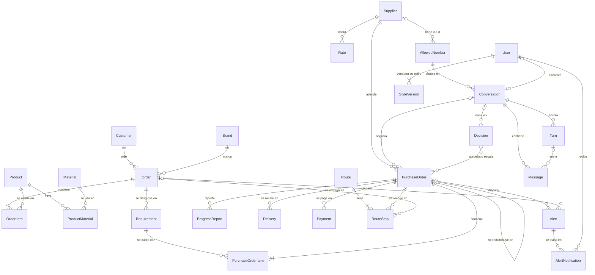

## 1. Catálogo y órdenes de clientes

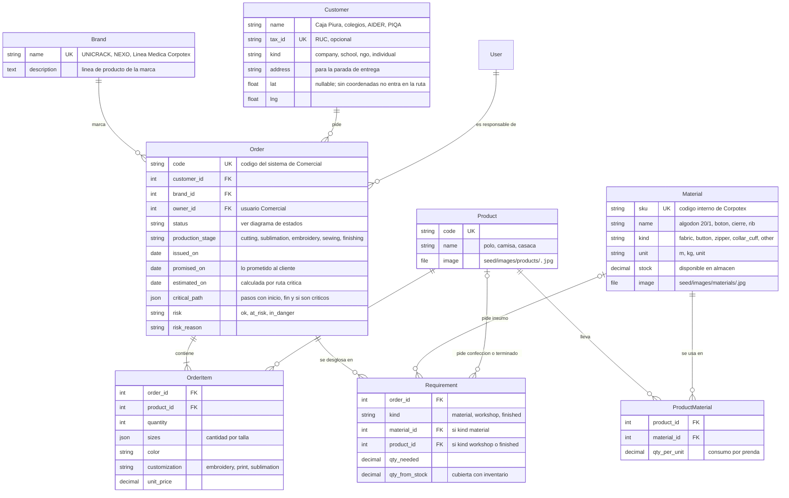

- **Entrada:** `POST /api/orders/` es la API simulada del sistema de Comercial. Es idempotente por `code`, la usa el botón "Simular orden de Comercial" del dashboard y la tool `register_order` del asistente de Comercial. `docs/api/` trae 3 payloads de ejemplo (Caja Piura, un colegio, AIDER) con productos y tallas del seed.
- **Desglose (`break_down_order`, paso 1 del flujo):** por cada `OrderItem`, `quantity` × `ProductMaterial.qty_per_unit`, menos `Material.stock`, da un `Requirement` de kind `material`. La costura genera uno de kind `workshop` (el matching decide si va a la planta o a un taller externo) y la tercerización completa uno de kind `finished`.
- **Lo que falta pedir (`qty_to_order`, calculado):** `qty_needed − qty_from_stock`. Lo cubierto de un `Requirement` es lo entregado por pedidos cancelados (`qty_delivered` de sus `PurchaseOrderItem`) más la `quantity` de los pedidos vivos. Así cuentan las unidades que un taller ya hizo antes de cancelar. El `status` del requerimiento en la API (`pending`, `covered`, `ordered`) sale de eso.
- **`critical_path`** es una foto en JSON del último cálculo, para mostrarla en el dashboard: `[{id, name, kind, start, end, critical, status, purchase_order_id}]`. Se recalcula cuando cambia un pedido; no hace falta una tabla de tareas.
- **Ruta crítica (`compute_critical_path`):** la fecha de llegada de los insumos (`committed_on`, o `internal_due_on` si todavía no hay compromiso), más las etapas en planta según `Config.stage_durations`, más la costura (en planta según `stage_durations`, o en taller según su `committed_on`), más el acabado, da `estimated_on`. Si `estimated_on` pasa de `promised_on`, `risk` sube.
- **`risk`** lo actualiza el monitor y es independiente de `status`.
- **`total_amount`** de la orden se calcula: suma de `quantity × unit_price` de sus ítems.

## 2. Proveedores y pedidos

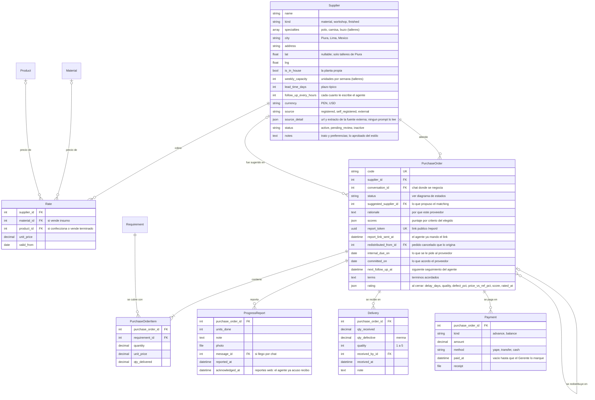

- **Consolidación:** un `PurchaseOrder` puede cubrir requerimientos de varias órdenes y marcas, porque cada `PurchaseOrderItem` apunta a su `Requirement`. Así funciona hoy la compra: un pedido por proveedor para las 3 marcas.
- **División de un pedido grande:** un `Requirement` de 1000 polos puede repartirse en varios `PurchaseOrderItem` de talleres distintos.
- **Planta propia:** es un `Supplier` con `is_in_house = true` y kind `workshop`, sin números. Entra al matching y al cálculo de carga como cualquier taller. Un pedido a la planta pasa de `approved` a `confirmed` sin negociación: no abre turno ni genera `no_channel`.
- **Calculados del pedido:** `kind` es el del proveedor; `total_amount` es la suma de `quantity × unit_price` de los ítems y `currency` la del proveedor; `units_done` y `last_progress_at` salen del último `ProgressReport`; `delivered_on` de la última `Delivery`; `changed_by_manager` es `supplier != suggested_supplier`; `paid_amount` y `pending_amount` suman sus `Payment`; `candidates` es el `proposal` de su `Decision` de asignación.
- **Justificación del matching (ADR 0024):** el pedido guarda `rationale` (texto) y `scores` (`{on_time, price, load, quality}` del elegido), que se generan una sola vez. El ranking completo, `[{supplier: {id, name}, supplier_id, supplier_name, score, scores, unit_price, currency, load_pct, rationale}]` ordenado por `score` (el `supplier` anidado es la forma que usa el front; las claves planas se conservan), vive en `Decision.detail.proposal[].candidates` y alimenta el "cambiar proveedor" del dashboard.
- **Pedidos consolidados de insumos (ADR 0025 A):** al confirmar la orden solo se piden taller y producto terminado; los requerimientos de insumos quedan en `Requirement.status = open` ("por pedir"; `ordered` cuando un pedido vivo los cubre, `covered` cuando lo entregado alcanza o no hacía falta pedir; `sync_requirement_status` lo mantiene al pedir, cancelar, rechazar y entregar). `GET /api/requirements/pending/` (Gerente y Producción; `?material_ids=1,2`) agrupa los abiertos de órdenes `confirmed`/`sourcing`/`in_production` por material: `{material: {id, sku, name, kind, unit, image}, total_to_order, orders: [{id, code, customer_name, qty, due_on}], due_on, suggested_supplier: {id, name} | null, candidates: [{supplier: {id, name}, unit_price, currency, score}], lead_time_days, reference_price, currency, alert_id}` (`reference_price`, `currency` y `candidates` solo para el Gerente: `null`/`[]` para Producción; `alert_id` es la `Alert` `purchase_suggested` abierta del material, si hay). `total_to_order` y `orders[].qty` son lo que falta comprar (`remaining_to_order`: por pedir menos lo que traen los pedidos vivos o lo ya entregado), el mismo número que usa `generate_purchase_orders`; un requerimiento sin saldo no aparece (hallazgo del 10/10 22:10: PI-0032 había entregado 600 de 1000 cuellos y el aviso decía 1000 mientras el pedido salía con 400). `POST /api/purchase-orders/generate/ {material_ids?, supplier_overrides?: {"<material_id>": supplier_id}}` (Gerente y Producción; el override fuerza el proveedor, que debe tener tarifa: 400 si no) llama a `generate_purchase_orders(material_ids=None, *, actor, supplier_overrides=None) -> {created, decision, skipped}`: por material, UN `PurchaseOrder` `suggested` con un `PurchaseOrderItem` por requerimiento (`match_requirements(..., consolidate=True)`: un solo candidato, sin partición), fecha límite = la más temprana de las órdenes, requerimientos → `ordered` y una `Decision` `approve_assignment` para el lote cuyo `proposal[]` trae además `orders: [{id, code, qty}]`; responde 201 `{created: [pedido serializado por rol, con `material: {id, sku, name}`, `supplier` y `orders`], decision_id, skipped: [{material_id, reason}]}` e ignora sin error un material sin requerimientos abiertos. Si ya existe un pedido `suggested` (sin aprobar) del mismo insumo y proveedor, los requerimientos nuevos entran como ítems de ese pedido en vez de crear otro (fecha límite = la más temprana, `proposal[]` de la decisión pendiente actualizado con cantidad y órdenes, `merged: true`); un pedido ya aprobado no se toca y lo nuevo va a un pedido aparte (ADR 0025 A.7). `POST /api/orders/break-down/ {order_ids?}` (Gerente y Producción) desglosa todas las órdenes `registered` o las indicadas → `{broken_down: [codes], skipped: [{code, reason}]}` (A.6). El pedido consolidado sale en el detalle de cada orden (`requirements[].purchase_orders`) y `PurchaseOrder.orders` lista todas las órdenes que agrupa.
- **Matching (`match_requirements`, paso 3):** usa `Rate` (precio), `supplier_scores` (cumplimiento y calidad, calculados sobre los `rating` de sus pedidos cerrados), la carga (unidades en pedidos abiertos frente a `weekly_capacity`) y el plazo. Crea los `PurchaseOrder` en `suggested` con `suggested_supplier`, `rationale` y `scores`, y después una `Decision` `approve_assignment` por el lote con el ranking completo en `detail.proposal`.
- **Fecha de un pedido en la ruta crítica:** `committed_on` si el proveedor ya se comprometió; si no, el mayor entre `internal_due_on` y mañana + `lead_time_days` del proveedor (un día para acordar y luego su plazo): un taller nuevo encontrado hoy sigue necesitando sus días, diga lo que diga la fecha límite interna. Así una redistribución a mitad de pedido recalcula la fecha de verdad y la orden sale en peligro cuando corresponde (escena del jurado).
- **Colchón:** `internal_due_on` = `Order.promised_on` menos `Config.buffer_days`. Es el "5 días al proveedor cuando al cliente se le prometieron 10". Con varias órdenes en un pedido, se toma la más cercana.
- **Reglas de jefe (`confirm_purchase_order`):** si el precio pasa la `Rate` vigente o la fecha pasa `internal_due_on`, lanza `ManagerApprovalRequired(reason)` y la tool le dice al modelo que escale. Es idempotente: confirmar un pedido ya `confirmed` con los mismos términos devuelve OK.
- **Cancelación (`cancel_by_supplier`):** pasa el pedido a `cancelled_by_supplier` y llama a `redistribute`, que además crea la ruta nueva en `proposed` (sección 3). Es idempotente: si el pedido ya estaba cancelado, no redistribuye de nuevo.
- **Calificación automática:** al cerrar el pedido (`delivered`) se llena `rating` a partir de las `Delivery` y las fechas: `{delay_days, quality, defect_pct, price_vs_ref_pct, score, rated_at}`. `supplier_scores` promedia los `rating` del proveedor en cada consulta; con la data de la demo no hace falta cachearlo. El seed trae pedidos cerrados con `rating` para que los puntajes no salgan vacíos.
- **Pagos (P0, ADR 0024):** al confirmar un pedido se crean dos `Payment` (50% `advance` y 50% `balance`) con `paid_at` vacío. `mark_payment_paid(payment, *, method, receipt=None, actor)` (`POST /api/payments/<id>/pay/`, multipart) llena `paid_at`, `method` y `receipt`; solo el Gerente. En la API, `status` es `paid` si `paid_at` tiene valor. `GET /api/payments/` lista todos. En el detalle del pedido van `payments: [{id, kind, kind_display, amount, status, due_on, paid_at, method, receipt}]`, `paid_amount`, `pending_amount` y `currency`; en el detalle del proveedor y en el Monitor (solo Gerente), `payments_summary: [{currency, paid, pending, overdue_count}]` agrupado por moneda, nunca sumando PEN con USD (en el Monitor, además, por proveedor). `due_on` se calcula: el adelanto vence al confirmar (`PurchaseOrder.created_at` del `confirmed`, en hora simulada) y el saldo el día de la última `Delivery`. La alerta `payment_due` sale de eso: un pago sin `paid_at` con `due_on` pasado.
- **Proveedores por revisar (ADR 0024):** `POST /api/suppliers/self-register/` es público (P0) y crea el `Supplier` con `source = self_registered` y `status = pending_review`. Para las fuentes externas (P1), la tool `suggest_suppliers(specialty, city)` del asistente del Gerente (la define `agente`) llama a `create_suggested_suppliers(candidates, *, actor)`: recibe `[{name, city, kind, specialty, source_url, evidence}]` ya validados, deduplica por nombre normalizado y ciudad contra los existentes, crea los `Supplier` con `source = external`, `status = pending_review` y la url y el extracto en `source_detail` (nunca en `notes`, que entra al prompt del agente de WhatsApp), y devuelve `{created, skipped}`. El Gerente los ve con `GET /api/suppliers/?status=pending_review` (con `source`, `source_detail` y `notes`) y los aprueba o descarta con `PATCH /api/suppliers/<id>/ {status: active | inactive}`.
- **Reporte público del taller (P1, ADR 0024):** cada pedido tiene un `report_token` (uuid). `GET /api/report/<token>/` devuelve `{code, product: {name, image}, quantity, committed_on, units_done}`, sin precios ni proveedor; `POST` multipart `{units_done, photo?, note?}` llama a `record_public_report`, que registra el `ProgressReport` (`actor = None`) y encola un `Turn` `web_report` en `PurchaseOrder.conversation`, si existe, para que el agente acuse recibo. Sin auth: el token es el secreto. La tool `send_report_link(code)` del agente arma la URL con `report_url(purchase_order)` y la marca con `mark_report_link_sent`, así el modelo nunca ve el token ni repite el link (`turn_state` trae `report_link_sent_at` por pedido).
- **Celulares (ADR 0016):** viven solo en `AllowedNumber`, de 0 a n por proveedor (por ejemplo, el dueño y el encargado del taller). Un proveedor tiene canal si tiene al menos un número activo.
  - Alta, importación y autoregistro llevan `name`, `kind`, `specialties` (en el CSV, separadas por `;`), `city`, `weekly_capacity`, `lead_time_days`, `currency` y un `phone` opcional, que crea su `AllowedNumber` con `active = false`. `follow_up_every_hours` toma 48 por defecto y `notes` queda vacío hasta el onboarding de estilo. Al importar, un proveedor ya existe si alguno de sus números coincide con el `phone`; si no, se compara por `name`.
  - El detalle del Gerente trae `numbers: [{id, phone, name, active, simulated}]`. `POST /api/suppliers/<id>/numbers/ {phone, name?}` agrega uno inactivo, y `PATCH /api/suppliers/<id>/numbers/<number_id>/ {active?, name?, phone?}` lo activa o desactiva. El `phone` solo se corrige si el número no tiene conversación. Los números no se borran: se desactivan.
  - La lista trae `numbers_count` y `active_numbers_count`, para mostrar "1 de 2 activos" o "Sin canal" sin cargar el detalle.

## 3. Rutas (ADR 0024)

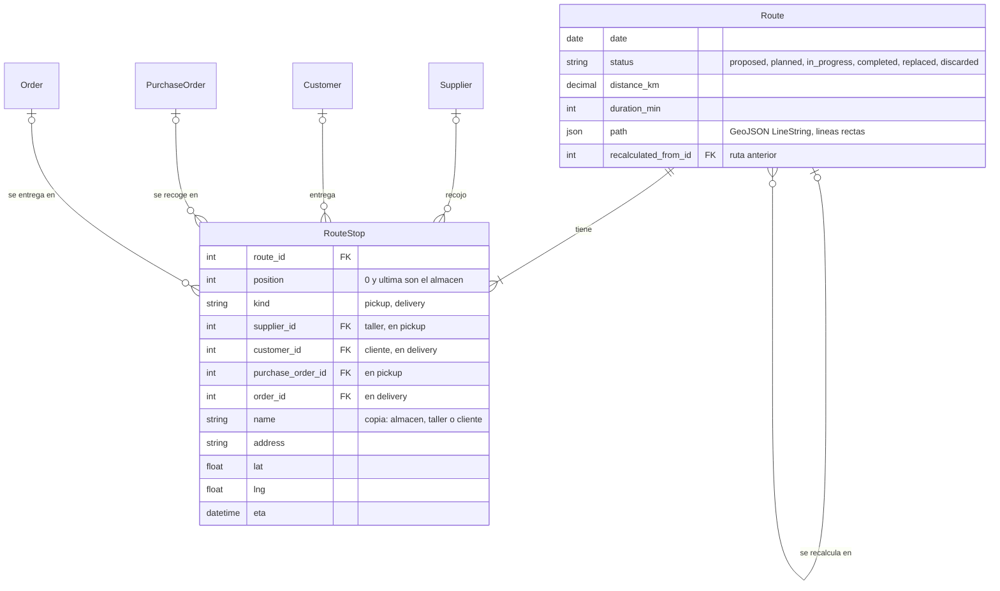

- **Puntos (corrección de Oscar, 10/10 23:35):** las rutas son de entrega de órdenes a clientes y salen de la planta principal; no hay recojos en proveedores (los de Lima mandan por Sullana Express y los talleres entregan en planta). La planta (`Config.plant_name`, `plant_lat`, `plant_lng`) es la primera y la última parada, con `kind = plant` y sin `customer` ni `order`. Un `delivery` por cada orden abierta (ni entregada ni cancelada) cuyo cliente tiene coordenadas y cuyo día de salida es ese día: `estimated_on` (la fecha de la ruta crítica) o, si no hay, `promised_on`. Sin coordenadas, la orden no entra. `RouteStop.Kind` conserva `pickup` para filas viejas, pero nada lo genera. Cada parada copia `name`, `address`, `lat` y `lng`, así la ruta no cambia si después se edita el cliente.
- **`plan_route(date, *, actor=None)`:** vecino más cercano desde el almacén más una pasada 2-opt sobre distancias haversine; sin servicio externo, `path` son líneas rectas entre paradas. `duration_min` = `distance_km` / 25 km/h × 60 + 10 min por parada; `eta` se acumula desde las 08:00 simuladas. Devuelve la ruta en `planned`; si ya había una `planned` para esa fecha, pasa a `replaced` y la nueva lleva `recalculated_from`. `POST /api/routes/plan/ {date}` lo expone a Gerente y Producción.
- **Redistribución (criterio 8):** la redistribución mueve la fecha de la orden afectada (los talleres nuevos necesitan su plazo), así que `redistribute` guarda el día de salida que tenía la orden antes de cancelar y, tras recalcular, arma el par: `before` = la ruta `planned` del día original con la parada en el cliente (si nadie la había planificado, se planifica en ese momento tal como estaba) y `after` = ruta `proposed` del día nuevo con esa parada, `recalculated_from = before` (`operations.routes.propose_for_redistribution`). `Decision.detail` lleva `before.route_id` y `after.route_id`. Al aprobar (`resolve_decision` → `promote`), la propuesta pasa a `planned`, la ruta `before` a `replaced` y, si ese día siguen saliendo otras órdenes, se vuelve a planificar sin la orden movida (enlazada por `recalculated_from`); al rechazar, la propuesta pasa a `discarded`. `GET /api/routes/?current=1` sin `date` devuelve la ruta próxima tocada más recientemente, así la recién aprobada sale como `current` con la vieja en `replaced`. El `name` de cada ruta ("Entregas del 21/10 (antes 17/10)") muestra el cambio de día en el mapa.
- **API:** `GET /api/routes/?current=1` devuelve `{current, replaced}`: la vigente (`planned` o `in_progress`) y la `replaced` enlazada, o `null`. `GET /api/routes/<id>/` devuelve cualquier ruta, en cualquier estado (`proposed`, `replaced` y `discarded` incluidas), con los mismos permisos: la escena abre `/routes?before=<id>&after=<id>` y, antes de aprobar, la de `after` está en `proposed`. Cada ruta trae `status`, `distance_km`, `duration_min`, `path` y `stops: [{position, kind, name, address, lat, lng, eta, supplier?: {id, name}, customer?: {id, name}, purchase_order?: {id, code}, order?: {id, code}}]`. El almacén sale de las paradas de inicio y fin.
- **Seed:** coordenadas aproximadas de Piura para la planta (bloque `plant` del README del PR de Kenji) y los 4 clientes (Caja Piura, Colegio Los Algarrobos, AIDER, PIQA). Los JSON no traen rutas: al final, `seed_demo` planifica una ruta `planned` por cada día de los próximos 31 en que sale alguna orden, para que `/routes` no esté vacío antes de la escena.

## 4. Mensajería, asistente y cola de turnos

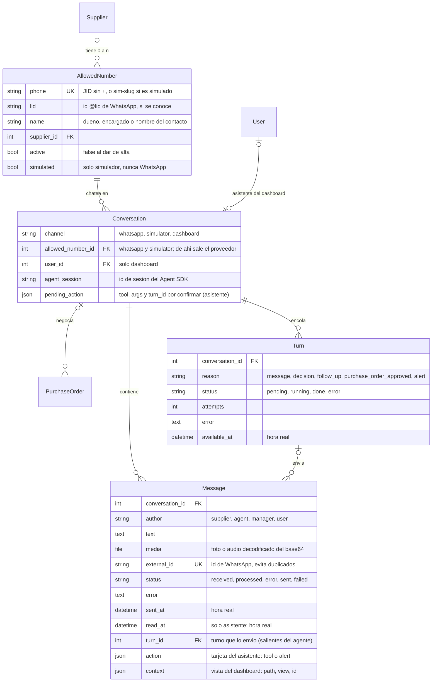

### Allowlist y webhook

- **Allowlist:** el webhook descarta, sin guardar nada, todo mensaje cuyo número no esté en `AllowedNumber` con `active = true`. Es la única fuente de celulares (ADR 0016) y la red de seguridad para no contestarle nunca a familia ni a contactos de Turbo. El agente y la extracción de estilo solo usan números activos.
- **Números simulados (`simulated = true`):** son los de los proveedores que se operan por el simulador. Su `phone` no es un teléfono: es `sim-<slug>`, que nunca coincide con un JID real.
  - El webhook nunca los acepta, y `send_text` se niega a mandarlos por WhatsApp (`NumberNotAllowed`).
  - Cuentan como canal activo, así que no disparan `no_channel`.
  - La extracción de estilo los salta: un proveedor que solo tiene números simulados sale como `no_phone`.
  - En el dashboard, el Gerente los ve como "Simulador".
- **Webhook (`/webhooks/evolution/<secret>/`):** valida el secreto con comparación de tiempo constante y acepta solo `MESSAGES_UPSERT`. Descarta grupos (`@g.us`) y estados. El payload crudo va al log, no a la BD.
- **`@lid`:** Baileys puede mandar `remoteJid` como `<id>@lid` en vez del teléfono. El webhook saca el número del campo alterno (`remoteJidAlt` o `senderPn`; se verifica con un payload real) y guarda el `lid` en `AllowedNumber`.
- **Proveedor de la conversación:** el número (`phone` o `lid`) se busca en `AllowedNumber`. La conversación es la de ese número (`Conversation.allowed_number`), y su proveedor es `allowed_number.supplier`.
- **Entrantes (`fromMe = false`):** se guarda el `Message` con `author = supplier` y `received`, y se llama a `enqueue_turn(conversation, "message")`.
- **Salientes desde el teléfono (`fromMe = true`):** si el `external_id` coincide con un mensaje del agente, es el eco de nuestro envío y se ignora. Si no coincide, pero el agente mandó el mismo texto en esa conversación hace menos de 30 s, también es eco: se completa el `external_id` de ese mensaje. En cualquier otro caso, lo escribió el Gerente a mano: se guarda con `author = manager` y `sent`, sin turno. Sirve para el historial del agente y para regenerar el estilo.
- **Media:** el base64 de las fotos se decodifica a `Message.media`. El tipo (imagen, audio, documento) se infiere del archivo.
- **Dirección:** en la API, `direction` es `inbound` para `supplier` y `user`, y `outbound` para `agent` y `manager`.
- **Idempotencia:** `external_id` es único. Si Evolution reintenta, el segundo insert falla y se ignora. Los mensajes del simulador y del asistente no tienen `external_id`.
- `Conversation` de WhatsApp o del simulador es única por `(channel, allowed_number)`. Un proveedor con dos números activos tiene dos conversaciones por canal, y cada número puede tener una por WhatsApp y otra en el simulador. Un CheckConstraint obliga a que `dashboard` lleve `user` y no `allowed_number`, y los otros canales al revés.

### Asistente del dashboard (ADR 0017 y 0020)

- **Conversación:** una por usuario, con `channel = dashboard` (restricción única parcial sobre `user`). Se crea en el primer GET o en el primer aviso.
- **`GET /api/assistant/messages/?after=<id>`** → `{typing, messages: [{id, role: user | assistant, text, action?, read_at, created_at}]}`. `role` sale de `author` (`user` → `user`, `agent` → `assistant`) y `created_at`, de `sent_at` (hora real).
- **`POST /api/assistant/messages/ {text, context?}`** guarda el `Message` (`user`, `received`) con su `context = {path, view, id?}` y llama a `enqueue_turn(conversation, "message")`, sin la espera de 5 s. `view` es una de `monitor`, `orders`, `order`, `purchase_orders`, `purchase_order`, `suppliers`, `supplier`, `routes`, `simulator`, `style` y `onboarding`; `id` solo va en las vistas de detalle.
- **`POST /api/assistant/messages/read/ {up_to_id}`** llama a `mark_assistant_read`: pone `read_at` a los mensajes del asistente de esa conversación hasta ese id. El dashboard lo llama cuando el panel está abierto y el mensaje se ve.
- **`POST /api/assistant/reset/`** vacía `agent_session` y `pending_action` para abrir un hilo nuevo. Los mensajes se quedan.
- **Códigos en el chat:** el asistente escribe códigos, no URLs; el dashboard los enlaza con `?code=` exacto en `GET /api/orders/` y `GET /api/purchase-orders/`. Órdenes: el código de Comercial (`CP-…`); pedidos: `PT-` taller, `PI-` insumo, `PF-` terminado, más un correlativo de 4 dígitos.
- **`GET /api/me/badges/`** → `{assistant_unread, latest_unread: {id, preview, alert_kind} | null, claude_ok, pending_decisions, orders_in_danger, claude_expired, claude_last_error, claude_refresh_expires_at}`. Se consulta cada 5 s desde cualquier vista. `claude_ok` va para todos los roles (hay credencial vigente y `Config.claude_last_error` está vacío), para el banner "El asistente no está disponible". Los demás campos solo para el Gerente; para los otros roles, `null`.
- **`action`** tiene dos formas, según `kind`:
  - `{kind: "tool", tool, status: done | failed, title, summary, links: [{kind: order | purchase_order | decision | supplier, id}]}`: cuando una tool que cambia algo termina, el agente llama a `record_assistant_action(conversation, turn, action)`, que crea un mensaje del asistente con `text = title`. La respuesta final va en otro mensaje, con `post_assistant_message(conversation, turn, text, action=None)`; el aviso de alertas usa ese mismo servicio con `action = {kind: "alert", alert_ids}`, donde `alert_ids` son ids de `Alert` (los mismos que trae `TurnBatch.alert_ids`; `finish_turn` marca las `AlertNotification` de ese usuario).
  - `{kind: "alert", alert_ids: [...]}`: el aviso proactivo (abajo). El serializer lo expande a `action.alerts: [{id, kind, kind_display, severity, order: {id, code} | null, purchase_order: {id, code} | null}]`, en el mismo orden que `alert_ids`; con eso el dashboard arma los botones "Ver orden" y "Ver pedido". El texto del asistente nunca lleva URLs.
- **`pending_action` = `{tool, args, turn_id}`:** las tools que escriben no ejecutan en el momento. Dejan la acción ahí y piden confirmación, y la ejecuta el código cuando el usuario confirma (diseño de `agente`). Vale solo para el turno inmediatamente siguiente: cada turno borra la que no creó, y si el usuario confirma con argumentos distintos, se rechaza y se borra. Un aviso nunca deja una `pending_action`.
- **Tools por rol:** se arman en el servidor según `user.role`. Llaman a los servicios con `actor = user`, que vuelven a chequear el rol, y leen con los serializers de ese rol.
- **`assistant_turn_state(batch)`:** `{now, user: {first_name, role}, context: {path, view, id?}, new_messages: [{id, text, sent_at}], pending_action, alerts: [...]}`: el usuario, su rol, el `context` del último mensaje, lo que su rol puede ver y, si el turno trae `alert_ids`, las alertas pasadas por el serializer del rol: `{id, kind, severity, detected_at, order, purchase_order, decision (solo en decision_pending), repeat}`. `repeat` es `true` si ya se le avisó antes de esa alerta a ese usuario. No lleva estado de proveedor ni el estilo del Gerente: el asistente tiene tono neutro. Nunca lleva `Alert.text`: el modelo redacta a partir de los datos.
- **Avisos proactivos (ADR 0020):** `run_monitor` crea las alertas y `notify_roles(alert)` crea una `AlertNotification` por usuario activo del rol destinatario (tabla del ADR: el Gerente recibe todo; Comercial solo `order_in_danger`; Producción `stalled_purchase_order` de taller, `delay` y `order_in_danger`) y encola un `Turn` `alert` en su conversación de asistente. Varias alertas del mismo tick caen en el mismo turno pendiente, así que sale un solo mensaje por usuario. Los turnos `alert` corren con esfuerzo bajo.

### Cola de turnos (ADR 0010 y 0018)

- **`enqueue_turn(conversation, reason)`** es la única entrada a la cola. La llaman el webhook, la API del asistente, `resolve_decision`, `approve_purchase_orders`, `notify_roles` y el tick. Como mucho hay un `Turn` `pending` por conversación (restricción única parcial): si ya existe, lo reutiliza y no pisa nada. `available_at` pasa a ahora + 5 s, con tope de 20 s desde que se creó el turno, en hora real; así se juntan los mensajes seguidos. En `dashboard` no hay espera. Al confirmar la transacción (`on_commit`), dispara la tarea `run_turn(conversation_id)` con `countdown` hasta `available_at`.
- **`claim_next_turn(conversation_id=None)`** toma un turno con `select_for_update(skip_locked=True)`, entre los que tienen `available_at <= ahora` y son de conversaciones sin otro turno `running`. `run_turn(conversation_id)` lo llama con su conversación; si no hay turno disponible, la tarea termina sin hacer nada. Pasa el turno a `running` y devuelve un `TurnBatch`:
  - `message_ids`: los entrantes en `received`;
  - `decision_ids`: las decisiones resueltas de la conversación con `communicated_at` vacío;
  - `follow_up_purchase_order_ids`: los pedidos de esta conversación (`PurchaseOrder.conversation`) abiertos con `next_follow_up_at <= clock.now()`;
  - `new_purchase_order_ids`: los pedidos de esta conversación en `approved`;
  - `alert_ids`: en `dashboard`, los ids de `Alert` (no de la notificación) de las `AlertNotification` del usuario con `sent_at` vacío cuya alerta sigue `open`;
  - `web_report_ids`: los `ProgressReport` con `acknowledged_at` vacío que llegaron por `/report/<token>` a pedidos de esta conversación.
  Si el lote queda vacío en todas sus listas (por ejemplo, otro turno ya atendió el seguimiento), el turno pasa a `done` sin llamar al modelo.
- **`turn_state(batch)`** arma el estado fresco con esos mismos ids. Claves (fijadas con `personalidad` el 10/10): `{now, supplier: {name, kind, city, currency, notes, contact_name}, channel, purchase_orders: [{code, status, status_display, items: [{name, quantity, unit_price}], rate_unit_price, internal_due_on, committed_on, terms, units_done, report_link_sent_at, is_follow_up, is_new}], decisions: [{id, kind, status, summary, note, purchase_order_codes}], new_messages: [{id, text, media_url, sent_at}], web_reports: [{purchase_order_code, units_done, reported_at}], style_md, manager_name, history?: [{sender, text, sent_at}]}`. `now` es `clock.now()`; `contact_name` es el `AllowedNumber.name` de la conversación (puede estar vacío); `purchase_orders` son todos los abiertos del proveedor; `style_md` es el de `Config.agent_user`; `history` (los últimos 20 mensajes) solo va con `with_history`, cuando se perdió la sesión. Nunca lleva el nombre del cliente, la fecha prometida ni el colchón. El trato (tú o usted) no es un campo: `persona` lo saca de `notes`.
  `reason` del `Turn` es solo rastro: el porqué sale de acá. Así juntar causas en un turno nunca pierde nada. En `dashboard`, el estado lo arma `assistant_turn_state`.
- **`finish_turn(batch, session_id, error=None)`** guarda `Conversation.agent_session` siempre que `session_id` venga (también si hubo error).
  - Si salió bien:
    - los mensajes pasan a `processed`;
    - las decisiones reciben `communicated_at`;
    - en los seguimientos, `next_follow_up_at` pasa a `clock.now()` + `follow_up_every_hours`;
    - los pedidos nuevos pasan a `negotiating`;
    - las `AlertNotification` del lote reciben `sent_at`;
    - los reportes web del lote reciben `acknowledged_at`.
  - Con error, la fila queda en `error` con su mensaje y se vuelve a encolar con `enqueue_turn`, heredando los intentos; nada del lote se marca, así el reintento lo vuelve a tomar. Al tercer error no se encola más: se crea una `Alert` `turn_failed`, y los mensajes del lote pasan a `error` para que no reabran turnos para siempre.
  - Al terminar, si quedó otro turno `pending` en la conversación, vuelve a disparar `run_turn`: una tarea que llegó mientras la conversación estaba ocupada terminó sin hacer nada.
- **Lo que llega mientras un turno corre** no entra en su lote; lo toma el turno siguiente.
- **Conversación de un pedido (`PurchaseOrder.conversation`):** la fija `approve_purchase_orders`.
  1. Si el proveedor tiene conversaciones de números activos, toma la que tiene el mensaje entrante más reciente.
  2. Si no tiene ninguna, crea una para su primer `AllowedNumber` activo (por id): de WhatsApp si el número es real, y del simulador si es `simulated`.
  3. Si no tiene números activos, no encola: el pedido queda en `approved` con una `Alert` `no_channel`.
  Los seguimientos van a esa misma conversación. Si su número se desactivó, el tick la vuelve a resolver con la misma regla. Así dos conversaciones del mismo proveedor nunca toman el mismo pedido. `PurchaseOrder.conversation` solo decide a dónde van los turnos proactivos: el proveedor puede hablar del pedido desde cualquiera de sus números.
- **`recover_stuck_turns()`**, al arrancar el worker (señal `worker_ready`): los turnos en `running` pasan a `error` ("worker reiniciado") y se vuelven a encolar. Ese reintento no cuenta como intento.
- **Barrido del tick:** cada 10 s dispara `run_turn` para los turnos `pending` con `available_at <= ahora` de conversaciones sin turno `running`, por si Redis perdió una tarea. También pasa a `error` los `running` de más de 10 min (el `soft_time_limit` de `run_turn` es de ~180 s).
- **`send_text(conversation, text, turn)`** vuelve a chequear que `conversation.allowed_number` siga activo y que no sea `simulated` si el canal es WhatsApp (`NumberNotAllowed`). Guarda el `Message` saliente con `agent` y su `turn`, y por WhatsApp lo envía con `POST /message/sendText/corpotex` usando el token de la instancia más el service token de Cloudflare Access. Completa `external_id` con el id que devuelve Evolution; si falla, el mensaje queda en `failed` y lanza `SendFailed`. En el canal `simulator` solo guarda. Con `Message.turn`, un reintento sabe qué ya envió ese turno.
- **`message_history(conversation, limit=20)`** devuelve instancias de `Message` en orden cronológico; sirve para la tool `read_history` y para abrir una sesión nueva si se perdió el archivo de sesión. `latest_photo_id(message_ids)` da el id del último mensaje con imagen del lote, para `record_progress`.
- **LID de WhatsApp (hallazgo del 10/10):** WhatsApp dirige algunos chats por `<id>@lid` en vez de `<teléfono>@s.whatsapp.net` (el chat de rol con Valeria quedó así en Evolution). El webhook saca el teléfono de `key.remoteJidAlt`, `senderPn`, `previousRemoteJid` o `participantAlt` (en la clave o en el payload) y guarda el LID en `AllowedNumber.lid`; si llega un LID sin teléfono y nadie lo tiene guardado, lo resuelve una vez con `EvolutionClient.resolve_phone(lid)` (busca `remoteJidAlt` en los mensajes de ese chat) y, si Evolution no responde, descarta el mensaje. `EvolutionClient.find_messages(jid, since)` lee los dos chats del contacto (teléfono y LID, con `chat_jids`: el otro sale de `AllowedNumber.lid` o de `resolve_lid`/`resolve_phone`, verificados contra la instancia real: `findMessages` acepta `where.key.remoteJidAlt`), une, deduplica por `key.id` y devuelve los `limit` más recientes; `find_chat_messages` es la lectura cruda de un solo chat. Vale cualquiera de los dos jids como entrada (la extracción de estilo pasa `AllowedNumber.jid`).
- **Horario de silencio:** `claim_next_turn` no entrega un lote de WhatsApp o simulador que sea solo proactivo (`follow_up_purchase_order_ids` o `new_purchase_order_ids`, sin mensajes, decisiones ni reportes web) si `clock.now()` cae fuera de `QUIET_HOURS = (21, 7)` (hora simulada de Lima, en settings): el Gerente no escribe primero de noche. El turno queda `pending` y el barrido del tick lo dispara pasadas las 7. Las respuestas a mensajes y el asistente del dashboard no se tocan.
- **"Escribiendo…":** `GET /api/conversations/<id>/messages/?after=<id>` devuelve `{typing, messages}`, con `typing = true` mientras haya un `Turn` `running` en la conversación.
- **Índices:** `Message (conversation, sent_at)` parcial con `status = received`, para que el worker encuentre rápido lo pendiente; `Message (conversation)` parcial con `author = agent` y `read_at` vacío, para los contadores; `Turn (status, available_at)`; `PurchaseOrder (next_follow_up_at)` parcial con estados abiertos.
- **Tools del agente** (sesión `agente`): `send_message`, `confirm_purchase_order`, `record_progress`, `report_cancellation`, `escalate_to_manager` y `read_history`. Están atadas a la conversación del turno, validan el pedido con `purchase_order_for_conversation`, que compara por proveedor (`po.supplier == conversation.allowed_number.supplier`, no por `po.conversation`) y lanza `ForeignPurchaseOrder`, y llaman a los servicios de esta tabla.
- **Simulador:** usa las mismas tablas con `channel = simulator`, y sirve de plan B y de herramienta de desarrollo.
  - `GET /api/simulator/contacts/` lista, sin teléfono, las conversaciones de los números activos: las del simulador y también las de WhatsApp. Cada contacto trae `{allowed_number_id, name, supplier, channel: whatsapp | simulator, conversation_id, simulated, last_message: {id, text, direction, sent_at} | null}`; el `id` sirve para detectar mensajes nuevos sin comparar textos.
  - Las de WhatsApp son de solo lectura: en la demo, el chat de la proveedora real se proyecta junto a los talleres simulados. Se leen con `GET /api/conversations/<id>/messages/?after=`.
  - `POST /api/simulator/messages/ {allowed_number_id, text, photo?}` escribe en la conversación del simulador de ese número. Devuelve 400 si se apunta a una conversación cuyo `channel` no es `simulator`.
  - Permisos: el simulador y `/api/conversations/` muestran texto de mensajes de proveedores, que puede traer precios. Por la regla de texto libre, son solo para el Gerente. En la demo, quienes actúan de proveedores usan la cuenta del Gerente.

## 5. Gerencia, monitor y avisos

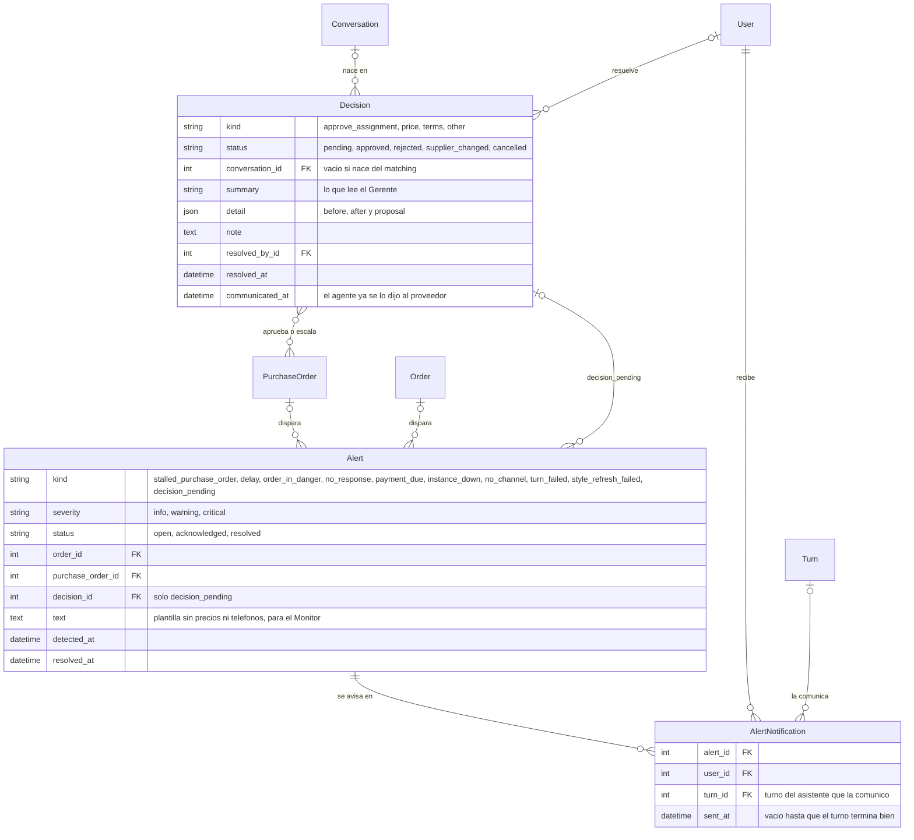

- **Lote:** `Decision.purchase_orders` es M2M. Una decisión `approve_assignment` cubre todos los pedidos de una orden nueva o de una redistribución, así el Gerente ve una tarjeta y no cuatro. Un pedido puede tener varias decisiones en su vida: la asignación y, después, una escalada por precio. Las órdenes afectadas salen de los pedidos.
- **`detail` de `approve_assignment`:** `{before: {estimated_on, total_amount, route_id} | null, after: {estimated_on, total_amount, route_id}, proposal: [{purchase_order_code, supplier, quantity, unit_price, committed_on, rationale, candidates: [...]}]}`. `before` es `null` en una orden nueva; `route_id` es `null` si no había ruta.
- **`create_decision`** es idempotente:
  1. bloquea los `PurchaseOrder` del lote con `select_for_update().filter(id__in=…).order_by("id")`, ordenados para evitar un deadlock entre el agente y el matching;
  2. si ya hay una `pending` del mismo `kind` que incluye alguno de esos pedidos, la devuelve;
  3. si no, la crea.
  No se puede usar una restricción única sobre una M2M.
- **`GET /api/manager/pending/`** junta tres listas: `Decision` en `pending`, `Order` con `risk = in_danger` y `Alert` en `open`.
- **`POST /api/manager/decisions/<id>/`** con `{action, supplier_id?, purchase_order_id?, note?}`:
  - `purchase_order_id` es obligatorio en `change_supplier` cuando la decisión tiene más de un pedido.
  - Es idempotente: si la decisión ya está resuelta con la misma `(action, supplier_id, purchase_order_id)`, devuelve el estado actual con 200; si se pide otra cosa, devuelve 409.
  - Solo el Gerente: `resolve_decision` chequea `require_role(actor, "manager")`.
  - Devuelve el estado nuevo.
- **`resolve_decision`:**
  - `approve_assignment` aprobada llama a `approve_purchase_orders`:
    1. los pedidos pasan a `approved`;
    2. se recalcula la orden (fecha y costo) y la `Route` `proposed` pasa a `planned`, con la anterior en `replaced`;
    3. se fija `PurchaseOrder.conversation` (regla de la sección 4) y se encola un `Turn` `purchase_order_approved` en esa conversación.
    Un proveedor sin ningún `AllowedNumber` activo no se puede contactar: su pedido queda en `approved` con una `Alert` `no_channel`. Con `change_supplier`, el pedido cambia de `supplier` (queda `suggested_supplier` como rastro) y la decisión queda en `supplier_changed`.
  - `price`, `terms` u `other` encolan un `Turn` `decision` en `Decision.conversation`.
  - `rejected` en una asignación cancela los pedidos `suggested`, pasa la ruta `proposed` a `discarded` y deja el requerimiento sin cubrir.
  - Al resolverse, su `Alert` `decision_pending` pasa a `resolved`.
- **Alertas:** `POST /api/alerts/<id>/acknowledge/` llama a `acknowledge_alert`, solo para el Gerente.
- **Sin duplicados en `Alert`:** restricción única parcial en `(kind, order, purchase_order, decision)` mientras esté `open`, con `nulls_distinct = False`.
- **Avisos por rol (`notify_roles`, ADR 0020):** por cada `Alert` nueva, crea una `AlertNotification` por usuario activo del rol destinatario y encola un `Turn` `alert` en su conversación de asistente (la crea si no existe). Una alerta se avisa una vez por usuario. Si sigue `open` un día simulado después del último `sent_at`, el tick crea otra `AlertNotification` solo para los usuarios `manager`; ese segundo aviso llega con `repeat = true`.
- **`tick()`** es una tarea de Celery beat, cada ~10 s reales, en la cola `periodic`:
  - encola un `Turn` `follow_up` en `PurchaseOrder.conversation` de los pedidos abiertos con `next_follow_up_at <= clock.now()` cuya conversación no tiene un turno `pending` ni `running` (si lo tiene, ese turno ya va a incluir el seguimiento en su lote);
  - barre los turnos vencidos (sección 4);
  - llama a `run_monitor()`, que actualiza `risk`, abre o cierra alertas (incluida `instance_down` según `connectionState` y `decision_pending` para las decisiones con más de `Config.decision_pending_hours` horas simuladas sin resolver, 12 por defecto) y llama a `notify_roles` por cada alerta nueva;
  - repite los avisos al Gerente de alertas que siguen abiertas al día siguiente simulado.
- **`GET /api/monitor/`** junta para el dashboard: `clock`, `kpis`, alertas abiertas, decisiones pendientes, órdenes en peligro y las últimas 3 `redistributions` (decisiones `approve_assignment` resueltas con un pedido que tiene `redistributed_from`).

## 6. Sistema, onboarding y estilo

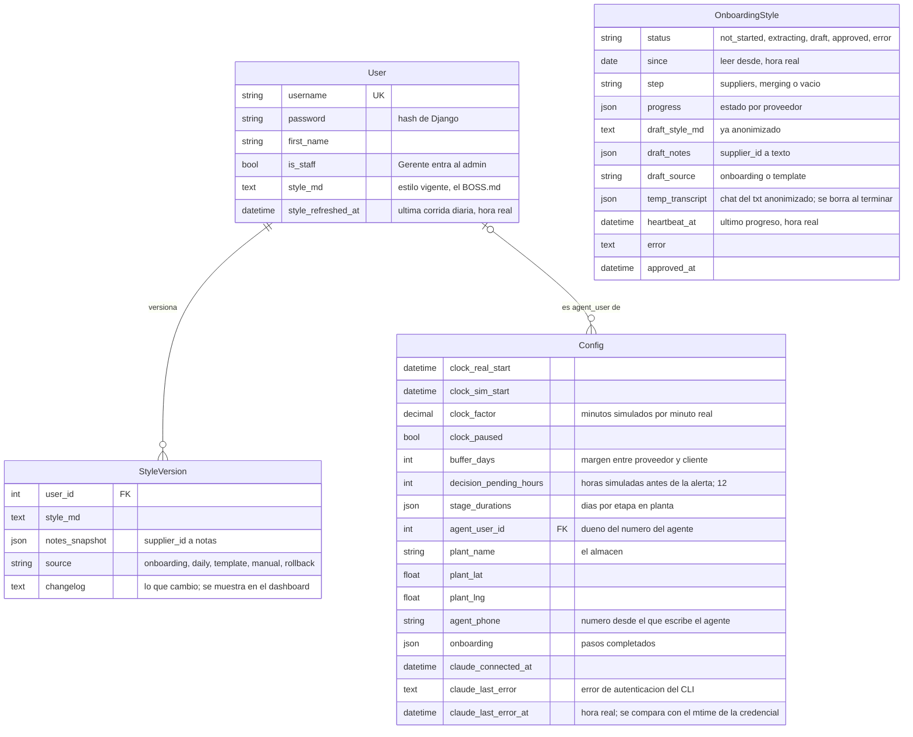

- **`User`** extiende `AbstractUser` desde la primera migración: cambiarlo después es caro. Los roles son grupos creados con una data migration. El Gerente gestiona usuarios y contraseñas desde el admin. Auth de la API con `TokenAuthentication` (ADR 0009); el seed genera un token por usuario.
- **`Config`** es una sola fila. `agent_user` es el dueño del número del agente de WhatsApp y `agent_phone` ese número (el que Evolution reporta como `fromMe`); el seed pone al Gerente y `51907898162`.
- **Reloj:** `clock.now()` = `clock_sim_start` + (hora real − `clock_real_start`) × `clock_factor`; con el reloj pausado devuelve `clock_sim_start`. Cada cambio de factor, pausa o salto rebasa primero (`clock_sim_start = clock.now()`, `clock_real_start = ahora real`) para que la hora no salte. `GET /api/clock/` devuelve `{now, factor, paused}`, y `PATCH /api/clock/ {factor?, paused?, advance_hours?}` llama a `set_clock`, solo para el Gerente.
- **`stage_durations`:** `{"cutting": 1, "sublimation": 1, "embroidery": 1, "sewing": 3, "finishing": 1}` en días. Suman los ~7 días de producción propia.
- **`onboarding`:** `{"whatsapp": {"done_at", "offline"}, "suppliers": {"done_at"}, "style": {"done_at"}}`. El paso 1 se marca hecho fuera de línea si falta el service token de Cloudflare Access.
- **Onboarding de WhatsApp (paso 1):**
  - `GET /api/onboarding/whatsapp/` lee `connectionState`, `webhook/find` y `settings/find`, y enmascara el secreto en la URL.
  - `POST .../qr/` llama a `instance/connect`. Devuelve `qr_base64: null` si la instancia ya está `open`.
  - `POST .../webhook/` aplica `webhook/set` y `settings/set`.
  Usa siempre la instancia `corpotex` con su token. Nunca crea, desconecta ni borra instancias, y nunca toca `personal-whatsapp`.
- **Conexión de Claude (paso 0, ADR 0022):** una sola cuenta por instalación, conectada por el Gerente desde `/settings/claude`, para todos los agentes. La credencial nunca va a la BD ni a la API.
  - `POST /api/settings/claude/start/` genera el `code_verifier` (PKCE) y devuelve `{url, state}`, con `state = verifier`: el servidor no guarda nada entre pasos.
  - `POST /api/settings/claude/exchange/ {code}` separa `<code>#<state>`, canjea en el endpoint de token con `code_verifier = state`, consulta el tipo de suscripción y escribe `<CLAUDE_CONFIG_DIR>/.credentials.json` con `{claudeAiOauth: {accessToken, refreshToken, expiresAt, refreshTokenExpiresAt, scopes, subscriptionType, clientId}}`, atómico (archivo temporal y `rename`) y con permisos 0600. Lo vuelve a leer antes de responder y llena `Config.claude_connected_at`.
  - `GET /api/settings/claude/status/` → `{connected, method: oauth | api_key | none, subscription_type, expires_at, refresh_token_expires_at, expired, last_error}`.
  - `POST /api/settings/claude/disconnect/` borra el archivo. `POST /api/settings/claude/set-key/ {api_key}` guarda la key en un archivo aparte y un `apiKeyHelper` en `settings.json` del `CLAUDE_CONFIG_DIR`, excluyente con el OAuth.
  - Las constantes (`CLIENT_ID`, `AUTHORIZE_URL`, `TOKEN_URL`, `REDIRECT_URI`, `SCOPES`) se copian de `mano` (`system/auth_providers/anthropic.py`) a `backend/core/claude_auth.py`.
  - **Sin credencial, la cola se pausa.** Con credencial ausente o vencida el CLI falla en 0,4 a 3 s con `authentication_failed`; `agent/sdk.py` lo convierte en `ClaudeNotConnected` y `run_turn` llama a `mark_claude_disconnected(error_text)`: guarda `Config.claude_last_error`, abre una sola `Alert` `claude_disconnected` y devuelve el turno a `pending` sin sumar intento, porque no es culpa del turno. Mientras `claude_last_error` tenga valor, `claim_next_turn` no entrega turnos y el barrido del tick no los dispara: así no hay un loop de fallos cada 3 s. `mark_claude_connected()`, que llaman `exchange/` y `set-key/` cuando salen bien, vacía el error, resuelve la alerta y vuelve a disparar `run_turn` para todos los turnos `pending`. El tick también la llama solo si `.credentials.json` tiene un mtime posterior a `claude_last_error` (lo renovó el propio CLI o alguien lo copió al volumen), para no quedar pausados por un 401 pasajero. El dashboard ve la pausa en `claude_ok` de badges.
  - Errores con código estable, para que el dashboard muestre texto humano sin regex: `400 {error_code, detail}`. `exchange/`: `missing_state` (falta la parte después del `#`), `invalid_code` (Anthropic rechazó el canje), `unreachable` (no se llegó al endpoint). `set-key/`: `key_format` (no empieza con `sk-ant-`), `key_rejected`, `key_unverifiable`. `disconnect/` sobre nada: `not_connected`. `detail` es el texto crudo, solo para la consola.
- **Estilo del Gerente (paso 3):** `OnboardingStyle` es una sola fila con el borrador. Lo aprobado vive en `User.style_md` de `Config.agent_user` (el `BOSS.md`) y en `Supplier.notes`.
  - `GET /api/onboarding/style/` → `{status, error, since, step, suppliers: [{id, name, status, messages_read, error}], boss_md, notes: [{supplier_id, supplier_name, notes}], approved_at}`. `approved_at` se llena en `approve/`.
  - `POST extract/ {supplier_ids?, since}` lee de Evolution solo los chats de los números activos de cada proveedor, y pasa un chat por número (el `supplier_id` se repite; `persona` los agrupa). Un proveedor sin números sale como `no_phone`, y uno con números pero ninguno activo, como `not_allowed`. `POST import-txt/` (multipart `{file, manager_author, since, supplier_id?}`) guarda en `temp_transcript` el chat ya anonimizado. Las dos encolan la tarea `run_style_extraction` en la cola `style`.
  - `extract/` y `template/` reemplazan el borrador. `import-txt/` lo amplía: llama a `update_style(current_md, current_notes, chats)` de `persona`, la misma función incremental del refresco diario, y si no hay borrador parte de la plantilla. Orden antes de la demo: `extract/` (la proveedora real), `import-txt/` (Lima, con `supplier_id`), `import-txt/` (México, con `supplier_id`) y `approve/`. Los dos `.txt` son sintéticos y viven en `backend/agent/persona/fixtures/`.
  - `PUT` guarda el borrador. `POST template/` carga como borrador la `StyleVersion` con `source = template` de la BD (la que creó el seed); solo si no existe, lee `persona/templates/style.base.md`. `POST approve/` llama a `approve_style`: copia el borrador a `agent_user.style_md` y a `Supplier.notes`, y crea una `StyleVersion` `onboarding` (o `template`, si el borrador vino de la plantilla). Es idempotente.
  - `extract`, `import-txt`, `template` y `PUT` devuelven 409 mientras `status = extracting`.
  - Si `heartbeat_at` pasa 5 minutos sin moverse, el GET la muestra como `error` ("extracción interrumpida") y se puede volver a lanzar.
  - El job borra `temp_transcript` al terminar, salga bien o con error. Los mensajes crudos de Evolution solo viven en memoria.
  - La extracción en sí (anonimización, parser del `.txt`, llamados al modelo, plantilla base) es de la sesión `personalidad`, en `backend/agent/persona/` (`extract_style -> {style_md, notes: {supplier_id: str}}`, `update_style -> {style_md, notes, changelog}`, `parse_whatsapp_export` y `validate_style(md) -> list[str]`, vacía si está bien). La tarea le pasa `chats = [{supplier_id, supplier_name, contact_names: [AllowedNumber.name, pushName], messages: [{sender: manager | supplier | agent, text, sent_at}]}]`, uno por número activo, y `on_progress(supplier_id, status, messages_read=None, error=None)`. El paso global `on_progress(None, "merging")` también sirve de latido.

### Estilo por usuario y refresco diario (ADR 0019)

- **`User.style_md`** es el estilo vigente. El agente de WhatsApp usa el de `Config.agent_user`; el asistente del dashboard no usa estilo.
- **Historial:** cada cambio crea una `StyleVersion` con su `changelog` y un `notes_snapshot` (las `Supplier.notes` de ese momento). Las fuentes son `onboarding`, `daily`, `template`, `manual` (edición del Gerente) y `rollback`.
- **Volver atrás:** `POST /api/style/versions/<id>/restore/` llama a `restore_style_version`, que crea una versión nueva `rollback`, copia de la elegida, y restaura `style_md` y `Supplier.notes`. El historial nunca se reescribe.
- **`refresh_style(user_id=None)`:** tarea de beat a las 03:00 de Lima, en hora real, en la cola `style`; sin `user_id` usa `Config.agent_user`. Las tareas de estilo viven en `core/tasks_style.py` (sesión `personalidad`) con nombre explícito `core.tasks.run_style_extraction` y `core.tasks.refresh_style`; `core/tasks.py` las reexporta.
  1. Lee de la BD los mensajes `author = manager` de conversaciones `whatsapp` con número activo, desde `User.style_refreshed_at`. Si no hay mensajes nuevos, no llama al modelo.
  2. Llama a `update_style` de `persona` e ignora el `notes` que devuelve. Si `validate_style` no devuelve errores, crea una `StyleVersion` `daily` y actualiza solo `User.style_md` y el `changelog`: nunca escribe `Supplier.notes`, porque el refresco se aplica sin revisión y texto de un proveedor podría colarse en el prompt de su propia conversación. Las notas cambian solo por `approve_style` o edición manual. Si no pasa, se queda el estilo actual y se crea una `Alert` `style_refresh_failed`.
  3. Siempre actualiza `style_refreshed_at`.
- **Una tarea de estilo a la vez:** el worker es uno solo con `-c 5` y la cola `style` no limita la concurrencia por sí misma, así que la extracción y el refresco toman un lock en la BD (`pg_try_advisory_lock` con una clave constante, `STYLE_LOCK_KEY = zlib.crc32(b"corpotex-style")`, nunca `hash()`, que cambia por proceso; liberado en `finally`). Si no lo consiguen, se reintentan con `countdown` en vez de ocupar un slot esperando. Si el proceso muere, Postgres suelta el lock al cerrarse la conexión.
- **API (solo Gerente):** `GET /api/style/versions/` (con `source`, `changelog` y `created_at`), `GET /api/style/versions/<id>/` (con `style_md`) y `POST .../restore/`. P1: `POST /api/style/refresh/` ("Aprender ahora"; no se usa en vivo en la demo).

## 7. Trabajo en segundo plano y docker compose (ADR 0018 y 0023)

`docker-compose.yml` en la raíz levanta todo con `docker compose up`, Next.js incluido. Los servicios de Python salen de una misma imagen, `backend/Dockerfile` (con uv). `infra/` queda solo para el tunnel.

| Servicio | Qué corre |
|---|---|
| `postgres` | La BD. Puerto publicado solo en loopback: `127.0.0.1:5432:5432` |
| `redis` | Broker de Celery. Puerto publicado solo en loopback: `127.0.0.1:6379:6379` |
| `web` | Django con runserver en `0.0.0.0:8000` dentro del contenedor y `backend/` montado, para que recargue al editar. Publicado como `127.0.0.1:8000:8000`: el tunnel corre en el host y le manda `/api`, `/admin`, `/webhooks`, `/static` y `/media` |
| `celery-worker` | `-Q turns,periodic,style -c 5`, pool prefork, `acks_late` y `prefetch_multiplier = 1` |
| `celery-beat` | Schedule estático en settings (sin django-celery-beat) |
| `frontend` | Next.js en modo dev, publicado como `127.0.0.1:3000:3000`; el tunnel le manda el resto |

- **Puertos en loopback, no en `0.0.0.0`:** la laptop va a estar en el wifi del hackathon. Con `5432:5432` y `6379:6379` a secas, cualquiera en esa red entra a Postgres con `corpotex/corpotex` y a Redis sin clave. Con `127.0.0.1:` adelante, `psql` y `redis-cli` siguen funcionando desde el host y el tunnel también, porque `cloudflared` corre en el host. La contraseña de Postgres se lee de `.env` (`POSTGRES_PASSWORD`, con valor por defecto en `.env.example`); dentro de la red de compose los servicios se hablan por nombre y no necesitan puertos publicados.

| Tarea | Cola | Se dispara |
|---|---|---|
| `run_turn(conversation_id)` | `turns` | `enqueue_turn` (con `countdown`), `finish_turn` y el barrido del tick. `soft_time_limit` ~180 s |
| `tick()` | `periodic` | beat, cada 10 s |
| `run_style_extraction()` | `style` | `extract/` e `import-txt/` del onboarding |
| `refresh_style(user_id=None)` | `style` | beat, a las 03:00 `America/Lima`, sin argumentos (usa `Config.agent_user`). P1: `POST /api/style/refresh/` |

- **Credencial de Claude (ADR 0022):** no hay token en `.env`. `web` y `celery-worker` montan el mismo volumen `agent-home` en `/app/.agent`: `CLAUDE_CONFIG_DIR=/app/.agent/config`, con `.credentials.json` (lo escribe Django, lo lee el worker en cada spawn del CLI) y las sesiones que se reanudan; `turns/`, `style/` y `search/` son los cwd fijos del SDK (ADR 0010).
- **CLI:** según la doc de `claude-agent-sdk` (0.2.165), el CLI de Claude Code viene dentro del wheel, sin Node, con Python 3.10 o más. Se confirma al construir la imagen; si falla, se agrega node.
- **Venv fuera de `/app`:** como `./backend` se monta en `/app`, el entorno de uv vive en `/usr/local` (`UV_PROJECT_ENVIRONMENT`), no en `/app/.venv`. Si alguien corre `uv sync` en la Mac, ese `.venv` trae el CLI para darwin y en Linux no corre: `backend/.dockerignore` excluye `.venv`, `.agent` y `media`.
- **Variables en compose:** `DATABASE_URL` apunta al servicio `postgres` y `REDIS_URL` a `redis://redis:6379/0`.
- **Si Redis o el worker se caen,** se paran los turnos. Al volver, `recover_stuck_turns` (en `worker_ready`) y el barrido del tick los retoman desde `Turn`.
- Desaparece el comando `run_agent`.

## 8. Seed de la demo (ADR 0021)

`python manage.py seed_demo` es idempotente: borra y recrea la data de demo (catálogo, proveedores, órdenes, pedidos, conversaciones de proveedores, decisiones y alertas), y nunca toca usuarios, tokens, la configuración de WhatsApp (`Config.onboarding`) ni los chats del asistente del dashboard; `--reset-chats` borra también esos chats (mensajes, turnos, `agent_session` y `pending_action`) para que el asistente arranque de cero antes del pitch. Los pedidos abiertos de un proveedor con número real activo quedan con `next_follow_up_at = T + follow_up_every_hours`, así el tick no manda un seguimiento apenas se reseedea: el primer contacto de la demo sale de la aprobación. El estilo (`StyleVersion`, `User.style_md`, `OnboardingStyle`) se conserva por defecto, para que un `seed_demo` antes de un ensayo no pise lo aprobado en el onboarding; `--reset-style` lo recrea desde `style_versions.json`. Crea los 3 usuarios por rol si no existen. Se corre al levantar el compose y antes de cada ensayo. Kenji genera los JSON y las imágenes con este formato; cualquier diferencia se resuelve acá antes de generar.

### Archivos

```
backend/seed/
  data/
    config.json
    brands.json
    customers.json
    materials.json
    products.json
    product_materials.json
    suppliers.json
    orders.json
    purchase_orders.json
    decisions.json
    alerts.json
    conversations.json
    style_versions.json
    BOSS.md
  images/
    materials/<sku>.jpg
    products/<code>.jpg
  README.md      supuestos de la data
  credits.md     origen de las imagenes
```

Kenji entrega esto en un PR a la rama `seed/demo-data`, desde `main`. Si no llega a tiempo, el plan B es un seed mínimo propio con el mismo formato (3 marcas, 4 clientes, 6 materiales, 4 productos, 5 proveedores, 3 órdenes), y su data se suma después.

Cada JSON es un array de objetos con las claves en inglés del modelo. Las imágenes se copian a `media/` y se asocian por nombre de archivo (`<sku>.jpg`, `<code>.jpg`); no hay campo `image` en los JSON. Tamaño: unos 800 px de lado y menos de 150 KB, porque pasan por el tunnel y se ven en el proyector.

### Reglas del formato

| Tema | Regla |
|---|---|
| Referencias | Nunca ids. Marca por `name`, cliente por `name`, material por `sku`, producto por `code`, proveedor por `key`, orden por `code`, pedido por `code`, usuario por `username`. |
| Fechas | Relativas al día de la demo `T`, que es las 08:00 `America/Lima` del día en que corre el seed: `"T"`, `"T+3"`, `"T-10"` para `date`; `"T-2 14:30"` para `datetime`. El seed pone `Config.clock_sim_start = T` y `clock_real_start = ahora`. |
| Dinero y cantidades decimales | Strings con dos decimales: `"12.50"`. Enteros como números. |
| Estados y tipos | Los valores en inglés de la tabla de `choices`. |
| Texto para personas | En español (nombres, notas, `summary`, `text`, `changelog`). |
| Teléfonos | Los JSON no traen teléfonos reales: los números simulados se escriben `"sim-<slug>"`. Los dos números reales de la demo son constantes del comando `seed_demo` (decisión de Oscar; el repo es público y lo acepta): la proveedora real (`Confecciones del Norte`) es `51906746241`, con `AllowedNumber.name` vacío salvo que Oscar dé un nombre: el bot saluda solo con el nombre de contacto y, si está vacío, saluda sin nombre; nunca deduce uno del nombre comercial. Si el PR de Kenji trae otro nombre para ese número, `seed_demo` lo pisa. y el Gerente (`Config.agent_phone`) es `51907898162`. El seed le agrega ese `AllowedNumber` activo al proveedor con `key = confecciones-norte`. |
| Opcionales | Se omiten o van en `null`. |
| Usuarios | `seed_demo` crea `gerente`, `comercial` y `produccion` si no existen, con la contraseña de `SEED_USERS_PASSWORD` (una para los tres, en `.env`; si falta, igual al username y un `warning` en el log) y un token cada uno. Ninguno es `is_staff`: el admin es solo del superuser `admin`. |

### Formato por archivo

```jsonc
// config.json (un objeto, no un array)
{"clock_factor": "60", "buffer_days": 5,
 "stage_durations": {"cutting": 1, "sublimation": 1, "embroidery": 1, "sewing": 3, "finishing": 1},
 "agent_user": "gerente", "agent_phone": "51907898162",
 "plant_name": "Almacén Corpotex", "plant_lat": -5.1945, "plant_lng": -80.6328}
// Si el PR de Kenji trae el bloque plant en README.md en vez de config.json, seed_demo lo lee de ahí.

// brands.json
[{"name": "UNICRACK", "description": "Uniformes escolares, incluye deportivos"}]

// customers.json
[{"name": "Caja Piura", "tax_id": "20100000001", "kind": "company", "address": "Av. Grau 100, Piura", "lat": -5.1950, "lng": -80.6320}]
// lat y lng opcionales; sin ellos el cliente no entra en la ruta.

// materials.json
[{"sku": "TEL-ALG-20-1", "name": "Algodón 20/1", "kind": "fabric", "unit": "kg", "stock": "120.00"}]

// products.json
[{"code": "POLO-ESC-01", "name": "Polo escolar manga corta"}]

// product_materials.json
[{"product": "POLO-ESC-01", "material": "TEL-ALG-20-1", "qty_per_unit": "0.25"},
 {"product": "POLO-ESC-01", "material": "RIB-CUE-01", "qty_per_unit": "1.00"}]

// suppliers.json
[{"key": "confecciones-norte", "name": "Confecciones del Norte", "kind": "workshop",
  "specialties": ["polo", "camisa"], "city": "Piura", "address": "Calle Lima 450, Piura", "lat": -5.1890, "lng": -80.6400, "is_in_house": false,
  "weekly_capacity": 800, "lead_time_days": 7, "follow_up_every_hours": 48,
  "currency": "PEN", "source": "registered", "status": "active",
  "notes": "Trato de usted. No insistir antes del mediodía.",
  "numbers": [{"name": "Simulador", "phone": "sim-confecciones-norte", "active": true}],
  "rates": [{"product": "POLO-ESC-01", "unit_price": "6.50", "valid_from": "T-200"}]}]
// Un proveedor de insumos lleva rates con "material" en vez de "product".
// El numero real de la proveedora (51906746241, name vacio) lo agrega seed_demo al proveedor confecciones-norte; no va en el JSON.
// Nombres fijos (los fixtures .txt de personalidad los referencian): "Textiles Lima Norte S.A.C." (Lima, contacto "Sr. Ramírez")
// e "Hilados del Bajío" (México, currency USD, contacto "Ing. Castañeda").

// orders.json
[{"code": "CP-2026-0001", "customer": "Caja Piura", "brand": "UNICRACK", "owner": "comercial",
  "status": "sourcing", "production_stage": "cutting", "issued_on": "T-6", "promised_on": "T+9",
  "risk": "ok", "risk_reason": "",
  "items": [{"product": "POLO-ESC-01", "quantity": 1000, "sizes": {"S": 300, "M": 400, "L": 300},
             "color": "azul", "customization": "embroidery", "unit_price": "18.00"}]}]
// El seed corre break_down_order para las órdenes con status posterior a registered,
// y compute_critical_path para todas: requirements, estimated_on y critical_path no se escriben.

// purchase_orders.json
[{"code": "PT-0001", "supplier": "taller-cancela", "status": "in_progress",
  "suggested_supplier": "taller-cancela", "redistributed_from": null,
  "internal_due_on": "T+4", "committed_on": "T+4", "next_follow_up_at": "T+1 09:00",
  "rationale": "Mejor precio entre los talleres con capacidad libre esta semana", "scores": {"on_time": "0.90", "price": "0.85", "load": "0.70", "quality": "0.80"},
  "terms": "50% adelanto, 50% contra entrega",
  "items": [{"order": "CP-2026-0001", "product": "POLO-ESC-01", "quantity": "1000", "unit_price": "6.50", "qty_delivered": "0"}],
  "progress_reports": [{"units_done": 400, "note": "Avanzamos 400", "reported_at": "T-1 17:00"}],
  "deliveries": [],   // opcional
  "payments": [{"kind": "advance", "amount": "3250.00", "method": "yape", "paid_at": "T-3 10:00"},
               {"kind": "balance", "amount": "3250.00", "method": null, "paid_at": null}],
  "rating": null}]
// Cada item apunta al requirement de (order, product) o (order, material).
// report_token lo genera el seed. El ranking completo (candidates) va en decisions.json, dentro de detail.proposal.
// Un pedido entregado lleva rating: {"delay_days": 0, "quality": 4.5, "defect_pct": "1.20", "price_vs_ref_pct": "0.00", "score": "0.92", "rated_at": "T-20 12:00"}.
// La conversación del pedido se resuelve con la regla de la sección 4.

// decisions.json
[{"kind": "price", "status": "pending", "purchase_orders": ["PI-0003"],
  "conversation": {"supplier": "textiles-lima", "number": "Simulador"},
  "summary": "Textiles Lima pide subir el algodón de S/ 18.00 a S/ 19.50", "detail": {"proposed_price": "19.50", "rate": "18.00"},
  "note": "", "resolved_by": null, "resolved_at": null}]
// conversation se omite en las approve_assignment.

// alerts.json
[{"kind": "order_in_danger", "severity": "critical", "status": "open",
  "order": "CP-2026-0002", "purchase_order": null,
  "text": "La orden CP-2026-0002 llegaría 3 días después de lo prometido", "detected_at": "T-1 08:00"}]
// Sin notificaciones: el seed las deja para que el primer tick avise en vivo.

// conversations.json (historial de los chats simulados)
[{"supplier": "taller-cancela", "number": "Simulador", "channel": "simulator",
  "messages": [{"author": "agent", "text": "Buenas, ¿cómo van los 1000 polos de Caja Piura?", "sent_at": "T-1 16:50"},
               {"author": "supplier", "text": "Vamos 400, mañana le mando foto", "sent_at": "T-1 17:00"}]}]

// style_versions.json (para Config.agent_user, en orden; la primera siempre es la plantilla)
[{"source": "template", "style_md_file": "BOSS.md", "changelog": "Perfil base", "created_at": "T-30 11:00"},
 {"source": "daily", "style_md": "# Estilo...\n...", "changelog": "Hoy aprendí: usa 'jefe' con los talleres de Piura", "created_at": "T-7 03:00"}]
// Cada versión trae style_md inline o style_md_file (ruta relativa a data/). La última queda en User.style_md;
// notes_snapshot sale de las notes de los proveedores. El estilo vive solo en la BD: en runtime no se lee ningún archivo.
// Si falta data/BOSS.md, el seed usa backend/agent/persona/templates/style.base.md como plantilla.
```

### Coherencia (reglas del ADR 0021)

- 3 marcas, 4 clientes, ~12 materiales, ~10 productos con sus `product_materials`, 10 proveedores (1 planta propia, 3 talleres de Piura, 3 de insumos en Lima, 1 de México en `USD`, y 2 `external` en `pending_review` sin tarifas ni números, para la pestaña "Por revisar"), ~8 órdenes en todos los estados y 3 `StyleVersion`. Coordenadas de Piura para el almacén, los 3 talleres y los 4 clientes.
- La fuente del formato real es el PR `seed/demo-data` de Kenji (trae su `validate_seed.py`). Si algo no calza con esta sección, se ajusta `seed_demo`, no el PR. Ajustes ya hechos en el loader: la primera línea `# …` de cada `style_md` se reemplaza por el título que exige `validate_style` ("# Estilo del Gerente"); los números simulados se generan `sim-<slug ascii>` por proveedor no interno y no externo; `proposal` como objeto se vuelve lista y, si no nombra pedido, toma el único pedido de la decisión; `source_detail` de los externos se arma desde `notes` si el JSON lo trae ahí.
- Todo producto que aparece en una orden tiene filas en `product_materials`, y todo material o producto pedido tiene `Rate` en su proveedor, para que el desglose y el matching cuadren.
- La escena precargada: la orden de Caja Piura (1000 polos UNICRACK) en `sourcing`, su pedido de taller en `in_progress` con un avance de 400, y dos talleres con `weekly_capacity` libre para absorber las 600 restantes. El seed NO trae los pedidos de redistribución, la `Decision` `approve_assignment` ni la `Alert` `order_in_danger` de esa orden: eso se crea en vivo en la escena. La decisión `pending` del seed es una de `price` o `terms` sobre otro pedido.
- El seed falla con un mensaje claro si una referencia no existe, una fecha no respeta el formato o un código no cumple el patrón (`CP-AAAA-NNNN` en órdenes; `PT-`, `PI-` o `PF-` + 4 dígitos según el `kind` del pedido); no carga a medias.

## Estados

### Order

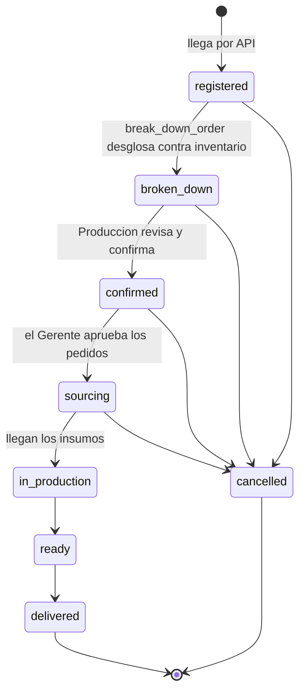

### PurchaseOrder

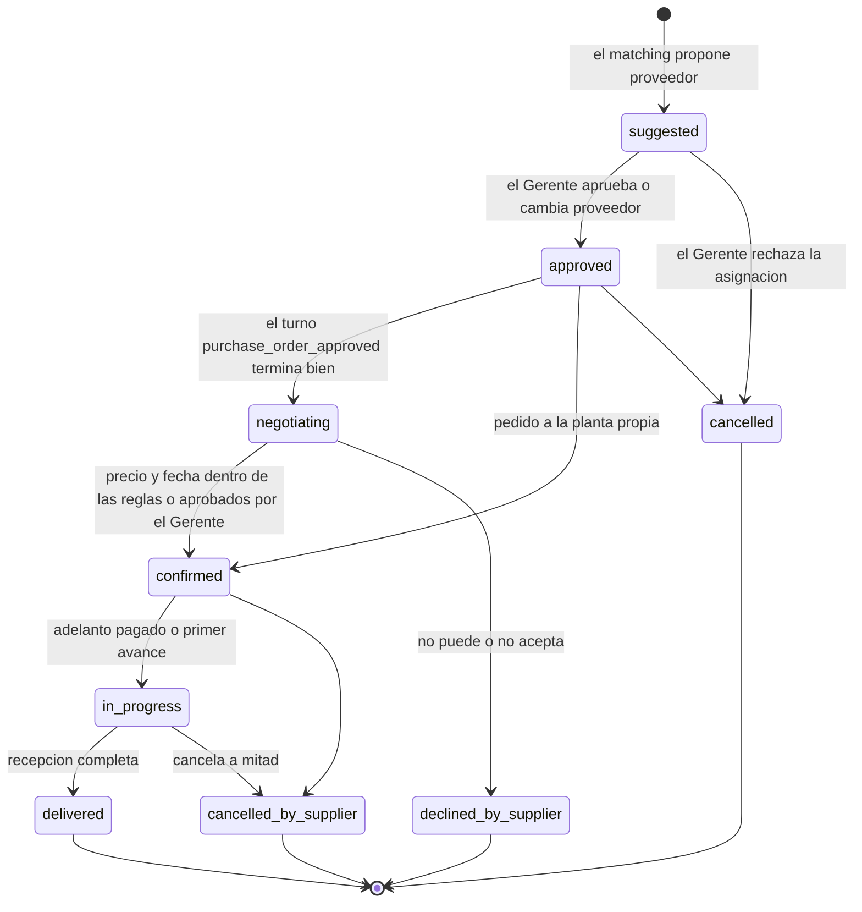

- Mientras haya una `Decision` `pending` sobre el pedido (precio o términos), sigue en `negotiating`; el dashboard lo muestra como "esperando al Gerente" (`waiting_manager`, calculado).
- Un pedido `approved` de un proveedor sin canal se queda ahí, con una `Alert` `no_channel`, hasta que el Gerente lo gestione.
- De `declined_by_supplier` y `cancelled_by_supplier`, `redistribute` devuelve al matching lo que falta del requerimiento, y nacen pedidos nuevos con `redistributed_from`.

### Decision

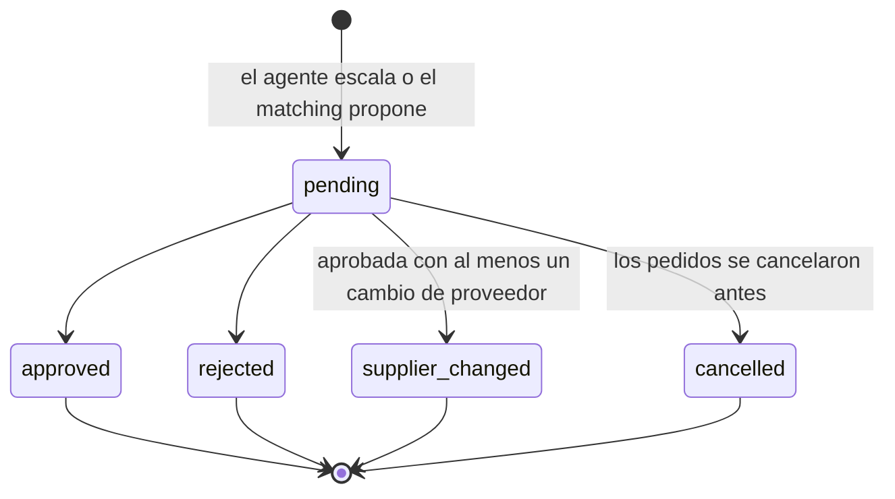

`communicated_at` se llena cuando un turno termina bien con esa decisión en su lote. No es un estado aparte.

### Turn

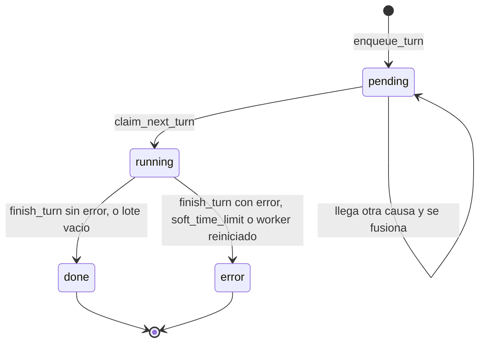

Una fila en `error` se vuelve a encolar con `enqueue_turn` (en un turno `pending` nuevo o en el que ya exista), heredando sus intentos. Al tercer intento fallido no se encola más y se crea una `Alert` `turn_failed`.

### Route

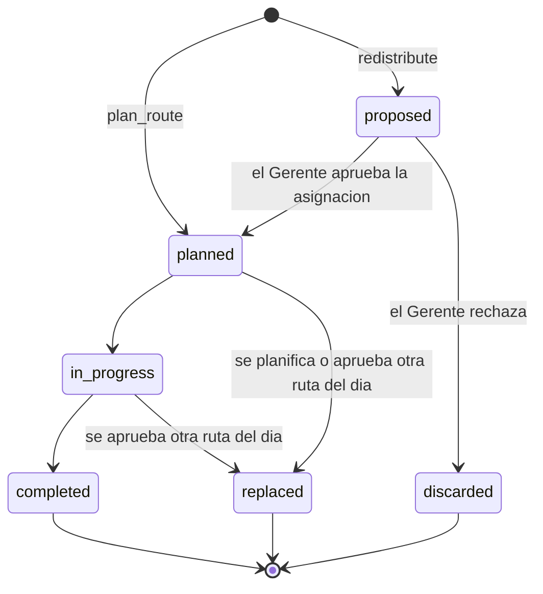

### OnboardingStyle

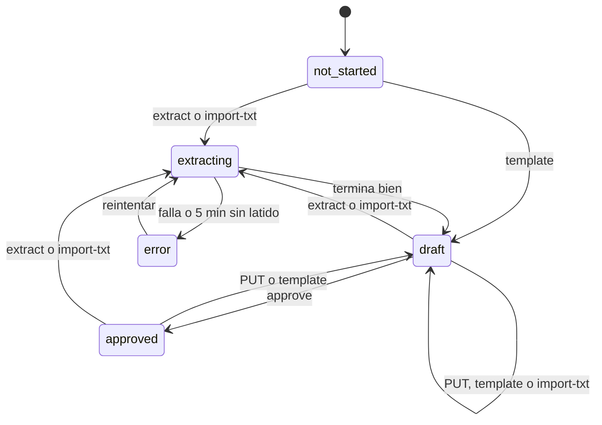

Lo aprobado no cambia hasta el próximo `approve`.

## Recorrido de la demo: un taller cancela a mitad

Los números (1000, 400 y 600) se fijan con el guion del pitch. El diagrama `taller-cancela` todavía dice 300 prendas.

1. `PurchaseOrder` T1 (taller, 1000 polos para Caja Piura) está `in_progress`, con un `ProgressReport` de 400 unidades. Todo viene del seed.
2. El taller escribe que no puede seguir. El webhook (o el simulador) guarda el `Message` y encola el turno. La tool `report_cancellation` llama a `cancel_by_supplier`: T1 pasa a `cancelled_by_supplier` y se registra la `Delivery` de las 400 que ya cosió, que la planta recoge.
3. `redistribute(T1)`: al `Requirement` le faltan 600 unidades. `match_requirements` las reparte entre talleres según `Rate`, capacidad, carga y puntajes, y crea T2 y T3 en `suggested`, con `redistributed_from = T1`, `rationale` y `scores`. Además crea la `Route` nueva en `proposed`, con `recalculated_from` apuntando a la vigente.
4. Se crea una `Decision` `approve_assignment` con `purchase_orders = [T2, T3]` y `detail = {before, after, proposal}`. La orden queda con `risk = in_danger` y una `Alert` `order_in_danger`; `notify_roles` avisa al Gerente (con la decisión y las cifras) y a Comercial (orden, cliente y fecha nueva, sin precios) por sus asistentes. La tarjeta "Redistribución" del dashboard muestra el antes y el después de la fecha estimada y del costo, y enlaza a `/routes?before=<id>&after=<id>` con las dos rutas.
5. El Gerente aprueba desde el Monitor (`POST /api/manager/decisions/<id>/ {action: "approve"}`) o pidiéndoselo a su asistente, que usa `resolve_decision` y deja una tarjeta `action` en el chat. `approve_purchase_orders` pasa T2 y T3 a `approved`, recalcula `estimated_on`, `critical_path` y `risk`, pasa la ruta `proposed` a `planned` (la anterior a `replaced`), y encola un `Turn` `purchase_order_approved` en la conversación de cada taller.
6. El agente escribe a los talleres de T2 y T3 (pasan a `negotiating`) y acuerda fechas. Con `confirm_purchase_order` quedan `confirmed`. Si la nueva `estimated_on` cumple `promised_on`, la orden sale de peligro y la alerta se resuelve.

## Criterios del jurado y dónde se cubren

| Criterio | Tablas |
|---|---|
| Registro de talleres con especialidad, capacidad, precios, calidad y cumplimiento | `Supplier`, `Rate`, puntajes calculados de `PurchaseOrder.rating` |
| Rating automático por entrega | `Delivery` → `PurchaseOrder.rating` → `supplier_scores` |
| Matching multicriterio con justificación | `PurchaseOrder.suggested_supplier`, `rationale` y `scores`; el ranking completo en `Decision.detail.proposal` |
| Dividir un pedido grande | varios `PurchaseOrderItem` sobre un mismo `Requirement` |
| Seguimiento de pedidos y pagos | `PurchaseOrder`, `ProgressReport`, `Payment` (P0: depositado y saldo por pedido y por proveedor), `Alert`, `Turn` `follow_up` y los avisos del asistente |
| Avance con fotos | `ProgressReport.photo`: por WhatsApp en base64, por el simulador, por el dashboard y por la página pública `/report/<token>` (P1) |
| Rutas multiparada en Piura | `Route`, `RouteStop`, `plan_route`; almacén, talleres y clientes con coordenadas; la redistribución recalcula también la ruta (ADR 0024) |
| Sugerir proveedores nuevos | Autoregistro público (P0) y tool `suggest_suppliers` (P1): `Supplier.source` (`self_registered`, `external`), `source_detail` y `status = pending_review` |

## Plan de implementación

El detalle por tarea (archivos, criterios de aceptación y estimados) está en `docs/planning.md`, sección B. Dos reglas de Oscar: cada PR trae los tests de lo que implementa, en `backend/tests/` con un `conftest.py` común, al menos uno por servicio (seed, rutas y proveedores incluidos), y el orquestador no mergea en rojo (`docker compose exec web pytest -q`). B1 es la puerta de todo: nada de `agente`, `personalidad` ni `disenador` se mergea antes.

Cada paso se revisa solo, en este orden:

1. **Proyecto:** sobre el `backend/Dockerfile`, el `pyproject.toml` y el `docker-compose.yml` de la raíz que ya están en `main` (ADR 0023). Django vive directo en `backend/` (`manage.py`, `config/` con `settings.py`, `urls.py` y `celery.py`). `core.User` antes de la primera migración, grupos por data migration, `TokenAuthentication`, drf-spectacular y settings: `ALLOWED_HOSTS` con `localhost`, `127.0.0.1`, `web` (el admin y la API entran por el rewrite de Next en desarrollo) y `corpotex.oscargicast.com`; `CSRF_TRUSTED_ORIGINS` con `http://localhost:3000`, `http://localhost:3001` y `https://corpotex.oscargicast.com`. Puertos de compose en loopback (sección 7). Sin `CLAUDE_CODE_OAUTH_TOKEN`: la cuenta se conecta desde el dashboard (ADR 0022).
2. **Todos los modelos de una vez** (P0 y P1), con admin y una migración por app. El PR B1 junta los pasos 1 y 2 más el reloj, `recover_stuck_turns` en `worker_ready` y un pytest que pase; su criterio es `docker compose up --build` con los 6 servicios arriba y `pytest -q` en verde.
3. **Seed:** el comando `seed_demo` con el formato de la sección 8, un JSON mínimo de prueba mientras llegan los de Kenji, un token por usuario y `Config.agent_user` = Gerente.
4. **Servicios de operaciones:** desglose, matching, ruta crítica, aprobación, confirmación con reglas de jefe, avance, entrega, cancelación, redistribución, pagos y `plan_route`.
5. **Mensajería:** webhook con allowlist, `send_text`, la cola de turnos con `run_turn` en Celery, `turn_state` y la API del asistente.
6. **Gerencia:** decisiones, alertas, `notify_roles`, monitor, `tick` y los endpoints del Gerente; servicios con `actor` para las tools del asistente.
7. **API del dashboard y contrato en `docs/api/`**, con los JSON de ejemplo, los serializers por rol y `/api/me/badges/`.
8. **Onboarding y estilo:** conexión de Claude (`core/claude_auth.py`), WhatsApp y alta de proveedores. La extracción, el historial de versiones y `refresh_style` los implementa la sesión `personalidad` en `core/views_style.py`, `core/onboarding.py`, `core/style.py` y `core/tasks_style.py`.
9. **P1:** `/api/report/<token>/` con `send_report_link`, `create_suggested_suppliers` para la tool `suggest_suppliers`, y `POST /api/style/refresh/`.

## Preguntas abiertas

1. ~~¿Cuál es la tercera marca?~~ Resuelto: las marcas son UNICRACK (uniformes escolares, incluye deportivos), NEXO (ropa de trabajo de alto rendimiento) y Línea Médica Corpotex.
2. ¿Un proveedor puede vender insumos y además confeccionar? Propuesta: un solo `kind` por proveedor.
3. ~~¿Las rutas entran en el alcance?~~ Resuelto dos veces: no (ADR 0015) y después sí (ADR 0024, por el criterio 6 del jurado).
4. ~~Faltan los PDFs de ejemplo de Comercial.~~ Resuelto: no habrá PDFs. El seed inventa las órdenes con el formato de la sección 8.
5. ~~¿Cuántas horas simuladas sin resolver una decisión disparan `decision_pending`?~~ Resuelto: 12 (`Config.decision_pending_hours`, con ese valor por defecto).
