# Modelo de datos del backend (planning)

Estado: propuesta revisada el 10/10 con lo acordado entre sesiones. No hay nada implementado.

Fuentes: `CLAUDE.md` y `docs/adr/`: Django + DRF (0002), Postgres (0005), monorepo (0008), API (0009), cola de turnos (0010), onboarding (0011), suscripción (0013), código en inglés (0014), sin rutas (0015), celulares en `AllowedNumber` (0016), asistente del tablero (0017, reemplaza al 0007 del Pana), Celery y Redis (0018) y estilo por usuario (0019).

**Idioma (ADR 0014):** todo el código va en inglés: apps, modelos, campos, valores de `choices`, servicios, excepciones, URLs y claves JSON de la API. Siguen en español este documento y lo que lee una persona: `verbose_name`, los `*_display` de la API, el admin, el tablero y los mensajes de WhatsApp.

## Equivalencias español → inglés

El orquestador fijó `Order`, `PurchaseOrder` y `Supplier`, y las tools del agente. El resto de los nombres los fija esta tabla. `docs/glosario.md` la junta con las tools del agente y las funciones de `personalidad`.

### Apps y modelos

| App | Modelos |
|---|---|
| `core` → `core` | `Usuario` → `User`, `Configuracion` → `Config`, `Marca` → `Brand`, `Cliente` → `Customer`, `Producto` → `Product`, `Insumo` → `Material`, `ProductoInsumo` → `ProductMaterial`, `OnboardingEstilo` → `OnboardingStyle` (nuevo), `VersionEstilo` → `StyleVersion` (nuevo) |
| `proveedores` → `suppliers` | `Proveedor` → `Supplier`, `Tarifa` → `Rate`. `Calificacion` desaparece: pasa a campos `rating_*` de `PurchaseOrder` |
| `operaciones` → `operations` | `Orden` → `Order`, `OrdenItem` → `OrderItem`, `Requerimiento` → `Requirement`, `Pedido` → `PurchaseOrder`, `PedidoItem` → `PurchaseOrderItem`, `Avance` → `ProgressReport`, `Entrega` → `Delivery`, `Pago` → `Payment`. `Ruta` y `ParadaRuta` no van (ADR 0015) |
| `mensajeria` → `messaging` | `NumeroPermitido` → `AllowedNumber`, `Conversacion` → `Conversation`, `Mensaje` → `Message`, `Turno` → `Turn` (nuevo) |
| `gerencia` → `manager` (no `management`, que choca con `management/commands/` de Django) | `Decision` → `Decision`, `Alerta` → `Alert` |
| `agente` → `agent` | Sin modelos: tareas de Celery, tools y prompts del agente de WhatsApp y del asistente. Runtime del SDK en `backend/.agent/` (gitignored) |

Roles: los grupos de Django se llaman `Gerente`, `Comercial` y `Produccion`, porque el nombre del grupo es una etiqueta del admin. En código y en la API son `role: manager | sales | production`.

### Campos

Sufijos: `*_on` para fechas (`date`) y `*_at` para fecha con hora (`datetime`). Auditoría en todas las tablas: `creado_en` → `created_at`, `actualizado_en` → `updated_at`.

| Modelo | Español → inglés |
|---|---|
| `User` | `username`, `password`, `first_name` e `is_staff` no cambian. Rol → `role` (propiedad que sale del grupo). `estilo_md` → `style_md` (nuevo; reemplaza a `Config.estilo_gerente`, ADR 0019), `estilo_refrescado_en` → `style_refreshed_at` (nuevo) |
| `Config` | `reloj_inicio_real` → `clock_real_start`, `reloj_inicio_simulado` → `clock_sim_start`, `reloj_factor` → `clock_factor`, `reloj_pausado` → `clock_paused`, `colchon_dias` → `buffer_days`, `duraciones_etapa` → `stage_durations` (nuevo), `onboarding` → `onboarding` (nuevo), `usuario_agente` → `agent_user` (nuevo). `estilo_gerente` pasa a `User.style_md` (ADR 0019) |
| `Brand` | `nombre` → `name`, `descripcion` → `description` |
| `Customer` | `nombre` → `name`, `ruc` → `tax_id`, `tipo` → `kind`, `contacto_nombre` → `contact_name`, `telefono` → `phone` |
| `Product` | `codigo` → `code`, `nombre` → `name`, `categoria` → `category`, `imagen` → `image` |
| `Material` | `codigo` → `sku` (código interno de Corpotex), `nombre` → `name`, `tipo` → `kind`, `unidad` → `unit`, `stock` → `stock` |
| `ProductMaterial` | `producto` → `product`, `insumo` → `material`, `cantidad_por_unidad` → `qty_per_unit` |
| `Order` | `codigo` → `code`, `cliente` → `customer`, `marca` → `brand`, `responsable` → `owner`, `estado` → `status`, `etapa_produccion` → `production_stage`, `fecha_emision` → `issued_on`, `fecha_entrega_prometida` → `promised_on`, `fecha_estimada` → `estimated_on`, `ruta_critica` → `critical_path`, `riesgo` → `risk`, `riesgo_motivo` → `risk_reason`, `monto_total` → `total_amount`, `ficha` → `spec_sheet`, `origen` → `source` |
| `OrderItem` | `orden` → `order`, `producto` → `product`, `cantidad` → `quantity`, `tallas` → `sizes`, `color` → `color`, `personalizacion` → `customization`, `precio_unitario` → `unit_price` |
| `Requirement` | `orden` → `order`, `tipo` → `kind`, `insumo` → `material`, `producto` → `product`, `cantidad_necesaria` → `qty_needed`, `cantidad_de_stock` → `qty_from_stock`, `cantidad_a_pedir` → `qty_to_order`, `estado` → `status` |
| `Supplier` | `nombre` → `name`, `tipo` → `kind`, `especialidades` → `specialties`, `contacto_nombre` → `contact_name`, `ciudad` → `city`, `direccion` → `address`, `es_propio` → `is_in_house` (nuevo), `capacidad_semanal` → `weekly_capacity`, `lead_time_dias` → `lead_time_days`, `frecuencia_consulta_horas` → `follow_up_every_hours`, `metodo_pago` → `payment_method`, `origen` → `source`, `estado` → `status`, `puntaje_cumplimiento` → `on_time_score`, `puntaje_calidad` → `quality_score`, `notas` → `notes`. `telefono_whatsapp` se elimina (ADR 0016): los celulares viven en `AllowedNumber`. En la API, `whatsapp_activo` se reemplaza por `numbers` (solo Gerente), `numbers_count` y `active_numbers_count` |
| `Rate` | `proveedor` → `supplier`, `insumo` → `material`, `producto` → `product`, `precio_unitario` → `unit_price`, `moneda` → `currency`, `vigente_desde` → `valid_from`, `fuente` → `source` |
| `PurchaseOrder` | `codigo` → `code`, `proveedor` → `supplier`, `conversacion` → `conversation` (nuevo), `tipo` → `kind`, `estado` → `status`, `proveedor_sugerido` → `suggested_supplier`, `justificacion` → `rationale`, `puntajes` → `scores`, `candidatos` → `candidates` (nuevo), `cambiado_por_gerente` → `changed_by_manager`, `redistribuido_de` → `redistributed_from`, `fecha_limite_interna` → `internal_due_on`, `fecha_comprometida` → `committed_on`, `fecha_entrega_real` → `delivered_on`, `unidades_completadas` → `units_done`, `ultimo_avance_en` → `last_progress_at`, `proxima_consulta_en` → `next_follow_up_at`, `seguimiento_solicitado_en` → `follow_up_requested_at` (nuevo), `monto_total` → `total_amount`, `moneda` → `currency`, `condiciones` → `terms`, `aprobado_por` → `approved_by`. De `Calificacion`: `dias_retraso` → `rating_delay_days`, `calidad` → `rating_quality`, `merma_pct` → `rating_defect_pct`, `precio_vs_referencia_pct` → `rating_price_vs_ref_pct`, `puntaje` → `rating_score`, `calificado_en` → `rated_at` |
| `PurchaseOrderItem` | `pedido` → `purchase_order`, `requerimiento` → `requirement`, `cantidad` → `quantity`, `precio_unitario` → `unit_price`, `cantidad_entregada` → `qty_delivered` |
| `ProgressReport` | `pedido` → `purchase_order`, `unidades_completadas` → `units_done`, `nota` → `note`, `foto` → `photo`, `origen` → `source`, `mensaje` → `message`, `reportado_en` → `reported_at` |
| `Delivery` | `pedido` → `purchase_order`, `cantidad_recibida` → `qty_received`, `cantidad_defectuosa` → `qty_defective`, `calidad` → `quality`, `recibido_por` → `received_by`, `recibido_en` → `received_at`, `nota` → `note` |
| `Payment` | `pedido` → `purchase_order`, `tipo` → `kind`, `monto` → `amount`, `metodo` → `method`, `estado` → `status`, `fecha_programada` → `due_on`, `pagado_en` → `paid_at`, `comprobante` → `receipt`, `requiere_factura` → `invoice_required`, `numero_factura` → `invoice_number`, `registrado_por` → `recorded_by` |
| `AllowedNumber` | `telefono` → `phone`, `lid` (nuevo), `nombre` → `name`, `rol` → `role`, `proveedor` → `supplier`, `activo` → `active` |
| `Conversation` | `canal` → `channel`, `numero` → `allowed_number` (nuevo; reemplaza a `telefono` y `proveedor`, que salen de él), `usuario` → `user` (nuevo, solo `dashboard`), `sesion_agente` → `agent_session`, `accion_pendiente` → `pending_action` (nuevo), `estado` → `status`, `ultimo_mensaje_en` → `last_message_at` |
| `Message` | `conversacion` → `conversation`, `direccion` → `direction`, `autor` → `author`, `texto` → `text`, `media` → `media`, `media_tipo` → `media_type`, `id_externo` → `external_id`, `payload` → `payload`, `estado` → `status`, `error` → `error`, `enviado_en` → `sent_at`, `turno` → `turn` (nuevo), `accion` → `action` (nuevo), `contexto` → `context` (nuevo) |
| `Turn` (nuevo) | `conversacion` → `conversation`, `motivo` → `reason`, `decision` → `decision`, `estado` → `status`, `intentos` → `attempts`, `error` → `error`, `disponible_en` → `available_at` |
| `Decision` | `tipo` → `kind`, `estado` → `status`, `pedidos` → `purchase_orders` (M2M; reemplaza a la FK `pedido`), `orden` → `order`, `conversacion` → `conversation`, `resumen` → `summary`, `detalle` → `detail`, `proveedor_nuevo` → `new_supplier`, `nota` → `note`, `resuelta_por` → `resolved_by`, `resuelta_en` → `resolved_at`, `canal` → `channel`, `comunicada_en` → `communicated_at` (nuevo). Se quitan `accion` y `notificada_pana_en` (ADR 0017) |
| `Alert` | `tipo` → `kind`, `severidad` → `severity`, `estado` → `status`, `orden` → `order`, `pedido` → `purchase_order`, `mensaje` → `text`, `detectada_en` → `detected_at`, `resuelta_en` → `resolved_at`. Se quita `notificada_pana_en` (ADR 0017) |
| `OnboardingStyle` (nuevo) | `estado` → `status`, `desde` → `since`, `paso` → `step`, `progreso` → `progress`, `borrador_boss_md` → `draft_boss_md`, `borrador_notas` → `draft_notes`, `transcript_temporal` → `temp_transcript`, `latido` → `heartbeat_at`, `error` → `error`, `aprobado_en` → `approved_at` |
| `StyleVersion` (nuevo) | `usuario` → `user`, `estilo_md` → `style_md`, `notas` → `notes_snapshot`, `origen` → `source`, `cambios` → `changelog` |

### Valores de `choices`

| Campo | Español → inglés |
|---|---|
| `User.role` | gerente → `manager`, comercial → `sales`, produccion → `production` |
| `Customer.kind` | empresa → `company`, colegio → `school`, ong → `ngo`, persona → `individual` |
| `Material.kind` | tela → `fabric`, boton → `button`, cierre → `zipper`, cuello_puno → `collar_cuff`, otro → `other` |
| `Material.unit` | m → `m`, kg → `kg`, unidad → `unit` |
| `Order.status` | registrada → `registered`, desglosada → `broken_down`, confirmada → `confirmed`, en_abastecimiento → `sourcing`, en_produccion → `in_production`, lista → `ready`, entregada → `delivered`, cancelada → `cancelled` |
| `Order.production_stage` | corte → `cutting`, sublimado → `sublimation`, bordado → `embroidery`, costura → `sewing`, acabado → `finishing` |
| `Order.risk` | ok → `ok`, en_riesgo → `at_risk`, en_peligro → `in_danger` |
| `Order.source` | api, pdf y manual no cambian |
| `OrderItem.customization` | bordado → `embroidery`, estampado → `print`, sublimado → `sublimation` |
| `Order.critical_path[]` | tipo → `kind`: insumo → `material`, taller → `workshop`, produccion → `production`, entrega → `delivery`. estado → `status`: pendiente → `pending`, en_curso → `in_progress`, hecho → `done`, atrasado → `late` |
| `Requirement.kind`, `Supplier.kind`, `PurchaseOrder.kind` | insumo/insumos → `material`, taller → `workshop`, terminado → `finished` |
| `Requirement.status` | pendiente → `pending`, cubierto → `covered`, pedido → `ordered` |
| `Supplier.source` | registrado → `registered`, autoregistro → `self_registered`, sugerido → `suggested` |
| `Supplier.status` | activo → `active`, por_revisar → `pending_review`, inactivo → `inactive` |
| `Supplier.payment_method`, `Payment.method` | yape → `yape`, transferencia → `transfer`, efectivo → `cash` |
| `Rate.currency`, `PurchaseOrder.currency` | `PEN` y `USD` no cambian |
| `Rate.source` | historico → `historical`, cotizacion → `quote`, negociado → `negotiated` |
| `PurchaseOrder.status` | sugerido → `suggested`, aprobado → `approved`, en_negociacion → `negotiating`, confirmado → `confirmed`, en_proceso → `in_progress`, entregado → `delivered`, rechazado_proveedor → `declined_by_supplier`, cancelado_proveedor → `cancelled_by_supplier`, cancelado → `cancelled` |
| `ProgressReport.source` | whatsapp, web y manual no cambian |
| `Payment.kind` | adelanto → `advance`, saldo → `balance` |
| `Payment.status` | pendiente → `pending`, pagado → `paid` |
| `AllowedNumber.role` | proveedor → `supplier`, equipo → `team`, gerente → `manager` |
| `Conversation.channel` | whatsapp → `whatsapp`, simulador → `simulator`, tablero → `dashboard` (nuevo, asistente) |
| `Conversation.status` | activa → `active`, en_pausa → `paused`, cerrada → `closed` |
| `Message.direction` | entrante → `inbound`, saliente → `outbound` |
| `Message.author` | proveedor → `supplier`, agente → `agent`, gerente → `manager`, usuario → `user` (nuevo, persona del tablero). Se quita `sistema`. En la API del asistente sale como `role`: `user` → `user`, `agent` → `assistant` |
| `Message.media_type` | imagen → `image`, audio → `audio`, documento → `document` |
| `Message.status` | recibido → `received`, procesado → `processed`, ignorado → `ignored`, error → `error`, enviado → `sent`, fallido → `failed`. Se quita `procesando`: "escribiendo…" sale de `Turn` |
| `Turn.reason` | mensaje → `message`, decision → `decision`, seguimiento → `follow_up`, pedido_aprobado → `purchase_order_approved` |
| `Turn.status` | pendiente → `pending`, en_curso → `running`, hecho → `done`, error → `error` |
| `Decision.kind` | aprobar_asignacion → `approve_assignment`, precio → `price`, terminos → `terms`, otro → `other` |
| `Decision.status` | pendiente → `pending`, aprobada → `approved`, rechazada → `rejected`, proveedor_cambiado → `supplier_changed`, cancelada → `cancelled` |
| `Decision.channel` | tablero → `dashboard`, asistente → `assistant` (nuevo), admin → `admin`. Se quita `pana` |
| `Alert.kind` | pedido_estancado → `stalled_purchase_order`, retraso → `delay`, orden_en_peligro → `order_in_danger`, sin_respuesta → `no_response`, pago_pendiente → `payment_due`, instancia_caida → `instance_down`, sin_canal → `no_channel` (nuevo), turno_fallido → `turn_failed` (nuevo), refresco_estilo_fallido → `style_refresh_failed` (nuevo) |
| `Alert.severity` | info → `info`, advertencia → `warning`, critica → `critical` |
| `Alert.status` | abierta → `open`, reconocida → `acknowledged`, resuelta → `resolved` |
| `OnboardingStyle.status` | sin_iniciar → `not_started`, extrayendo → `extracting`, borrador → `draft`, aprobado → `approved`, error → `error` |
| `OnboardingStyle.step` | proveedores → `suppliers`, juntando → `merging` |
| `StyleVersion.source` | onboarding → `onboarding`, diario → `daily`, plantilla → `template`, manual → `manual`, vuelta_atras → `rollback` |
| Estado por proveedor en `OnboardingStyle.progress` | pendiente → `pending`, leyendo → `reading`, analizando → `analyzing`, listo → `done`, sin_celular → `no_phone`, sin_chat → `no_chat`, no_permitido → `not_allowed`, error → `error` |

### Servicios y excepciones

Son sync; el agente los envuelve con `sync_to_async`. Los que tienen reglas de permiso reciben `actor` como keyword obligatorio y sin valor por defecto: un `User`, o `None` cuando los llama el sistema (el agente de WhatsApp, el matching o el tick), que lo pasa a propósito. Así, si una tool del asistente se olvida de pasarlo, falla con `TypeError` en vez de correr con permisos de sistema. Lo chequean con `require_role(actor, *roles)`, que lanza `PermissionDenied`.

| Español | Inglés | Módulo |
|---|---|---|
| `reloj.ahora()` | `clock.now()` | `core/clock.py` |
| `encolar_turno(conversacion, motivo, decision=None)` | `enqueue_turn(conversation, reason, decision=None)` | `messaging/services.py` |
| `tomar_siguiente_turno()` | `claim_next_turn(conversation_id=None) -> TurnBatch \| None` | `messaging/services.py` |
| `LoteTurno {turno, mensaje_ids, decision_ids, seguimiento_pedido_ids, nuevo_pedido_ids}` | `TurnBatch {turn, message_ids, decision_ids, follow_up_purchase_order_ids, new_purchase_order_ids}` | `messaging/services.py` |
| `terminar_turno(lote, sesion_id, error=None)` | `finish_turn(batch, session_id, error=None)` | `messaging/services.py` |
| `recuperar_turnos_colgados()` | `recover_stuck_turns()` | `messaging/services.py` |
| `estado_turno(lote)` | `turn_state(batch) -> dict` | `messaging/services.py` |
| Estado del turno del asistente | `assistant_turn_state(batch) -> dict` | `messaging/services.py` |
| `historial(conversacion, limite=20)` | `message_history(conversation, limit=20)` | `messaging/services.py` |
| `enviar_texto(conversacion, texto, turno)` | `send_text(conversation, text, turn)` | `messaging/services.py` |
| `pedido_de_conversacion(conversacion, codigo)` | `purchase_order_for_conversation(conversation, code)` | `messaging/services.py` |
| Acción del asistente | `record_assistant_action(conversation, turn, action)` | `messaging/services.py` |
| `evolution.enviar_texto` (cliente HTTP) | `evolution.send_text(phone, text)` | `messaging/evolution.py` |
| Lectura de chats para el estilo | `evolution.find_messages(jid, since)` | `messaging/evolution.py` |
| Instancia (onboarding) | `evolution.connection_state()`, `find_webhook()`, `find_settings()`, `connect()`, `set_webhook()`, `set_settings()` | `messaging/evolution.py` |
| Desglose | `break_down_order(order)` | `operations/services.py` |
| Comercial registra una orden | `register_order(payload, *, actor)` | `operations/services.py` |
| Producción confirma | `confirm_order(order, *, actor)` | `operations/services.py` |
| Matching | `match_requirements(requirements)` | `operations/services.py` |
| Ruta crítica | `compute_critical_path(order)` | `operations/services.py` |
| `aprobar_pedidos` | `approve_purchase_orders(purchase_orders, approved_by)` | `operations/services.py` |
| `confirmar_pedido` | `confirm_purchase_order(purchase_order, *, unit_price, committed_on, terms)` | `operations/services.py` |
| `registrar_avance` | `record_progress(purchase_order, *, units_done, note="", message_id=None, photo=None, actor)` | `operations/services.py` |
| Registrar entrega | `record_delivery(purchase_order, *, qty_received, qty_defective, quality, note="", actor)` | `operations/services.py` |
| Marcar pago | `mark_payment_paid(payment, *, method, receipt=None, actor)` | `operations/services.py` |
| `cancelar_por_proveedor` | `cancel_by_supplier(purchase_order, *, reason, units_done=None)` | `operations/services.py` |
| `redistribuir` | `redistribute(purchase_order)` | `operations/services.py` |
| `crear_decision` | `create_decision(*, kind, purchase_orders, summary, detail, conversation=None, order=None)` | `manager/services.py` |
| `resolver_decision` | `resolve_decision(decision, *, action, supplier_id=None, purchase_order_id=None, note="", channel, actor)` | `manager/services.py` |
| Reconocer alerta | `acknowledge_alert(alert, *, actor)` | `manager/services.py` |
| Monitor | `run_monitor()` | `manager/services.py` |
| `tick()` | `tick()` | `manager/services.py` |
| Mover el reloj | `set_clock(*, factor=None, paused=None, advance_hours=None, actor)` | `core/clock.py` |
| Permisos | `require_role(actor, *roles)` | `core/permissions.py` |
| Extracción de estilo (onboarding) | `run_style_extraction()` | `core/onboarding.py` |
| Estilo por usuario | `approve_style(onboarding_style, *, actor)`, `restore_style_version(version, *, actor)`, `refresh_style(user)` | `core/style.py` |
| Tareas de Celery | `run_turn(conversation_id)`, `tick`, `run_style_extraction`, `refresh_style` | `agent/tasks.py`, `manager/tasks.py`, `core/tasks.py` |
| `ReglaDeJefe(motivo)` | `ManagerApprovalRequired(reason)` | `operations/exceptions.py` |
| `NumeroNoPermitido` | `NumberNotAllowed` | `messaging/exceptions.py` |
| `EnvioFallido` | `SendFailed` | `messaging/exceptions.py` |
| `PedidoAjeno` | `ForeignPurchaseOrder` | `messaging/exceptions.py` |
| Rol insuficiente | `PermissionDenied` (de Django) | lo lanza `require_role` |

### URLs de la API

Todas con barra final (ADR 0009). Los filtros también van en inglés (`?status=`, `?risk=`, `?brand=`, `?kind=`, `?order=`, `?supplier=`, `?waiting_manager=1`, `?source=`).

| Español | Inglés |
|---|---|
| `/api/auth/login/`, `/api/auth/logout/`, `/api/auth/me/` | no cambian |
| `/api/reloj/` (GET, PATCH) | `/api/clock/` |
| `/api/monitor/` | no cambia |
| `/api/gerente/pendientes/` | `/api/manager/pending/` |
| `/api/gerente/decisiones/<id>/` (POST) | `/api/manager/decisions/<id>/` |
| `/api/ordenes/`, `/api/ordenes/<id>/`, `/api/ordenes/<id>/confirmar/` | `/api/orders/`, `/api/orders/<id>/`, `/api/orders/<id>/confirm/` |
| `/api/pedidos/`, `/api/pedidos/<id>/` | `/api/purchase-orders/`, `/api/purchase-orders/<id>/` |
| Entregas y avances desde el tablero (nuevo) | `/api/purchase-orders/<id>/deliveries/` (POST), `/api/purchase-orders/<id>/progress/` (POST, multipart con foto) |
| `/api/pagos/<id>/pagar/` | `/api/payments/<id>/pay/` |
| `/api/alertas/<id>/reconocer/` | `/api/alerts/<id>/acknowledge/` |
| `/api/proveedores/`, `/api/proveedores/<id>/`, `/api/proveedores/importar/`, `/api/proveedores/autoregistro/` | `/api/suppliers/`, `/api/suppliers/<id>/`, `/api/suppliers/import/`, `/api/suppliers/self-register/` |
| Números del proveedor (nuevo, ADR 0016) | `/api/suppliers/<id>/numbers/` (POST), `/api/suppliers/<id>/numbers/<number_id>/` (PATCH) |
| `/api/simulador/contactos/`, `/api/simulador/mensajes/` | `/api/simulator/contacts/`, `/api/simulator/messages/` |
| `/api/conversaciones/<id>/mensajes/?desde=<id>` | `/api/conversations/<id>/messages/?after=<id>` |
| `/api/onboarding/whatsapp/`, `.../qr/`, `.../webhook/` | no cambian |
| `/api/onboarding/estilo/` (GET, PUT), `extraer/`, `importar-txt/`, `base/`, `aprobar/` | `/api/onboarding/style/`, `extract/`, `import-txt/`, `template/`, `approve/` |
| `/webhooks/evolution/<secreto>/` | `/webhooks/evolution/<secret>/` (la URL no cambia) |
| Asistente (nuevo, ADR 0017) | `/api/assistant/messages/?after=<id>` (GET), `/api/assistant/messages/` (POST), `/api/assistant/reset/` (POST) |
| Estilo (nuevo, ADR 0019) | `/api/style/versions/`, `/api/style/versions/<id>/`, `/api/style/versions/<id>/restore/` (POST). P1: `/api/style/refresh/` (POST) |
| `/api/schema/` | no cambia |

Claves JSON: las de los modelos. Cada `status` o `kind` viaja con su `status_display` o `kind_display`, que es el texto en español.

### Sin Pana ni Kenji (ADR 0017)

Se eliminan el contrato con Kenji, `notify_pana` y los `pana_notified_at`. Los avisos para el Gerente salen en el Monitor y en el contador del menú (kpis de `/api/monitor/`). La decisión se resuelve con `{action: approve | reject | change_supplier, supplier_id?, purchase_order_id?, note?, channel?}` (sección 4).

## Resumen

- 6 apps de Django, 25 modelos y 26 tablas propias: la 26.ª es la intermedia de `Decision.purchase_orders`. No cuenta las de Django, DRF y Celery (grupos, tokens, sesiones). El conteo anterior (24) estaba mal: eran 25. Desde entonces se quitó `Calificacion`, entraron `Turn` y `OnboardingStyle`, salieron `Route` y `RouteStop` (ADR 0015) y entró `StyleVersion` (ADR 0019).
- Todos los modelos se crean de una vez, P0 y P1 juntos. P1 queda como lógica y endpoints, no como tablas, para que el frontend tenga el contrato completo desde el principio.
- Las fechas del negocio usan el reloj simulado (acelerado), no la hora real. Las excepciones son los tiempos de WhatsApp y de la cola, que van en hora real.
- Las escalaciones al Gerente son filas de `Decision`. Una decisión puede cubrir un lote de pedidos.
- Hay dos agentes sobre la misma cola de turnos (`Turn`), uno a la vez por conversación: el de WhatsApp, que escribe por el Gerente con su estilo, y el asistente del tablero, uno por usuario y con tools según su rol (ADR 0017).
- Todo el trabajo en segundo plano corre en Celery con Redis, y `Turn` sigue siendo la fuente de verdad de la cola (ADR 0018).
- Los mensajes de números que no están activos en la allowlist no se guardan: la instancia `corpotex` recibe todo lo que llega al número de Oscar, familia incluida.

## Convenciones

| Tema | Regla |
|---|---|
| Claves | `id` bigint autoincremental en todas las tablas. Los diagramas muestran las FK como `<nombre>_id`; en Django el campo se llama `<nombre>`. |
| Auditoría | Todas las tablas tienen `created_at` y `updated_at` en hora real. Los diagramas los omiten. |
| Fechas de negocio | Todo `*_on` y todo `*_at` del dominio se escribe con `clock.now()` (hora simulada). Excepciones en hora real: `Message.sent_at`, `Turn.available_at`, `OnboardingStyle.since`, `OnboardingStyle.heartbeat_at` y `User.style_refreshed_at`. |
| Dinero | `Decimal(12, 2)`. Moneda `PEN` por defecto; `USD` solo para el proveedor de México, sin conversión automática. |
| Estados | `TextChoices` con valor en inglés y etiqueta en español. Las transiciones viven en servicios, no en `save()`. |
| Borrado | No se borra: se pasa a `cancelled` o `inactive`. |
| Teléfonos | Formato del JID de WhatsApp, sin `+` (ej. `51900000000`). |
| Permisos | Por rol, en dos capas: los servicios chequean `require_role(actor, ...)`, y la lectura pasa por serializers por rol, que usan también las tools del asistente. El modelo no puede conseguir más permisos pidiéndolos. Precios, pagos y celulares (`AllowedNumber.phone`, `numbers`) solo los ve el Gerente. A `sales` y `production` tampoco les llega texto libre donde se cuelan precios o teléfonos: `PurchaseOrder.terms`, `rationale` y `candidates`, `Decision.summary` y `detail`, `Supplier.notes` y el texto de los mensajes de WhatsApp; ven estados, fechas, cantidades y nombres. `Alert.text` sale de plantillas sin precios ni teléfonos, así que lo ven todos. El simulador lista contactos sin teléfono. |
| Servicios | Las vistas, el webhook, las tools de los dos agentes y las tareas de Celery llaman a `backend/*/services.py`. Nadie más escribe modelos directo. |
| API | FKs anidadas como `{id, name}` o `{id, code}`. Listas sin paginación. URLs de archivos relativas (`/media/...`). Fechas ISO con zona `America/Lima`. |

## Apps

| App | Modelos | Responsabilidad |
|---|---|---|
| `core` | `User`, `Config`, `Brand`, `Customer`, `Product`, `Material`, `ProductMaterial`, `OnboardingStyle`, `StyleVersion` | Usuarios y roles, reloj, catálogo, inventario, onboarding y estilo por usuario |
| `suppliers` | `Supplier`, `Rate` | Registro de proveedores y talleres, precios históricos, puntajes |
| `operations` | `Order`, `OrderItem`, `Requirement`, `PurchaseOrder`, `PurchaseOrderItem`, `ProgressReport`, `Delivery`, `Payment` | Órdenes de clientes, desglose, pedidos a proveedores, calificación y pagos |
| `messaging` | `AllowedNumber`, `Conversation`, `Message`, `Turn` | Allowlist, chats de WhatsApp, simulador y asistente, webhook, cola de turnos y envío por Evolution |
| `manager` | `Decision`, `Alert` | Pendientes del Gerente, monitor y tick |
| `agent` | sin modelos | Tarea `run_turn`, tools y prompts del agente de WhatsApp y del asistente (sesión `agente`); `agent/persona/` es de la sesión `personalidad` |

## Vista general

Solo relaciones; los campos están en las secciones siguientes.

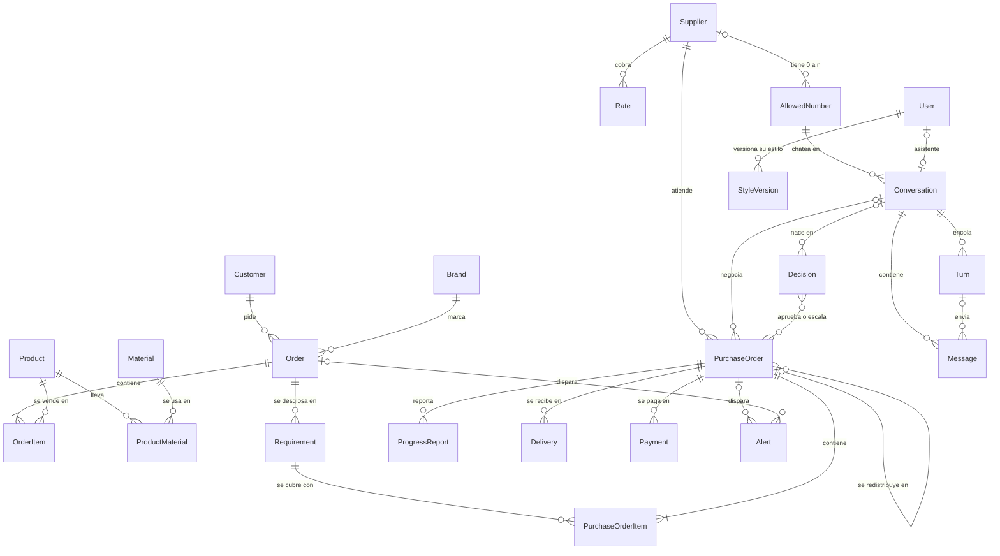

## 1. Catálogo y órdenes de clientes

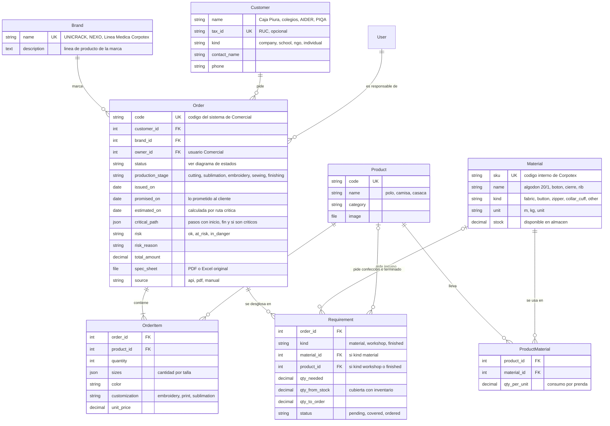

- **Entrada:** `POST /api/orders/` es la API simulada del sistema de Comercial. Es idempotente por `code` y la usa el botón "Simular orden de Comercial" del tablero. `docs/api/` trae 3 payloads de ejemplo (Caja Piura, un colegio, AIDER) con productos y tallas del seed.
- **Desglose (`break_down_order`, paso 1 del flujo):** por cada `OrderItem`, `quantity` × `ProductMaterial.qty_per_unit`, menos `Material.stock`, da un `Requirement` de kind `material`. La costura genera uno de kind `workshop` (el matching decide si va a la planta o a un taller externo) y la tercerización completa uno de kind `finished`.
- **Cantidad cubierta de un `Requirement`:** lo entregado por pedidos cancelados (`qty_delivered` de sus `PurchaseOrderItem`) más la `quantity` de los pedidos vivos. Así cuentan las unidades que un taller ya hizo antes de cancelar.
- **`critical_path`** es una foto en JSON del último cálculo, para mostrarla en el tablero: `[{id, name, kind, start, end, critical, status, purchase_order_id}]`. Se recalcula cuando cambia un pedido; no hace falta una tabla de tareas.
- **Ruta crítica (`compute_critical_path`):** la fecha de llegada de los insumos (`committed_on`, o `internal_due_on` si todavía no hay compromiso), más las etapas en planta según `Config.stage_durations`, más la costura (en planta según `stage_durations`, o en taller según su `committed_on`), más el acabado, da `estimated_on`. Si `estimated_on` pasa de `promised_on`, `risk` sube.
- **`risk`** lo actualiza el monitor y es independiente de `status`.

## 2. Proveedores y pedidos

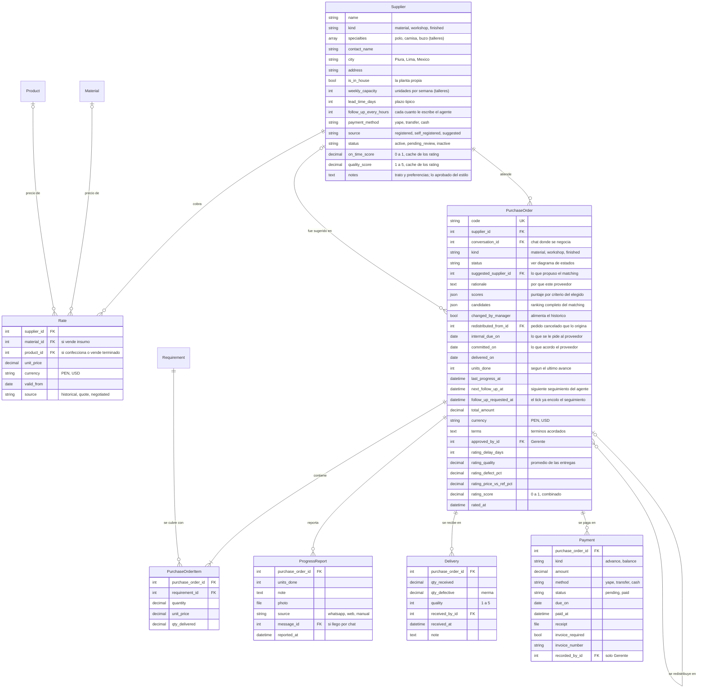

- **Consolidación:** un `PurchaseOrder` puede cubrir requerimientos de varias órdenes y marcas, porque cada `PurchaseOrderItem` apunta a su `Requirement`. Así funciona hoy la compra: un pedido por proveedor para las 3 marcas.
- **División de un pedido grande:** un `Requirement` de 1000 polos puede repartirse en varios `PurchaseOrderItem` de talleres distintos.
- **Planta propia:** es un `Supplier` con `is_in_house = true` y kind `workshop`, sin números. Entra al matching y al cálculo de carga como cualquier taller. Un pedido a la planta pasa de `approved` a `confirmed` sin negociación: no abre turno ni genera `no_channel`.
- **Matching (`match_requirements`, paso 3):** usa `Rate` (precio), los puntajes cacheados de `Supplier` (cumplimiento y calidad), la carga (unidades en pedidos abiertos frente a `weekly_capacity`, calculada y no guardada) y el plazo. Crea los `PurchaseOrder` en `suggested` con `suggested_supplier`, `rationale`, `scores` y `candidates` (el ranking completo, que alimenta "cambiar proveedor" en el tablero). Después crea una `Decision` `approve_assignment` por el lote.
- **Colchón:** `internal_due_on` = `Order.promised_on` menos `Config.buffer_days`. Es el "5 días al proveedor cuando al cliente se le prometieron 10".
- **Reglas de jefe (`confirm_purchase_order`):** si el precio pasa la `Rate` vigente o la fecha pasa `internal_due_on`, lanza `ManagerApprovalRequired(reason)` y la tool le dice al modelo que escale. Es idempotente: confirmar un pedido ya `confirmed` con los mismos términos devuelve OK.
- **Cancelación (`cancel_by_supplier`):** pasa el pedido a `cancelled_by_supplier` y llama a `redistribute`. Es idempotente: si el pedido ya estaba cancelado, no redistribuye de nuevo.
- **Calificación automática:** al cerrar el pedido (`delivered`), se llenan los campos `rating_*` a partir de `Delivery` y las fechas. Después se recalculan `on_time_score` y `quality_score` del `Supplier`. El seed puede cargar puntajes fijos.
- **Pagos:** al confirmar un pedido se crean dos `Payment` (50% `advance` y 50% `balance`). Solo el Gerente marca un pago como `paid`.
- **Celulares (ADR 0016):** viven solo en `AllowedNumber`, de 0 a n por proveedor (por ejemplo, el dueño y el encargado del taller). Un proveedor tiene canal si tiene al menos un número activo.
  - Alta, importación y autoregistro aceptan un `phone` opcional (en el CSV, la columna `phone`) y crean su `AllowedNumber` con `active = false`. Al importar, un proveedor ya existe si alguno de sus números coincide con el `phone`; si no, se compara por `name`.
  - El detalle del Gerente trae `numbers: [{id, phone, name, active}]`. `POST /api/suppliers/<id>/numbers/ {phone, name?}` agrega uno inactivo, y `PATCH /api/suppliers/<id>/numbers/<number_id>/ {active?, name?, phone?}` lo activa o desactiva. El `phone` solo se corrige si el número no tiene conversación. Los números no se borran: se desactivan.
  - La lista trae `numbers_count` y `active_numbers_count`, para mostrar "1 de 2 activos" o "Sin canal" sin cargar el detalle.

## 3. Mensajería, asistente y cola de turnos

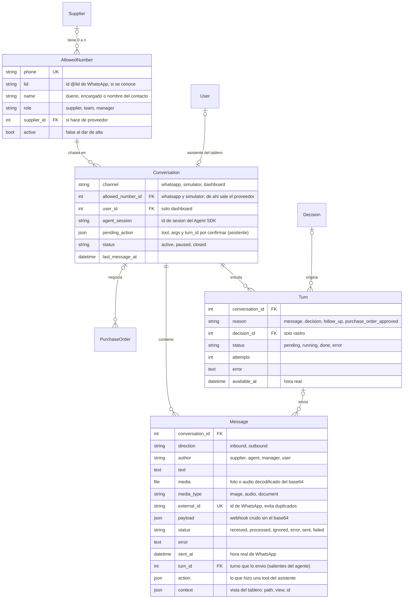

### Allowlist y webhook

- **Allowlist:** el webhook descarta, sin guardar nada, todo mensaje cuyo número no esté en `AllowedNumber` con `active = true`. Es la única fuente de celulares (ADR 0016) y la red de seguridad para no contestarle nunca a familia ni a contactos de Turbo. El agente y la extracción de estilo solo usan números activos. Los miembros del equipo que actúan de proveedores se siembran activos.
- **Webhook (`/webhooks/evolution/<secret>/`):** valida el secreto con comparación de tiempo constante y acepta solo `MESSAGES_UPSERT`. Descarta grupos (`@g.us`) y estados.
- **`@lid`:** Baileys puede mandar `remoteJid` como `<id>@lid` en vez del teléfono. El webhook saca el número del campo alterno (`remoteJidAlt` o `senderPn`; se verifica con un payload real) y guarda el `lid` en `AllowedNumber`.
- **Proveedor de la conversación:** el número (`phone` o `lid`) se busca en `AllowedNumber`. La conversación es la de ese número (`Conversation.allowed_number`), y su proveedor es `allowed_number.supplier`.
- **Entrantes (`fromMe = false`):** se guarda el `Message` con `inbound`, `supplier` y `received`, y se llama a `enqueue_turn(conversation, "message")`.
- **Salientes desde el teléfono (`fromMe = true`):** si el `external_id` coincide con un mensaje del agente, es el eco de nuestro envío y se ignora. Si no coincide, pero el agente mandó el mismo texto en esa conversación hace menos de 30 s, también es eco: se completa el `external_id` de ese mensaje. En cualquier otro caso, lo escribió el Gerente a mano: se guarda con `outbound`, `manager` y `sent`, sin turno. Sirve para el historial del agente y para regenerar el estilo.
- **Media:** el base64 de las fotos se decodifica a `Message.media`, y `payload` se guarda sin él.
- **Idempotencia:** `external_id` es único. Si Evolution reintenta, el segundo insert falla y se ignora. Los mensajes del simulador no tienen `external_id`.
- `Conversation` de WhatsApp o del simulador es única por `(channel, allowed_number)`. Un proveedor con dos números activos tiene dos conversaciones por canal, y cada número puede tener una por WhatsApp y otra en el simulador. Un CheckConstraint obliga a que `dashboard` lleve `user` y no `allowed_number`, y los otros canales al revés.

### Asistente del tablero (ADR 0017)

- **Conversación:** una por usuario, con `channel = dashboard` (restricción única parcial sobre `user`). Se crea en el primer GET.
- **`GET /api/assistant/messages/?after=<id>`** → `{typing, messages: [{id, role: user | assistant, text, action?, created_at}]}`. `role` sale de `author` (`user` → `user`, `agent` → `assistant`) y `created_at`, de `sent_at` (hora real).
- **`POST /api/assistant/messages/ {text, context?}`** guarda el `Message` (`inbound`, `user`, `received`) con su `context = {path, view, id?}` y llama a `enqueue_turn(conversation, "message")`, sin la espera de 5 s. `view` es una de `monitor`, `orders`, `order`, `purchase_orders`, `purchase_order`, `suppliers`, `supplier`, `simulator`, `style` y `onboarding`; `id` solo va en las vistas de detalle.
- **`POST /api/assistant/reset/`** vacía `agent_session` y `pending_action` para abrir un hilo nuevo. Los mensajes se quedan.
- **`action`:** cuando una tool que cambia algo termina, el agente llama a `record_assistant_action(conversation, turn, action)`. Crea un mensaje del asistente con `text = title` y `action = {tool, status: done | failed, title, summary, links: [{kind: order | purchase_order | decision | supplier, id}]}`. La respuesta final del asistente va en otro mensaje.
- **`pending_action` = `{tool, args, turn_id}`:** las tools que escriben no ejecutan en el momento. Dejan la acción ahí y piden confirmación, y la ejecuta el código cuando el usuario confirma (diseño de `agente`).
- **Tools por rol:** se arman en el servidor según `user.role`. Llaman a los servicios con `actor = user`, que vuelven a chequear el rol, y leen con los serializers de ese rol.
- **`assistant_turn_state(batch)`:** el usuario, su rol, el `context` del último mensaje y lo que su rol puede ver. No lleva estado de proveedor ni el estilo del Gerente: el asistente tiene tono neutro.
- **Avisos para el Gerente:** el Monitor y el contador del menú, que sale de los `kpis` de `/api/monitor/`.

### Cola de turnos (ADR 0010 y 0018)

- **`enqueue_turn(conversation, reason, decision=None)`** es la única entrada a la cola. La llaman el webhook, la API del asistente, `resolve_decision`, `approve_purchase_orders` y el tick. Como mucho hay un `Turn` `pending` por conversación (restricción única parcial): si ya existe, lo reutiliza, llena `decision` si viene y no pisa nada. `available_at` pasa a ahora + 5 s, con tope de 20 s desde que se creó el turno, en hora real; así se juntan los mensajes seguidos. En `dashboard` no hay espera. Al confirmar la transacción (`on_commit`), dispara la tarea `run_turn(conversation_id)` con `countdown` hasta `available_at`.
- **`claim_next_turn(conversation_id=None)`** toma un turno con `select_for_update(skip_locked=True)`, entre los que tienen `available_at <= ahora` y son de conversaciones sin otro turno `running`. `run_turn(conversation_id)` lo llama con su conversación; si no hay turno disponible, la tarea termina sin hacer nada. Pasa el turno a `running` y devuelve un `TurnBatch` (en `dashboard`, solo `message_ids`):
  - `message_ids`: los entrantes en `received`;
  - `decision_ids`: las decisiones resueltas de la conversación con `communicated_at` vacío;
  - `follow_up_purchase_order_ids`: los pedidos de esta conversación (`PurchaseOrder.conversation`) con `follow_up_requested_at` lleno;
  - `new_purchase_order_ids`: los pedidos de esta conversación en `approved`.
- **`turn_state(batch)`** arma el estado fresco con esos mismos ids. Trae:
  - los pedidos abiertos del proveedor con su código, la `Rate` vigente y los `terms` aprobados;
  - las decisiones;
  - `Supplier.notes` y el estilo de `Config.agent_user` (`User.style_md`).
  Descarta los seguimientos de pedidos que se cerraron o cancelaron mientras el turno esperaba. `motivo` y `decision` del `Turn` son solo rastro: el porqué sale de acá. Así juntar causas en un turno nunca pierde nada. En `dashboard`, el estado lo arma `assistant_turn_state`.
- **`finish_turn(batch, session_id, error=None)`** guarda `Conversation.agent_session` siempre que `session_id` venga (también si hubo error).
  - Si salió bien:
    - los mensajes pasan a `processed`;
    - las decisiones reciben `communicated_at`;
    - en los seguimientos se borra `follow_up_requested_at` y `next_follow_up_at` pasa a ahora + `follow_up_every_hours`;
    - los pedidos nuevos pasan a `negotiating`.
  - Con error, la fila queda en `error` con su mensaje y se vuelve a encolar con `enqueue_turn`, heredando los intentos. Al tercer error no se encola más: se crea una `Alert` `turn_failed`, y los mensajes del lote pasan a `error` para que no reabran turnos para siempre.
  - Al terminar, si quedó otro turno `pending` en la conversación, vuelve a disparar `run_turn`: una tarea que llegó mientras la conversación estaba ocupada terminó sin hacer nada.
- **Lo que llega mientras un turno corre** no entra en su lote; lo toma el turno siguiente.
- **Conversación de un pedido (`PurchaseOrder.conversation`):** la fija `approve_purchase_orders`.
  1. Si el proveedor tiene conversaciones de números activos, toma la que tiene el mensaje entrante más reciente.
  2. Si no tiene ninguna, crea la conversación de WhatsApp de su primer `AllowedNumber` activo (por id).
  3. Si no tiene números activos, no encola: el pedido queda en `approved` con una `Alert` `no_channel`.
  Los seguimientos van a esa misma conversación. Si su número se desactivó, el tick la vuelve a resolver con la misma regla. Así dos conversaciones del mismo proveedor nunca toman el mismo pedido. `PurchaseOrder.conversation` solo decide a dónde van los turnos proactivos: el proveedor puede hablar del pedido desde cualquiera de sus números.
- **`recover_stuck_turns()`**, al arrancar el worker (señal `worker_ready`): los turnos en `running` pasan a `error` ("worker reiniciado") y se vuelven a encolar. Ese reintento no cuenta como intento.
- **Barrido del tick:** cada 10 s dispara `run_turn` para los turnos `pending` con `available_at <= ahora` de conversaciones sin turno `running`, por si Redis perdió una tarea. También pasa a `error` los `running` de más de 10 min (el `soft_time_limit` de `run_turn` es de ~180 s).
- **`send_text(conversation, text, turn)`** vuelve a chequear que `conversation.allowed_number` siga activo (`NumberNotAllowed`). Guarda el `Message` saliente con `agent` y su `turn`, y por WhatsApp lo envía con `POST /message/sendText/corpotex` usando el token de la instancia más el service token de Cloudflare Access. Completa `external_id` con el id que devuelve Evolution; si falla, el mensaje queda en `failed` y lanza `SendFailed`. En el canal `simulator` solo guarda. Con `Message.turn`, un reintento sabe qué ya envió ese turno.
- **`message_history(conversation, limit=20)`** sirve para la tool `read_history` y para abrir una sesión nueva si se perdió el archivo de sesión.
- **"Escribiendo…":** `GET /api/conversations/<id>/messages/?after=<id>` devuelve `{typing, messages}`, con `typing = true` mientras haya un `Turn` `running` en la conversación.
- **Índices:** `Message (conversation, sent_at)` parcial con `status = received`, para que el worker encuentre rápido lo pendiente, y `Turn (status, available_at)`.
- **Tools del agente** (sesión `agente`): `send_message`, `confirm_purchase_order`, `record_progress`, `report_cancellation`, `escalate_to_manager` y `read_history`. Están atadas a la conversación del turno, validan el pedido con `purchase_order_for_conversation`, que compara por proveedor (`po.supplier == conversation.allowed_number.supplier`, no por `po.conversation`) y lanza `ForeignPurchaseOrder`, y llaman a los servicios de esta tabla.
- **Simulador:** usa las mismas tablas con `channel = simulator`. `GET /api/simulator/contacts/` lista solo números activos y sin teléfono. Sirve de plan B y de herramienta de desarrollo.

## 4. Gerencia y monitor

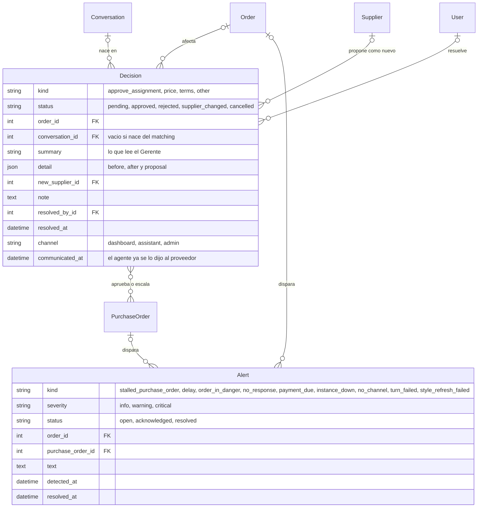

- **Lote:** `Decision.purchase_orders` es M2M. Una decisión `approve_assignment` cubre todos los pedidos de una orden nueva o de una redistribución, así el Gerente ve una tarjeta y no cuatro. Un pedido puede tener varias decisiones en su vida: la asignación y, después, una escalada por precio.
- **`detail` de `approve_assignment`:** `{before: {estimated_on, total_amount} | null, after: {estimated_on, total_amount}, proposal: [{supplier, quantity, unit_price, committed_on, rationale}]}`. `before` es `null` en una orden nueva.
- **`create_decision`** es idempotente:
  1. bloquea los `PurchaseOrder` del lote con `select_for_update().filter(id__in=…).order_by("id")`, ordenados para evitar un deadlock entre el agente y el matching;
  2. si ya hay una `pending` del mismo `kind` que incluye alguno de esos pedidos, la devuelve;
  3. si no, la crea.
  No se puede usar una restricción única sobre una M2M.
- **`GET /api/manager/pending/`** junta tres listas: `Decision` en `pending`, `Order` con `risk = in_danger` y `Alert` en `open`.
- **`POST /api/manager/decisions/<id>/`** con `{action, supplier_id?, purchase_order_id?, note?, channel?}`:
  - `purchase_order_id` es obligatorio en `change_supplier` cuando la decisión tiene más de un pedido.
  - Es idempotente: si la decisión ya está resuelta con la misma `(action, supplier_id, purchase_order_id)`, devuelve el estado actual con 200; si se pide otra cosa, devuelve 409.
  - `channel` vale `dashboard` si no viene; la tool del asistente manda `assistant`.
  - Solo el Gerente: `resolve_decision` chequea `require_role(actor, "manager")`.
  - Devuelve el estado nuevo.
- **`resolve_decision`:**
  - `approve_assignment` aprobada llama a `approve_purchase_orders`:
    1. los pedidos pasan a `approved`;
    2. se recalcula la orden (fecha y costo);
    3. se fija `PurchaseOrder.conversation` (regla de la sección 3) y se encola un `Turn` `purchase_order_approved` en esa conversación.
    Un proveedor sin ningún `AllowedNumber` activo no se puede contactar: su pedido queda en `approved` con una `Alert` `no_channel`. Con `change_supplier`, el pedido cambia de proveedor, `changed_by_manager = true` y la decisión queda en `supplier_changed`.
  - `price`, `terms` u `other` encolan un `Turn` `decision` en `Decision.conversation`.
  - `rejected` en una asignación cancela los pedidos `suggested` y deja el requerimiento en `pending`.
- **Alertas:** `POST /api/alerts/<id>/acknowledge/` llama a `acknowledge_alert`, solo para el Gerente.
- **Sin duplicados en `Alert`:** restricción única parcial en `(kind, order, purchase_order)` mientras esté `open`, con `nulls_distinct = False`.
- **`tick()`** es una tarea de Celery beat, cada ~10 s reales, en la cola `periodic`:
  - en los pedidos con `next_follow_up_at <= clock.now()` que todavía no tienen la marca, marca `follow_up_requested_at` y encola un `Turn` `follow_up` en `PurchaseOrder.conversation`;
  - barre los turnos vencidos (sección 3);
  - llama a `run_monitor()`, que actualiza `risk` y abre o cierra alertas, incluida `instance_down` según `connectionState`.
- **`GET /api/monitor/`** junta para el tablero: `clock`, `kpis`, alertas abiertas, decisiones pendientes, órdenes en peligro y las últimas 3 `redistributions` (decisiones `approve_assignment` resueltas con un pedido que tiene `redistributed_from`). Los `kpis` alimentan también el contador del menú.

## 5. Sistema, onboarding y estilo

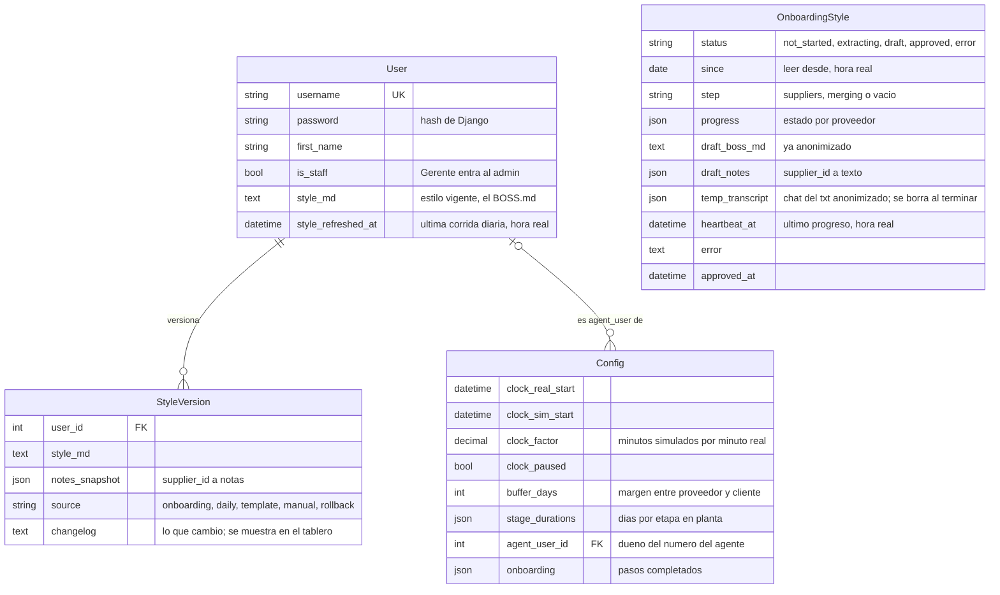

- **`User`** extiende `AbstractUser` desde la primera migración: cambiarlo después es caro. Los roles son grupos creados con una data migration. El Gerente gestiona usuarios y contraseñas desde el admin. Auth de la API con `TokenAuthentication` (ADR 0009); el seed genera un token por usuario.
- **`Config`** es una sola fila. `agent_user` es el dueño del número del agente de WhatsApp; el seed pone al Gerente.
- **Reloj:** `clock.now()` = `clock_sim_start` + (hora real − `clock_real_start`) × `clock_factor`; con el reloj pausado devuelve `clock_sim_start`. Cada cambio de factor, pausa o salto rebasa primero (`clock_sim_start = clock.now()`, `clock_real_start = ahora real`) para que la hora no salte. `GET /api/clock/` devuelve `{now, factor, paused}`, y `PATCH /api/clock/ {factor?, paused?, advance_hours?}` llama a `set_clock`, solo para el Gerente.
- **`stage_durations`:** `{"cutting": 1, "sublimation": 1, "embroidery": 1, "sewing": 3, "finishing": 1}` en días. Suman los ~7 días de producción propia.
- **`onboarding`:** `{"whatsapp": {"done_at", "offline"}, "suppliers": {"done_at"}, "style": {"done_at"}}`. El paso 1 se marca hecho fuera de línea si falta el service token de Cloudflare Access.
- **Onboarding de WhatsApp (paso 1):**
  - `GET /api/onboarding/whatsapp/` lee `connectionState`, `webhook/find` y `settings/find`, y enmascara el secreto en la URL.
  - `POST .../qr/` llama a `instance/connect`. Devuelve `qr_base64: null` si la instancia ya está `open`.
  - `POST .../webhook/` aplica `webhook/set` y `settings/set`.
  Usa siempre la instancia `corpotex` con su token. Nunca crea, desconecta ni borra instancias, y nunca toca `personal-whatsapp`.
- **Estilo del Gerente (paso 3):** `OnboardingStyle` es una sola fila con el borrador. Lo aprobado vive en `User.style_md` de `Config.agent_user` (el `BOSS.md`) y en `Supplier.notes`.
  - `GET /api/onboarding/style/` → `{status, error, since, step, suppliers: [{id, name, status, messages_read, error}], boss_md, notes: [{supplier_id, supplier_name, notes}], approved_at}`.
  - `POST extract/ {supplier_ids?, since}` lee de Evolution solo los chats de los números activos de cada proveedor, y pasa un chat por número (el `supplier_id` se repite; `persona` los agrupa). Un proveedor sin números sale como `no_phone`, y uno con números pero ninguno activo, como `not_allowed`. `POST import-txt/` (multipart `{file, manager_author, since, supplier_id?}`) guarda en `temp_transcript` el chat ya anonimizado. Las dos encolan la tarea `run_style_extraction` en la cola `style`.
  - `PUT` guarda el borrador. `POST template/` carga la plantilla base como borrador. `POST approve/` llama a `approve_style`: copia el borrador a `agent_user.style_md` y a `Supplier.notes`, y crea una `StyleVersion` `onboarding` (o `template`, si el borrador vino de la plantilla). Es idempotente.
  - `extract`, `import-txt`, `template` y `PUT` devuelven 409 mientras `status = extracting`.
  - Si `heartbeat_at` pasa 5 minutos sin moverse, el GET la muestra como `error` ("extracción interrumpida") y se puede volver a lanzar.
  - El job borra `temp_transcript` al terminar, salga bien o con error. Los mensajes crudos de Evolution solo viven en memoria.
  - La extracción en sí (anonimización, parser del `.txt`, llamados al modelo, plantilla base) es de la sesión `personalidad`, en `backend/agent/persona/` (`extract_style` y `parse_whatsapp_export`). La tarea le pasa `chats = [{supplier_id, supplier_name, contact_names: [AllowedNumber.name, pushName], messages: [{sender: manager | supplier | agent, text, sent_at}]}]`, uno por número activo, y `on_progress(supplier_id, status, messages_read=None, error=None)`. El paso global `on_progress(None, "merging")` también sirve de latido.

### Estilo por usuario y refresco diario (ADR 0019)

- **`User.style_md`** es el estilo vigente. El agente de WhatsApp usa el de `Config.agent_user`; el asistente del tablero no usa estilo.
- **Historial:** cada cambio crea una `StyleVersion` con su `changelog` y un `notes_snapshot` (las `Supplier.notes` de ese momento). Las fuentes son `onboarding`, `daily`, `template`, `manual` (edición del Gerente) y `rollback`.
- **Volver atrás:** `POST /api/style/versions/<id>/restore/` llama a `restore_style_version`, que crea una versión nueva `rollback`, copia de la elegida, y restaura `style_md` y `Supplier.notes`. El historial nunca se reescribe.
- **`refresh_style(user)`:** tarea de beat a las 03:00 de Lima, en hora real, en la cola `style`.
  1. Lee de la BD los mensajes `author = manager` de conversaciones `whatsapp` con número activo, desde `User.style_refreshed_at`. Si no hay mensajes nuevos, no llama al modelo.
  2. Si el resultado de `persona` pasa la validación, crea una `StyleVersion` `daily` y la aplica. Si no pasa, se queda el estilo actual y se crea una `Alert` `style_refresh_failed`.
  3. Siempre actualiza `style_refreshed_at`.
- **Una tarea de estilo a la vez:** el worker es uno solo con `-c 5` y la cola `style` no limita la concurrencia por sí misma, así que la extracción y el refresco toman un lock en la BD (`pg_try_advisory_lock`, liberado en `finally`). Si no lo consiguen, se reintentan con `countdown` en vez de ocupar un slot esperando. Si el proceso muere, Postgres suelta el lock al cerrarse la conexión.
- **API (solo Gerente):** `GET /api/style/versions/` (con `source`, `changelog` y `created_at`), `GET /api/style/versions/<id>/` (con `style_md`) y `POST .../restore/`. P1: `POST /api/style/refresh/` ("Aprender ahora"; no se usa en vivo en la demo).
- **Seed:** 3 `StyleVersion` con changelog, para que el historial no se vea vacío.

## 6. Trabajo en segundo plano y docker compose (ADR 0018)

`infra/docker-compose.yml` levanta todo menos Next.js, que corre en el host con pnpm. Los servicios de Python salen de una misma imagen, `backend/Dockerfile` (con uv).

| Servicio | Qué corre |
|---|---|
| `postgres` | La BD |
| `redis` | Broker de Celery |
| `web` | Django con runserver en `0.0.0.0:8000` y `backend/` montado, para que recargue al editar. El tunnel le manda `/api`, `/admin`, `/webhooks`, `/static` y `/media` |
| `celery-worker` | `-Q turns,periodic,style -c 5`, pool prefork, `acks_late` y `prefetch_multiplier = 1` |
| `celery-beat` | Schedule estático en settings (sin django-celery-beat) |

| Tarea | Cola | Se dispara |
|---|---|---|
| `run_turn(conversation_id)` | `turns` | `enqueue_turn` (con `countdown`), `finish_turn` y el barrido del tick. `soft_time_limit` ~180 s |
| `tick()` | `periodic` | beat, cada 10 s |
| `run_style_extraction()` | `style` | `extract/` e `import-txt/` del onboarding |
| `refresh_style(user)` | `style` | beat, a las 03:00 `America/Lima`. P1: `POST /api/style/refresh/` |

- **Worker:** lleva `CLAUDE_CODE_OAUTH_TOKEN` y el volumen `agent-home` en `/app/.agent`: `config/` es el `CLAUDE_CONFIG_DIR`, donde quedan las sesiones que se reanudan, y `turns/` y `style/` son los cwd fijos del SDK (ADR 0010).
- **CLI:** según la doc de `claude-agent-sdk` (0.2.165), el CLI de Claude Code viene dentro del wheel, sin Node, con Python 3.10 o más. Se confirma al construir la imagen; si falla, se agrega node.
- **Variables en compose:** `DATABASE_URL` apunta al servicio `postgres` y `REDIS_URL` a `redis://redis:6379/0`.
- **Si Redis o el worker se caen,** se paran los turnos. Al volver, `recover_stuck_turns` (en `worker_ready`) y el barrido del tick los retoman desde `Turn`.
- Desaparece el comando `run_agent`.

## Estados

### Order

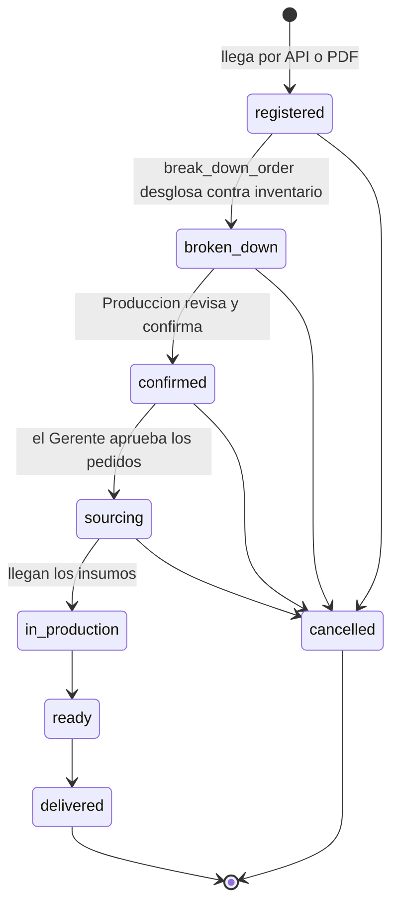

### PurchaseOrder

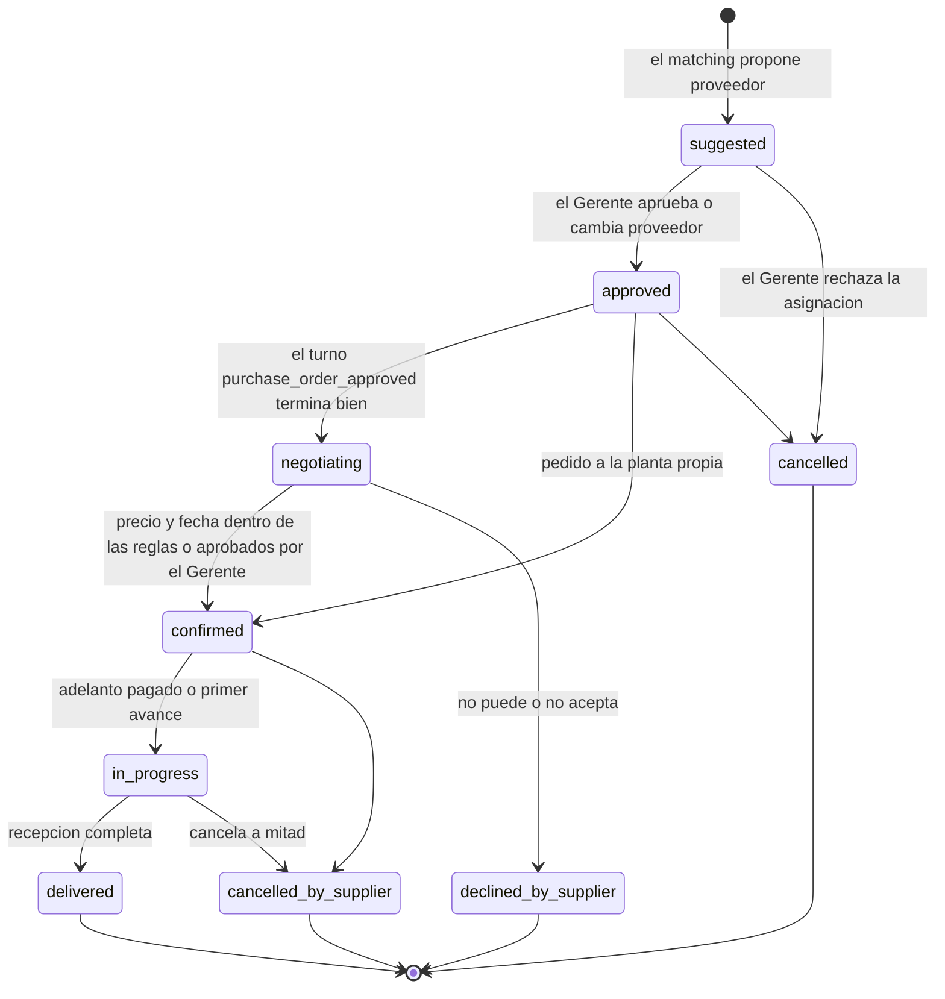

- Mientras haya una `Decision` `pending` sobre el pedido (precio o términos), sigue en `negotiating`; el tablero lo muestra como "esperando al Gerente" (`waiting_manager`).
- Un pedido `approved` de un proveedor sin canal se queda ahí, con una `Alert` `no_channel`, hasta que el Gerente lo gestione.
- De `declined_by_supplier` y `cancelled_by_supplier`, `redistribute` devuelve al matching lo que falta del requerimiento, y nacen pedidos nuevos con `redistributed_from`.

### Decision

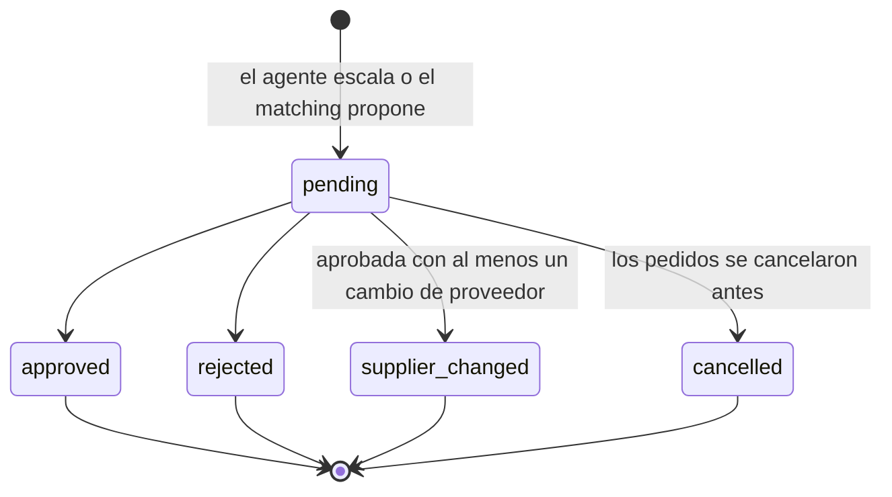

`communicated_at` se llena cuando un turno termina bien con esa decisión en su lote. No es un estado aparte.

### Turn

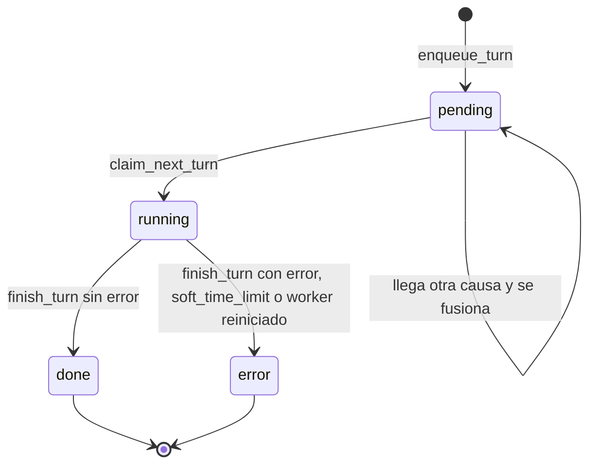

Una fila en `error` se vuelve a encolar con `enqueue_turn` (en un turno `pending` nuevo o en el que ya exista), heredando sus intentos. Al tercer intento fallido no se encola más y se crea una `Alert` `turn_failed`.

### OnboardingStyle

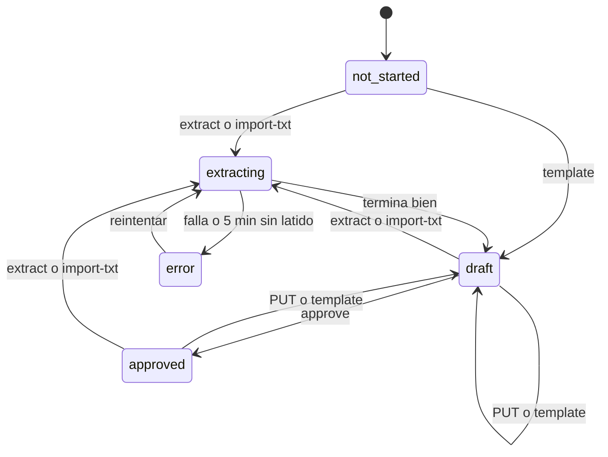

Lo aprobado no cambia hasta el próximo `approve`.

## Recorrido de la demo: un taller cancela a mitad

Los números (1000, 400 y 600) se fijan con el guion del pitch. El diagrama `taller-cancela` todavía dice 300 prendas.

1. `PurchaseOrder` T1 (kind `workshop`, 1000 polos para Caja Piura) está `in_progress`, con un `ProgressReport` de 400 unidades.
2. El taller escribe que no puede seguir. El webhook guarda el `Message` y encola el turno. La tool `report_cancellation` llama a `cancel_by_supplier`: T1 pasa a `cancelled_by_supplier` y se registra la `Delivery` de las 400 que ya cosió, que la planta recoge.
3. `redistribute(T1)`: el `Requirement` queda con 600 unidades sin cubrir. `match_requirements` las reparte entre talleres según `Rate`, capacidad, carga y puntajes, y crea T2 y T3 en `suggested`, con `redistributed_from = T1`, `rationale` y `candidates`.
4. Se crea una `Decision` `approve_assignment` con `purchase_orders = [T2, T3]` y `detail = {before, after, proposal}`, y aparece en el Monitor y en el contador del menú del Gerente. La orden queda con `risk = in_danger` y una `Alert` `order_in_danger`. La tarjeta "Redistribución" del tablero muestra el antes y el después de la fecha estimada y del costo.
5. El Gerente aprueba desde el Monitor (`POST /api/manager/decisions/<id>/ {action: "approve"}`) o pidiéndoselo a su asistente, que usa `resolve_decision` con `channel = assistant` y deja una tarjeta `action` en el chat. `approve_purchase_orders` pasa T2 y T3 a `approved`, recalcula `estimated_on`, `critical_path`, `total_amount` y `risk`, y encola un `Turn` `purchase_order_approved` en la conversación de cada taller.
6. El agente escribe a los talleres de T2 y T3 (pasan a `negotiating`) y acuerda fechas. Con `confirm_purchase_order` quedan `confirmed`. Si la nueva `estimated_on` cumple `promised_on`, la orden sale de peligro y la alerta se resuelve.

## Criterios del jurado y dónde se cubren

| Criterio | Tablas |
|---|---|
| Registro de talleres con especialidad, capacidad, precios, calidad y cumplimiento | `Supplier`, `Rate` |
| Rating automático por entrega | `Delivery` → campos `rating_*` de `PurchaseOrder` → puntajes de `Supplier` |
| Matching multicriterio con justificación | `PurchaseOrder.suggested_supplier`, `rationale`, `scores`, `candidates` |
| Dividir un pedido grande | varios `PurchaseOrderItem` sobre un mismo `Requirement` |
| Seguimiento de pedidos y pagos | `PurchaseOrder`, `ProgressReport`, `Payment`, `Alert`, `Turn` `follow_up` |
| Avance con fotos | `ProgressReport.photo` (llega por WhatsApp en base64 o por el simulador) |
| Rutas multiparada en Piura | Fuera de alcance (ADR 0015): los proveedores de Lima envían por Sullana Express y Corpotex recoge en la agencia. Se explica en el pitch |
| Sugerir proveedores nuevos | `Supplier.source` (`self_registered`, `suggested`) y `status = pending_review` |

## Plan de implementación

Cada paso se revisa solo, en este orden:

1. **Proyecto:** Django + DRF, `core.User` antes de la primera migración, grupos por data migration, `TokenAuthentication`, drf-spectacular y settings (`ALLOWED_HOSTS` con `corpotex.oscargicast.com` y `localhost`), Celery con Redis e `infra/docker-compose.yml` (sección 6). `pyproject.toml` con `claude-agent-sdk` desde el primer commit.
2. **Todos los modelos de una vez** (P0 y P1), con admin y una migración por app.
3. **Seed:** usuarios por rol, catálogo de Corpotex, talleres en Piura (con la planta propia), proveedores de Lima y el de México. También `Supplier.notes` distintas por proveedor (tú o usted, "no insistir", horario), números del equipo activos, un token por usuario, `Config.agent_user` = Gerente, 3 `StyleVersion` con changelog y la orden de Caja Piura con el taller que va a cancelar.
4. **Servicios de operaciones:** desglose, matching, ruta crítica, aprobación, confirmación con reglas de jefe, avance, cancelación y redistribución.
5. **Mensajería:** webhook con allowlist, `send_text`, la cola de turnos con `run_turn` en Celery, `turn_state` y la API del asistente.
6. **Gerencia:** decisiones, alertas, monitor, `tick` y los endpoints del Gerente; servicios con `actor` para las tools del asistente.
7. **API del tablero y contrato en `docs/api/`**, con los JSON de ejemplo y los serializers por rol.
8. **Onboarding y estilo:** WhatsApp, alta e importación de proveedores, la tarea de extracción, el historial de versiones y `refresh_style`.
9. **P1:** pagos, autoregistro y `POST /api/style/refresh/`.

## Preguntas abiertas

1. ~~¿Cuál es la tercera marca?~~ Resuelto: las marcas son UNICRACK (uniformes escolares, incluye deportivos), NEXO (ropa de trabajo de alto rendimiento) y Línea Médica Corpotex.
2. ¿Un proveedor puede vender insumos y además confeccionar? Propuesta: un solo `kind` por proveedor.
3. ~~¿Las rutas entran en el alcance?~~ Resuelto: no se implementan (ADR 0015).
4. Faltan los PDFs de ejemplo de Comercial para fijar los campos de `Order` y `OrderItem`.
