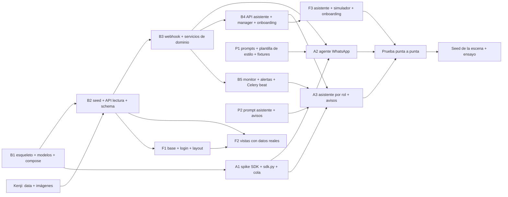

# Planning y roadmap

Estado al sábado 10/10, 16:30. Demo: domingo 11/10. Diseño cerrado en `docs/adr/` (0001 a 0021) y commiteado en `main`; todavía no hay código.

## Equipo y sesiones

| Sesión | Alcance | Carpeta y rama |
|---|---|---|
| `backend` | Django + DRF, modelos, servicios, API, webhook, Celery, seed, compose | `backend/`, `infra/`, `docs/api/`; worktree `../corpotex-backend`, rama `backend` |
| `agente` | Worker de turnos, agente de WhatsApp, asistente del dashboard, tools por rol, SDK aislado | `backend/agent/`; worktree `../corpotex-agente`, rama `agente/worker` |
| `personalidad` | Prompts, estilo del Gerente (se guarda en `User.style_md` y `StyleVersion`; en el repo solo va la plantilla base), extracción y refresco, fixtures sintéticos, escenarios de prueba | `backend/agent/persona/`; worktree `../corpotex-personalidad`, rama `personalidad` |
| `disenador` | Dashboard Next.js: vistas, asistente, simulador, onboarding, estilo | `frontend/`; worktree `../corpotex-frontend`, rama `feat/tablero` |
| `orquestador` | Coordinación, ADRs, merges a `main`, enlace con Oscar y Kenji | este checkout |
| Oscar | Decisiones, credenciales, chat de rol con la proveedora real, guion y pitch | |
| Kenji | Data e imágenes del seed con `infsh` | fuera del repo |

Reglas: cada sesión trabaja en su worktree y abre PR contra `main`; el orquestador mergea en el orden de dependencias de abajo. Código en inglés, docs en español (ADR 0014). Sin créditos de Claude en los commits.

## Dependencias

## Roadmap

Horas en hora real. Las estimaciones son de cada sesión; el orquestador las ajusta al mergear.

### Fase 0, sábado 16:30 a 17:30: salida

| # | Quién | Qué | Listo cuando |
|---|---|---|---|
| 0.1 | Oscar | "Arranquen" | Las 4 sesiones abren su worktree desde `main` |
| 0.2 | Oscar | Para el spike de `agente`: `claude setup-token` en una terminal y pasarle el token a `agente` fuera del repo. La conexión real se hace después desde `/settings/claude` (ADR 0022) | `agente` corre el spike |
| 0.3 | Oscar | Service token de Cloudflare Access → `.env` | El backend puede llamar a Evolution |
| 0.5 | Oscar | Ignore Groups activado y webhook guardado en Evolution | `GET webhook/find/corpotex` lo muestra |
| 0.6 | Kenji | Data e imágenes del seed | Carpeta `seed/` entregada |

### Fase 1, sábado 17:30 a 20:00: cimientos

| # | Quién | Qué | Depende de | Estimado |
|---|---|---|---|---|
| B1 | backend | Proyecto Django + DRF, 25 modelos con admin, usuarios y grupos, Celery, `infra/docker-compose.yml`, `backend/Dockerfile`, `pyproject.toml` con claude-agent-sdk. PR a `main` | 0.1 | 2 h |
| A1 | agente | Spike fuera del repo (latencia, aislamiento, 4 en paralelo). Luego `agent/sdk.py` (`isolated_options`, `complete`), `tasks.run_turn`, `channels.py` | 0.2, B1 | 2 h |
| P1 | personalidad | `persona/templates/style.base.md` (plantilla vacía del estilo), `build_prompt` del agente de WhatsApp, `rules` en español, fixtures sintéticos de Lima y México, `scenarios.yaml` | 0.1 | 2 h |
| F1 | disenador | Next.js, login con token por pestaña, layout con menú por rol, reloj en el header, mocks con el shape de la API | 0.1 | 2 h |

Hito 1 (20:00): `docker compose up` levanta Postgres, Redis, Django, worker y beat; el admin muestra los modelos; el front hace login contra Django.

### Fase 2, sábado 20:00 a 23:30: datos y flujo principal

| # | Quién | Qué | Depende de | Estimado |
|---|---|---|---|---|
| B2 | backend | `seed_demo` con los fixtures de Kenji (o datos mínimos propios si no llegan), API de lectura (órdenes, pedidos, proveedores, alertas, monitor), `/api/schema/` y `docs/api/` | B1, 0.6 | 2 h |
| B3 | backend | Webhook con allowlist y `@lid`, `send_text` vía Evolution, servicios de dominio (`break_down_order`, `match_requirements`, `compute_critical_path`, `redistribute`, `confirm_purchase_order`, `cancel_by_supplier`, `create_decision`, `resolve_decision`), cola `Turn` (`enqueue_turn`, `claim_next_turn`, `finish_turn`, `turn_state`) | B2 | 3 h |
| A2 | agente | Agente de WhatsApp: tools (`send_message`, `confirm_purchase_order`, `record_progress`, `report_cancellation`, `escalate_to_manager`, `read_history`), turno por lote, sesión por conversación, envío por `corpotex` | A1, B3, P1 | 2 h |
| F2 | disenador | Órdenes, pedidos, Monitor y proveedores con datos reales; tipos generados desde `/api/schema/`; fotos | B2 | 3 h |
| P2 | personalidad | `build_assistant_prompt` (rol, avisos), `extract_style`, `update_style`, `parse_whatsapp_export` | P1 | 2 h |

Hito 2 (23:30): un mensaje por el simulador llega al agente y el agente responde; el Monitor muestra órdenes y alertas del seed.

### Fase 3, domingo 00:00 a 03:00: asistente, onboarding y monitor

| # | Quién | Qué | Depende de | Estimado |
|---|---|---|---|---|
| B4 | backend | API del asistente, `/api/manager/*`, onboarding (Claude, WhatsApp, proveedores, estilo), `/api/settings/claude/*` (ADR 0022), `/api/style/versions/`, simulador con chats reales en solo lectura, `/api/me/badges/` | B3 | 2.5 h |
| B5 | backend | `run_monitor`, `notify_roles`, `AlertNotification`, tick en beat, `refresh_style` a las 03:00, lock de estilo | B3 | 1.5 h |
| A3 | agente | Asistente del dashboard: tools por rol, confirmación con `pending_action`, turnos `alert` | A1, B4, B5, P2 | 2 h |
| F3 | disenador | Panel del asistente con tarjetas y contador, simulador en modo presentación, onboarding de 4 pasos (Claude, WhatsApp, proveedores, estilo), `/settings/claude` con conectar/reconectar (ADR 0022), `/style` con historial | B4 | 3.5 h |

Hito 3 (03:00): el Gerente aprueba una decisión desde el asistente; Comercial recibe un aviso distinto de la misma escena.

### Fase 4, domingo 03:00 a 09:00: descanso y pulido

- Dormir. Quien siga despierto: P1 pendientes (pagos, `/catalog`, "Aprender ahora", autoregistro) solo si todo lo anterior cierra.

### Fase 5, domingo 09:00 a 12:00: integración y ensayo

| # | Quién | Qué |
|---|---|---|
| D1 | todos | Prueba punta a punta por WhatsApp real con la proveedora: pedido, avance con foto, cancelación, redistribución, aprobación, avisos |
| D2 | Oscar + personalidad | Chat de rol con la proveedora (20 min), `extract` + `import-txt` x2, revisar y aprobar el estilo. Antes de la demo, nunca en vivo |
| D3 | backend | Seed final de la escena: Caja Piura, 1000 polos, 400 avanzados, 2 talleres con capacidad |
| D4 | disenador | Dos ventanas lado a lado (Gerente y Comercial), modo presentación, fotos cargadas |
| D5 | Oscar | Guion y ensayo cronometrado. Orden del guion: onboarding ya hecho → estilo aprobado → escena de WhatsApp → avisos por rol |
| D6 | todos | Video de respaldo de la corrida completa |

Hito 4 (12:00): ensayo completo sin tocar código.

## Qué entra en la demo

Orden del guion:

1. Dashboard con el Monitor y los datos del seed (fotos de productos y materiales).
2. Onboarding mostrado ya hecho: WhatsApp conectado, proveedores cargados, estilo aprobado con su historial.
3. Comercial registra una orden; el motor la desglosa y Producción confirma.
4. Matching con justificación; el Gerente aprueba desde el asistente.
5. El agente escribe al taller por WhatsApp real con el estilo del Gerente; el taller manda avance con foto.
6. El taller cancela. El sistema redistribuye entre dos talleres y recalcula fecha y costo.
7. Avisos proactivos: el Gerente recibe la decisión; Comercial, la nueva fecha. Lado a lado.
8. El Gerente aprueba; el agente contacta a los talleres nuevos (simulador).

Fuera de alcance a propósito: rutas (ADR 0015), extracción de estilo en vivo (ADR 0011), QR en vivo.

## Riesgos y respuesta

| Riesgo | Respuesta |
|---|---|
| Kenji no entrega la data a tiempo | B2 arranca con un seed mínimo propio (3 marcas, 4 clientes, 6 materiales, 4 productos, 5 proveedores, 3 órdenes); la data de Kenji se suma después |
| El Agent SDK no corre bien en Celery (sesiones, 4 en paralelo) | El spike A1 lo detecta antes de B3; plan B: un solo proceso worker con `-c 1` para la demo |
| Límite de uso de la suscripción durante la demo | Las sesiones de desarrollo quedan quietas; nada de extracción en vivo; avisos con `effort=low` |
| Wifi del evento | Tethering; simulador para todo menos la proveedora real; video de respaldo |
| Pod de Evolution reiniciado | Verificar `connectionState` antes de la demo; si cae, la escena sigue por el simulador |
| El flujo personal de n8n responde a la proveedora | Oscar lo verifica el sábado; si responde, se pausa durante la demo |
| Merges que chocan en `main` | Un PR por fase y por sesión; el orquestador mergea en el orden del grafo |

## Seguimiento

El orquestador actualiza este archivo al cerrar cada hito con lo hecho, lo que se cayó y lo que se movió de fase.
